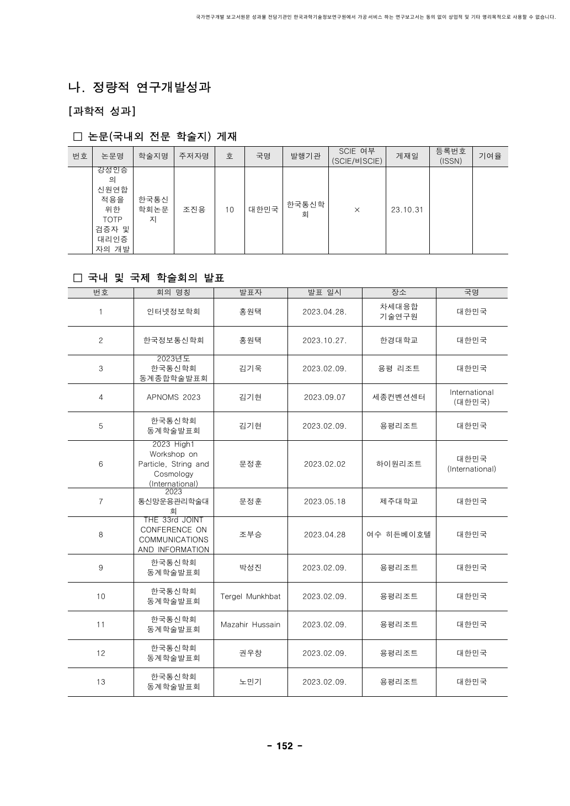
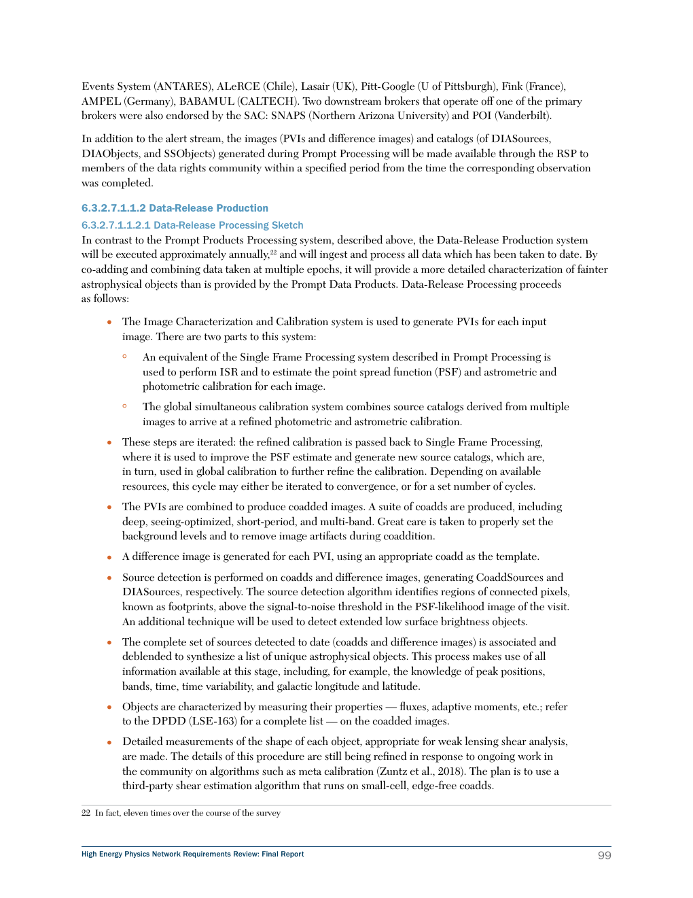
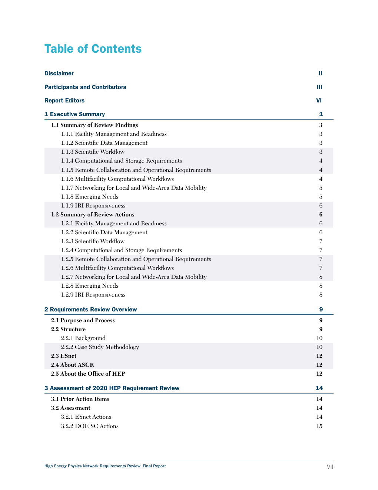

# 별첨 B. 미국 DoE·ESnet 보고서 심층

> [!NOTE]
> 같은 연구망 기관인 ESnet 보고서(427쪽)와 KISTI 연차보고서를 구조·가독성 관점에서 나란히 본 기록입니다. 핵심 리포트 1절(문제)의 근거입니다.

> [!NOTE]
> [비교 리포트](appendix-a-countries.md)가 각국의 성과보고 "제도"를 봤다면, 이 문서는 실제 보고서 한 권을 구조·가독성·기계가독성 관점에서 뜯어본 기록입니다. 우리와 임무가 가장 가까운 기관의 보고서를 골랐습니다.

## 기준점이 된 두 보고서

| | 미국 | 한국 |
|---|---|---|
| 보고서 | High Energy Physics Network Requirements Review: Final Report (2024) | 미래 수요 기반의 과학기술연구망 인프라 구축·운영 및 서비스 (2023) |
| 기관 | DoE 산하 ESnet (Lawrence Berkeley National Laboratory) | KISTI 과학기술연구망센터 |
| 분량 | 약 427쪽 (LBNL-2001696) | 약 80쪽 |
| 원문 | <https://www.es.net/assets/Uploads/20251001-HEP-RR-Final.pdf> | [ScienceON TRKO202400000471](https://scienceon.kisti.re.kr/srch/selectPORSrchReport.do?cn=TRKO202400000471) |

두 기관은 모두 국가 연구망을 운영한다는 점에서 임무가 거의 같습니다. 그래서 같은 종류의 일을 하는 두 조직이 보고서를 어떻게 쓰는지 나란히 둘 수 있습니다. 보존한 ESnet 목차 발췌는 [`sources/usa/`](sources/usa/esnet-hep-rr-toc_2026-11-26.md)에 있습니다.

## 시사점 1 — 표는 꼭 필요할 때만, 단순하게

미국 보고서는 427쪽 가운데 앞부분에 표가 거의 없습니다. 수치를 나란히 보여야 하는 자리에서만 단순한 표를 씁니다. 한국 보고서는 80쪽 가운데 앞 20쪽 가까이가 표이고, 그 표가 여러 겹으로 복잡합니다.

- **양식형 표(form-like table)**: 칸 이름이 미리 박혀 있고 사람이 값을 채우는 표
- **복합·중첩 표(complex/nested table)**: 표 안에 표가 들어가고 셀이 병합된 표
- **구획 기반 표(block-based table)**: 본문을 구획으로 나누려고 두른 표

표가 없어도 되는 자리에서도 표를 씁니다. 한 문장을 강조하려고 1×1 셀 표를 두르는 식입니다. 이런 표는 데이터가 아니라 판형을 위한 것이라, 기계가 읽을 때 "이 표의 각 칸이 무슨 데이터인가"라는 질문에 답을 주지 못합니다. 셀 병합이 많을수록 PDF·HWP에서 행과 열의 의미를 되살리기 어렵습니다.

위는 기준 보고서의 정량적 연구개발성과 표입니다. 논문 제목이 좁은 칸에 들어가 글자 단위로 끊기고, 머리글은 모두 검정이라 어디가 제목인지 눈에 들어오지 않습니다. 같은 내용을 미국 보고서는 본문 문장과 간단한 목록으로 적습니다.

## 시사점 2 — 제목과 목록에 색을 써서 눈에 들어오게

미국 보고서는 단계 제목에 색을 씁니다. 목록 머리문자(bullet)에도 색을 넣어, 어디가 제목이고 어디가 본문인지 한눈에 들어옵니다. 위 본문 쪽을 보면 소제목(6.3.2.7.1.1.2 등)이 청록색이고 머리문자도 같은 색입니다.

한국 보고서는 단계 제목이 모두 검정이라, 제목이 본문에 묻혀 눈에 들어오지 않습니다. 색은 미학의 문제처럼 보이지만, 사람이 구조를 빨리 파악하게 돕는 신호이기도 합니다.

## 시사점 3 — 제목의 정렬과 번호 규칙이 일정하다

미국 보고서는 아무리 낮은 단계의 제목이라도 전부 왼쪽 정렬입니다. 모든 제목 단계가 같은 번호체계와 같은 글꼴을 씁니다. 8단계(예: `6.3.2.8.1.2.2`)까지 내려가도 규칙이 그대로입니다.

한국 보고서는 단계마다 들여쓰기가 들쭉날쭉하고, 단계마다 번호체계와 글꼴이 바뀝니다. `2 > 2.4 > (1) > ○`처럼 번호 규칙이 섞이고, 글꼴도 `헤드라인 > 고딕 > 명조`로 달라집니다. 들여쓰기와 번호가 제각각이면 기계가 "이 제목은 몇 단계인가"를 판정하기 어렵습니다. 일정한 번호체계는 사람에게 가독성을, 기계에게 계층 구조를 줍니다.

`□ > ○ > - > ·` 체계는 1~2쪽짜리 개조식 보고서에는 어울립니다. 그러나 본문을 굳이 목록으로 쓰고 머리문자를 붙여야 하는지는 따져 볼 문제입니다.

## 시사점 4 — 본문 단계가 깊게 내려가지 않는다

미국 보고서는 목록보다 본문(문장)이 많습니다. 본문 단계가 2단계를 넘지 않고, 깊어진다 싶으면 그 지점을 제목 단계로 올립니다. 내용이 깊어지면 목록을 더 파는 대신 새 제목을 만드는 쪽입니다.

한국 보고서는 본문 대부분이 목록(`□ > ○ > - > ·`)이고, 단계가 `□ > ○ > - > · > ※`처럼 더 내려갑니다. 단계가 내려갈수록 들여쓰기가 깊어지고, 그만큼 한 줄에 담기는 본문이 줄어 종이가 낭비됩니다. 내용은 제목이 아니라 들여쓰기 깊이에 묻힙니다. [비교 리포트](appendix-a-countries.md)에서 본 "목차가 양식 칸 이름뿐"이라는 문제와 같은 뿌리입니다.

## 시사점 5 — 문서 안에 링크가 많다

미국 보고서는 PDF 본문에서 링크를 적극적으로 씁니다. 다른 절, 참고문헌, 외부 자료로 바로 이동할 수 있어 427쪽을 오가기 쉽습니다.

한국 보고서는 PDF 본문에 링크가 거의 없습니다. 목차에 링크가 걸린 경우가 간혹 있을 뿐, 본문이 다른 본문을 참조할 때 링크가 없습니다. 링크는 종이에서 웹으로 넘어갈 때 구조가 살아 있는지 보여주는 지표입니다. 참조가 링크로 걸려 있으면 그 참조 관계를 기계도 따라갈 수 있습니다.

## 시사점 6 — 상세하고 눈에 들어오는 목차

미국 보고서는 목차가 상세합니다. 목차만 15쪽이고 6단계 제목까지 펼쳐 보여, 목차만 읽어도 보고서가 무엇을 다루는지 알 수 있습니다. 목차 3줄마다 배경색을 바꾸어 가시성을 높였습니다(위 목차 이미지).

한국 보고서는 목차 글자가 크고 상세하지 않습니다. 양식 칸 이름만 늘어서 있어, 목차만 보고는 이 과제가 무엇을 했는지 알기 어렵습니다.

## 종합 — 구조가 곧 데이터다

여섯 가지는 서로 다른 지적처럼 보이지만 한 가지를 가리킵니다. 미국 보고서는 **내용의 계층을 제목 단계로 표현**하고, 표와 색과 링크를 그 계층을 드러내는 데 씁니다. 한국 보고서는 **계층을 들여쓰기와 목록 머리문자로 표현**하고, 표를 판형을 짜는 데 씁니다.

차이는 미감이 아니라 기계가독성으로 이어집니다. 제목 단계가 일정하면 문서의 뼈대를 기계가 추출할 수 있습니다. 표가 데이터일 때만 쓰이면 각 칸의 의미를 되살릴 수 있습니다. 반대로 셀 병합으로 판형을 짠 표, 들여쓰기로만 표현한 계층, 링크 없는 참조는 PDF에서 다시 파싱해야 하고 그 과정에서 구조가 깨집니다.

이 비교의 실천적 함의는 [개요](index.md)에서 밝힌 방향과 같습니다. 보고서를 예쁘게 꾸미자는 것이 아니라, **내용의 구조를 판형과 분리해 명시적으로 표현**하면 사람에게는 가독성이, 기계에게는 추출 가능성이 함께 따라옵니다.

## 자료

- ESnet 보고서 목차 발췌(보존): [`sources/usa/esnet-hep-rr-toc_2026-11-26.md`](sources/usa/esnet-hep-rr-toc_2026-11-26.md)
- ESnet 보고서 원문: <https://www.es.net/assets/Uploads/20251001-HEP-RR-Final.pdf> (427쪽, LBNL-2001696)
- KISTI 연차보고서: [ScienceON TRKO202400000471](https://scienceon.kisti.re.kr/srch/selectPORSrchReport.do?cn=TRKO202400000471)
