# 별첨 E. 표 사용 분석 — 무엇을 표로 만드나

> [!NOTE]
> 한국 보고서의 표 쓰임을 유형별로 나누고, 쪽마다 재어 챕터별로 수치화하고, 국가별 보고서 전체를 썸네일로 비교한 기록입니다. 핵심 리포트 1절(문제)의 수치 근거입니다.

> [!NOTE]
> [비교 리포트](appendix-a-countries.md)가 성과 표를, [초록·요약문](appendix-d-abstract.md)이 보고서 앞머리를 봤다면, 이 문서는 한 가지에 집중합니다. 한국 보고서는 표를 **데이터를 담을 때만이 아니라 거의 모든 곳에** 씁니다. 그 쓰임을 유형별로 모아 해외와 비교합니다.

## 한국 보고서의 표 — 규모와 유형

기준으로 삼은 KISTI 연차보고서는 약 200쪽에 **표 24개, 그림 149개**가 있고, 앞부분 20쪽 가까이가 표입니다. 표는 네 가지 방식으로 쓰입니다. 뒤의 셋은 표가 데이터를 담는 그릇이 아니라 판형을 짜는 수단입니다.

### 1. 양식형 표 — 칸 이름이 미리 박힌 표

[사업화 계획 및 무역 수지 개선 효과](appendix-a-countries.md), [정량적 연구개발성과](appendix-b-doe.md) 표가 여기 해당합니다. 칸이 좁아 논문 제목이 글자 단위로 끊기고, 해당 사항이 없어도 빈 표가 그대로 실립니다.

### 2. 복합·중첩 표 — 표 안에 표, 수식이 박힌 칸

[연차보고서 초록](appendix-d-abstract.md)이 대표적입니다. 식별정보·참여기관·연구개발비 현황을 한 표에 넣는데, 연구개발비 칸은 정부출연금(A)·현금(B)·현물(C)·소계(D=B+C)·합계(G=A+D+E)처럼 **수식이 박힌 회계 표가 표 안에 중첩**되어 있습니다.

### 3. 구획 기반 표 — 본문과 목차를 표 테두리로 감쌈

가장 눈에 띄는 쓰임입니다. 보고서의 영문 SUMMARY와 목차가 **단일 셀 표 테두리 안에** 들어가 있습니다. 담긴 것은 데이터가 아니라 서술과 목차입니다.

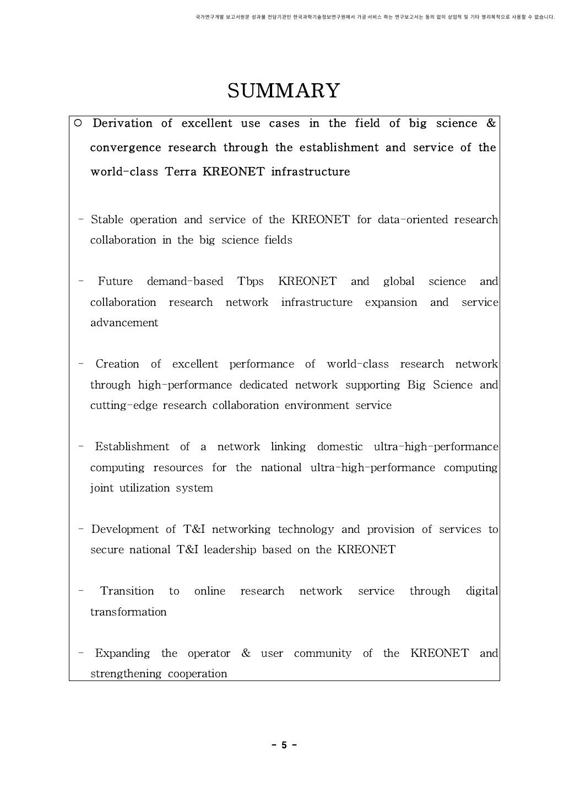

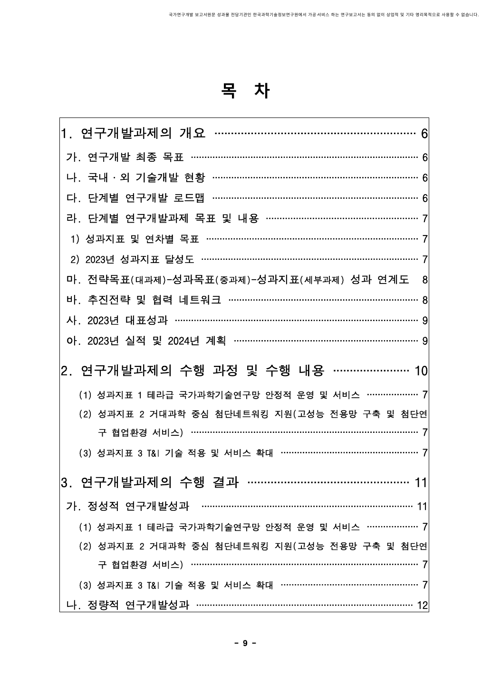

### 4. 강조용 표 — 한 문장·목록을 표로 둘러 강조

본문에서 한 문장이나 한 목록을 강조하려고 1×1 셀 표로 둘러싸는 쓰임입니다. 표가 강조 도구로 쓰입니다.

### 1년 뒤에도 줄지 않았다 (2025년 보고서)

[2025년 보고서](appendix-d-abstract.md)에서 초록 양식이 일부 바뀌었지만, 표로 감싸는 쓰임은 줄지 않았습니다. 2025년 보고서에서도 **영문 SUMMARY와 목차는 여전히 표 테두리 안에** 있습니다.

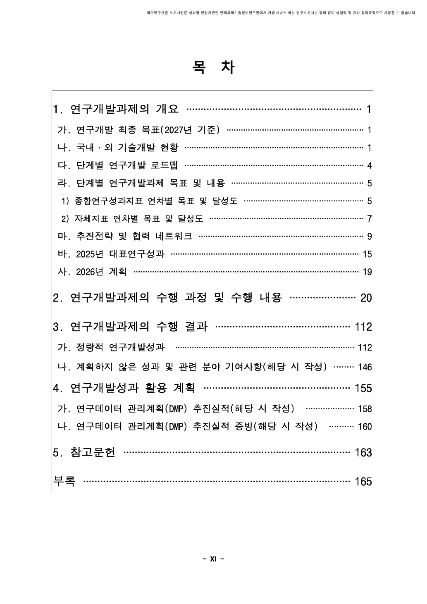

목차 자체도 달라지지 않은 점이 있습니다.

- **여전히 1쪽**입니다. 1~5장과 부록 전체가 한 쪽에 들어가고, 항목은 대부분 양식 칸 이름(개요·수행 과정·수행 결과·활용 계획·참고문헌)이라 목차만 보고는 이 과제가 무엇을 했는지 알기 어렵습니다
- 오히려 **앙상해졌습니다**. 2024년 목차에 있던 "전략목표(대과제)-**성과목표**(중과제)-성과지표(세부과제) 성과 연계도" 항목이 2025년 목차에서는 사라졌습니다. 내용을 드러내던 줄이 하나 줄어든 셈입니다

표로 감싸는 방식도, 목차가 양식 칸 이름에 머무는 것도 1년 사이 그대로였습니다. 양식 개정이 판형을 손볼 뿐 구조를 바꾸지 않는다는 [초록에서 본 패턴](appendix-d-abstract.md)이 목차에서도 똑같이 나타납니다.

## 왜 문제인가 — 표는 기계에게 "여기는 데이터"라는 신호다

표는 기계에게 "이것은 행과 열로 의미가 나뉜 tabular data"라는 신호입니다. 그런데 서술을, 목차를, 강조하려는 한 문장을 표로 감싸면, 기계는 **데이터가 아닌 것을 데이터로** 읽습니다. 셀 병합이 겹치고 표 안에 표가 들어가고 수식 칸이 섞이면, PDF·HWP에서 "이 칸이 무슨 데이터인가"를 되살리는 일이 사실상 불가능해집니다. 표를 많이 쓸수록 기계가 읽을 수 있는 구조는 오히려 줄어듭니다.

## 해외 — 표는 데이터일 때만

미국 DoE 산하 ESnet 보고서는 427쪽인데 앞부분에 표가 거의 없습니다. 수치를 나란히 보여야 할 때만 간단한 표를 씁니다. 목차는 표로 감싸지 않고 **색 밴드와 일관된 번호체계**로 구분합니다.

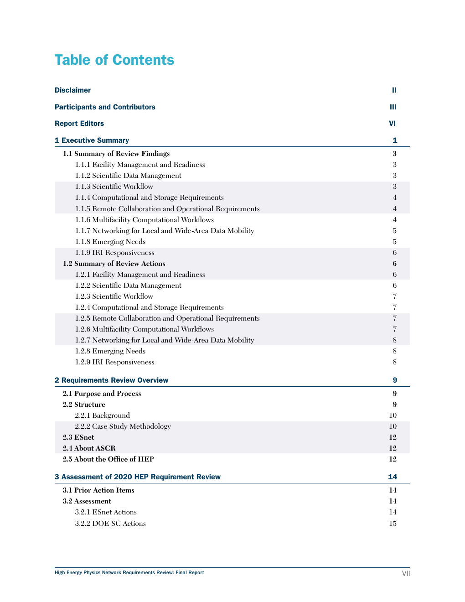

같은 자리에서 한국 보고서는 목차를 표로 감싸고(위 이미지 참조), 미국 보고서는 표 없이 색과 번호로 구분합니다. 나머지 나라도 마찬가지입니다. 일본·중국·미국·EU·영국은 성과를 필드나 레코드로 받고 본문은 서술로 쓰며, 표는 수치가 실제로 표일 때만 씁니다. 그래서 공개 DB가 데이터를 필드 단위로 렌더링할 수 있습니다.

## 한눈에 보기: 같은 일을 하는 기관의 보고서 버드뷰

> 국가 연구망을 운영하는 기관끼리 보고서를 전 쪽 썸네일 격자로 놓고, 보고서 전체가 표인지 서술인지 한 화면에서 비교합니다. 썸네일은 [`tools/birdview.py`](tools/birdview.py)로 다시 만들 수 있습니다.

| 나라 | 연구망 | 운영 기관 | 비교한 보고서 | 쪽수 | 양식형 표 점유율 |
|---|---|---|---|---|---|
| 한국 | KREONET | KISTI | 연구망 운영 과제 연차보고서 2024·2025 | 202·260 | 14.6%·9.5% |
| 일본 | SINET | 국립정보학연구소(NII) | 国立情報学研究所年報 2024년도 | 280 | 5.2% |
| 미국 | ESnet | LBNL(DoE) | ESnet Annual Report 2024 / HEP 요구사항 검토 보고서 | 48 / 427 | 측정 제외* |
| 중국 | CSTNET | 중국과학원 컴퓨터네트워크정보센터(CNIC) | 활동 연차보고서 공개본 없음. 2025년도 부서 결산서만 공개 | 26 | 해당 없음 |
| EU | GÉANT | GÉANT Association | 연차보고서가 웹 페이지로만 공개(PDF 없음) | - | 해당 없음 |

\* ESnet 연차보고서는 어두운 사진 배경이 많은 잡지형 판형이라 괘선 측정 도구가 사진 경계를 표로 오인합니다. 눈으로 보면 표는 수치 몇 개뿐입니다.

보고서의 성격은 조금씩 다릅니다. KISTI 보고서는 연구망 운영 과제의 연차보고서이고, NII 年報는 연구소 전체의 연차보고서입니다. 그래도 같은 연구망 운영 기관이 1년 활동을 200~300쪽으로 정리한다는 점에서 가장 가까운 비교 대상입니다.

### 한국: KISTI 연구망 과제 연차보고서

앞머리(초록·요약문·SUMMARY·목차)가 테두리 친 표와 박스이고, 본문은 표·도표·스크린샷이 빼곡합니다. 순수 서술만 있는 쪽이 드뭅니다.

**2024 (202쪽)**

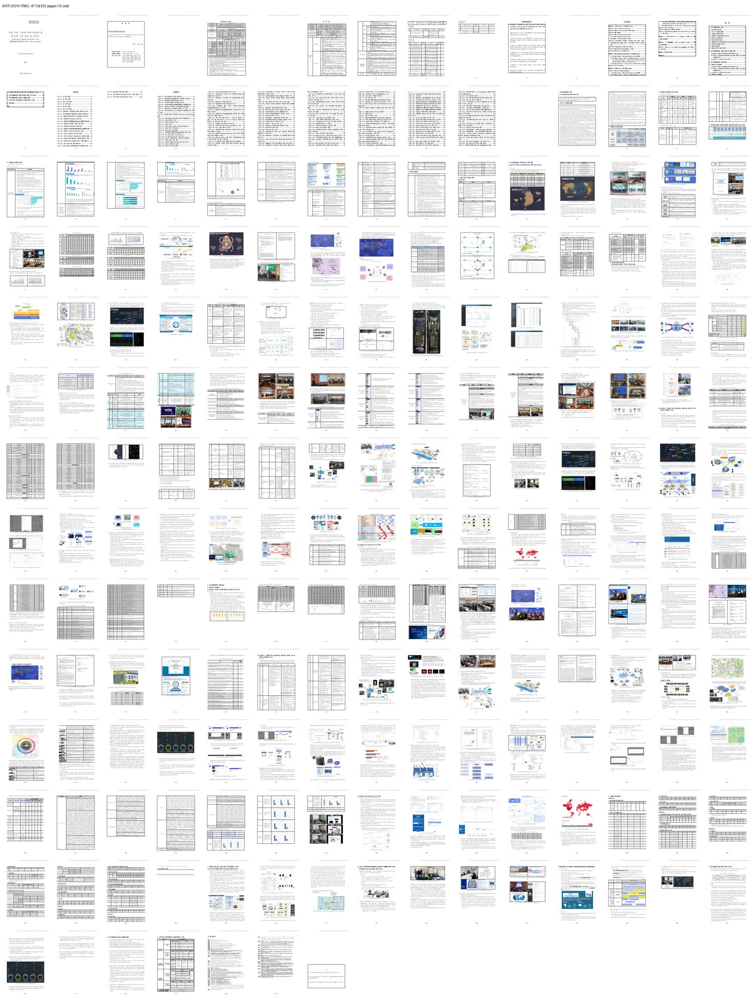

**2025 (260쪽)**: 패턴은 같고 분량이 29% 늘었습니다. 늘어난 부분은 대부분 뒤쪽 3분의 1을 차지하는 "표의 벽"(정량적 연구개발성과·부록)입니다.

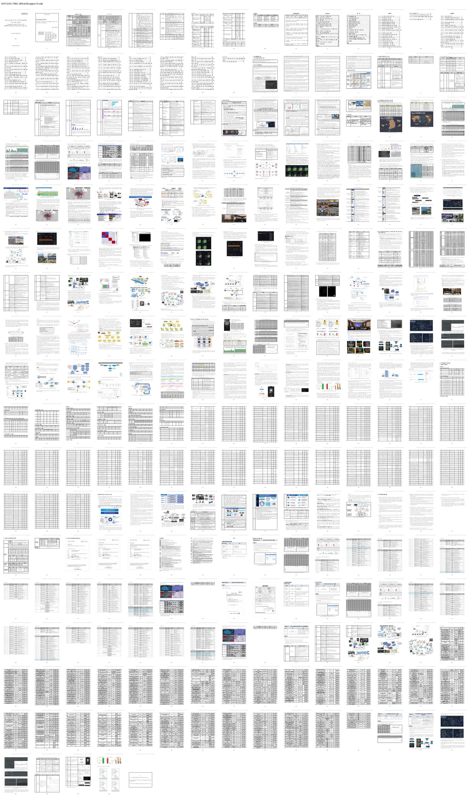

### 일본: NII 年報 2024년도

[国立情報学研究所年報 2024년도](https://www.nii.ac.jp/about/upload/2024-nii-nenpou.pdf)(280쪽, [보존 텍스트](sources/japan/nii-nenpou-2024_2026-11-26.txt.md)). SINET6를 운영하는 NII의 연차보고서로, 분량이 KISTI 보고서와 거의 같습니다.

- 목차는 박스 없이 점선 지시선으로 쪽 번호를 잇는 평범한 목록입니다.
- 앞쪽 연구 활동 총괄(8~35쪽)은 서술 본문입니다.
- 공동연구·과연비·수탁연구 목록과 결산·외부자금·회의 명단 같은 실제 데이터는 데이터표로 둡니다.
- 가장 긴 부분인 개인 연구업적(48~159쪽, 110쪽 분량)은 표가 아니라 연구자별 서지 목록입니다. 한국 보고서가 정량성과를 병합 표로 만드는 것과 대비됩니다.

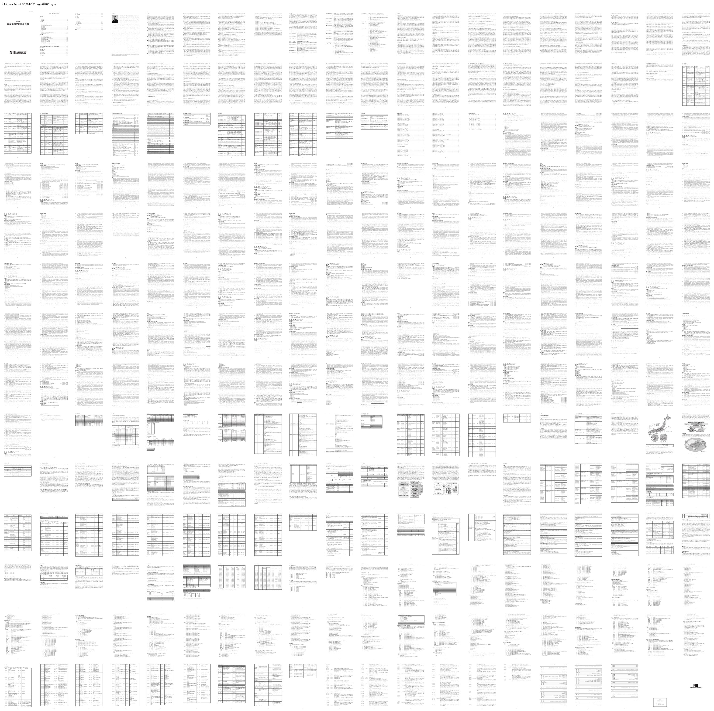

참고로 처음 비교에 쓴 [NEDO 事業報告書](sources/japan/nedo-report_2026-11-26.txt.md)(28쪽)는 연구망 기관이 아니고 결산 중심의 짧은 보고서라 위 NII 年報로 바꿨습니다. 썸네일은 [여기](images/birdview-japan-nedo.jpg)에 남겨 둡니다.

### 미국: ESnet 연차보고서와 요구사항 검토 보고서

[ESnet 2024 Annual Report](https://www.es.net/assets/pubs_presos/ESnet-2024-AR_Cover+Body_digital_fnl_25-SN-10463-.pdf)(48쪽, [보존 텍스트](sources/usa/esnet-ar-2024_2026-11-26.txt.md))는 대외 홍보용 잡지형 연차보고서입니다. 수치는 "ESnet by the numbers" 같은 인포그래픽 몇 쪽에 모으고, 나머지는 사진과 서술입니다. 같은 내용은 [웹 판](https://annualreports.es.net/)으로도 공개됩니다.

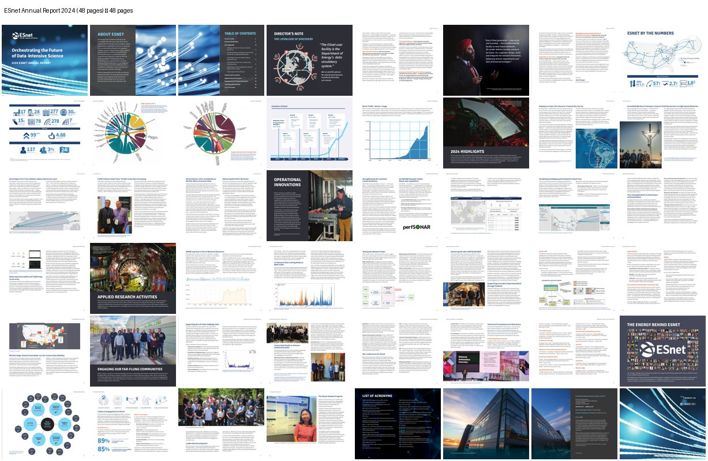

기술 내용은 별도의 [HEP Network Requirements Review](sources/usa/esnet-hep-rr-toc_2026-11-26.md)(2024, 427쪽)에 담깁니다. 거의 전부 흐르는 본문이고, 표는 데이터를 담을 때만 나옵니다([별첨 B](appendix-b-doe.md)).

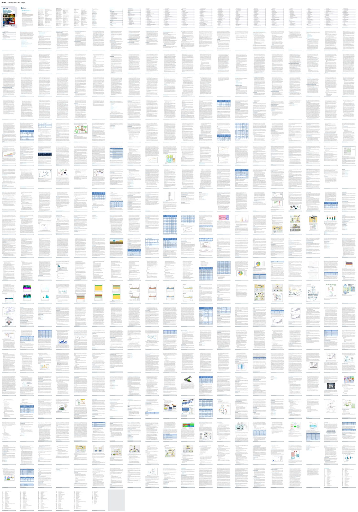

연차 활동(홍보용 연차보고서)과 기술 내용(요구사항 검토 보고서)을 다른 문서로 나눈 것 자체가 차이입니다. 한국 과제 연차보고서는 둘을 한 권에 담습니다.

### 중국: CNIC는 활동 보고서를 공개하지 않는다

CSTNET을 운영하는 CNIC 누리집의 "信息公开年报"(정보공개 연보)는 활동 보고서가 아니라 정부정보 공개 신청 처리 건수를 적는 법정 서식입니다([2023년도 예](https://cnic.cas.cn/xxgk/xxgknb/202403/t20240315_7035827.html), 대부분 0건). 공개되는 PDF는 [2025년도 부서 결산서](sources/china/cnic-juesuan-2025_2026-11-26.txt.md)(部门决算, 26쪽)로, 정부 공통 재무 서식입니다. 연구망 활동을 정리한 《中国科研信息化蓝皮书》는 출판물이라 공개 PDF를 찾지 못했습니다.

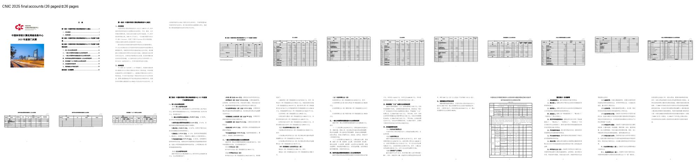

### EU: 연차보고서가 웹 페이지다

GÉANT의 연차보고서는 [ar.geant.org](https://ar.geant.org/)에 웹 페이지로만 공개됩니다. 과제 단위의 정기·최종 보고서는 Funding & Tenders Portal 안에만 있고, 공개되는 것은 CORDIS의 짧은 일반인용 요약("Results in Brief")입니다. 버드뷰할 PDF가 없다는 점이 관찰점입니다.

### 정리

- **한국**: 앞머리 박스, 본문 표밭, 뒤쪽 표의 벽. 성과도 병합 표에 담는다.
- **일본 NII**: 같은 분량에서 서술과 서지 목록이 중심이고, 표는 데이터일 때만 쓴다.
- **미국 ESnet**: 연차보고서는 짧은 홍보물, 기술 내용은 서술 위주의 별도 보고서로 나눈다.
- **중국 CNIC·EU GÉANT**: 비교할 공개 PDF 연차보고서가 없다. EU는 웹 페이지로 공개한다.

## 챕터별 표 비율 — 기계 가독성 신호등 (2024 vs 2025)

표라고 다 같은 표는 아닙니다. 쪽마다 표 영역을 기계 가독성·사용 권장도에 따라 **녹색(좋음·권장)에서 빨강(나쁨·지양)까지** 네 단계로 색칠했습니다. 판정은 세로 괘선 수·가로 괘선 수·점유율로 하며([`tools/measure_tables.py`](tools/measure_tables.py)), 완벽하지는 않지만 경향은 또렷합니다.

<b>기계 가독성 · 사용 권장도</b> (왼쪽 좋음 → 오른쪽 지양) 
■ <b>데이터표</b> — 기계 가독 높음, <b>사용 권장</b> (조밀한 다열 격자, 엑셀 처리 가능) 
■ <b>콜아웃·강조 박스</b> — 가독 높음 (글 한 덩어리). HWP 글상자로 넣으면 표가 아니게 되어 교체 
■ <b>구획</b> — 차라리 나음 (큰 박스지만 안은 글이라 추출 가능, 글상자로 교체 가능) 
■ <b>양식형 표</b> — <b>가장 지양</b> (셀 병합·수식으로 데이터가 갇혀, 데이터처럼 보이나 파싱하면 틀린 값) 
■ 표 아님(서술·그림)

<table class="tcat"><thead><tr><th>챕터</th><th>2024</th><th>2025</th></tr></thead><tbody>
<tr><td style="text-align:left">1. 개요</td><td>

전체 62% · 🟢21 🟡0 🟠8 🔴33 (14쪽)
</td><td>

전체 69% · 🟢8 🟡0 🟠21 🔴39 (19쪽)
</td></tr>
<tr><td style="text-align:left">2. 수행 과정·내용</td><td>

전체 31% · 🟢14 🟡1 🟠1 🔴15 (84쪽)
</td><td>

전체 25% · 🟢15 🟡1 🟠0 🔴10 (92쪽)
</td></tr>
<tr><td style="text-align:left">3. 정성적 성과</td><td>

전체 29% · 🟢6 🟡1 🟠2 🔴20 (53쪽)
</td><td>—</td></tr>
<tr><td style="text-align:left">3. 정량적 성과*</td><td>

전체 16% · 🟢11 🟡3 🟠0 🔴2 (7쪽)
</td><td>

전체 70% · 🟢68 🟡1 🟠0 🔴2 (34쪽)
</td></tr>
<tr><td style="text-align:left">3. 계획외·기여</td><td>

전체 18% · 🟢3 🟡0 🟠0 🔴16 (10쪽)
</td><td>

전체 34% · 🟢9 🟡0 🟠0 🔴24 (9쪽)
</td></tr>
<tr><td style="text-align:left">4. 활용 계획</td><td>

전체 38% · 🟢38 🟡0 🟠0 🔴0 (2쪽)
</td><td>

전체 13% · 🟢10 🟡0 🟠0 🔴3 (8쪽)
</td></tr>
<tr><td style="text-align:left">부록*</td><td>—</td><td>

전체 61% · 🟢54 🟡0 🟠0 🔴6 (73쪽)
</td></tr>
<tr style="background:#f6f8fa;font-weight:700"><td style="text-align:left">서술 챕터 평균 정량성과·부록 제외</td><td>

전체 32% · 🟢12 🟡1 🟠2 🔴18 (163쪽)
</td><td>

전체 32% · 🟢13 🟡1 🟠3 🔴15 (128쪽)
</td></tr>
</tbody></table>

가장 지양해야 할 것을 맨 오른쪽(빨강)에 두었습니다. **양식형 표가 가장 나쁜 이유**는, 데이터표처럼 생겼지만 셀 병합과 수식(예: 초록의 `G=A+D+E`)으로 구조가 깨져 있어, 기계가 "데이터인 줄 알고" 파싱하면 오히려 **틀린 값을 뽑기** 때문입니다. 반대로 구획(주황)은 정직하게 "글 한 덩어리"라 텍스트가 그대로 추출되고 HWP 글상자로도 바꿀 수 있어 차라리 낫습니다. 콜아웃도 같은 이유로 녹색에 가깝습니다.

- **가장 지양할 빨강(양식형 표)이 서술 챕터에 15~18% 깔려 있습니다.** 2024년 18%, 2025년 15%. 사업화 표·초록·개요 목표표가 여기 해당합니다. 데이터를 담되 사람도 기계도 못 읽게 담은 표입니다.
- **"개요" 챕터가 가장 빨갛고, 더 빨개졌습니다.** 양식형(빨강)이 2024년 33% → 2025년 39%, 거기에 구획(주황)이 21% 더해져 **지양 대상(빨강+주황)이 41% → 60%**입니다. 과제를 서술로 소개해야 할 챕터가 파싱 안 되는 표로 절반 넘게 차 있습니다.
- **구획(주황)·콜아웃(노랑)은 상대적으로 낫고 고치기 쉽습니다.** 둘 다 안이 글이라 추출되고 글상자로 교체되니, 급한 것은 빨강(양식형)을 **데이터표로 펴는** 일입니다.
- **녹색(데이터표)은 정량적 성과·부록에만 몰려 있습니다.** 본래 표여야 할 자리이고, 권장되는 쓰임입니다.

정리하면, **고쳐야 할 1순위는 빨강(양식형 표)입니다. 데이터를 병합·수식 표에 가두지 말고 데이터표로 펴면, 서술 챕터의 15~18%, 개요의 40% 가까이가 기계가 읽을 수 있는 형태로 바뀝니다.** 구획·콜아웃은 글상자로 돌리면 그만입니다.

## 불릿은 리스트가 아니다 — NTIS 복붙이 드러낸 것

한국 보고서의 개조식 목록(□ > ○ > - > ·)은 리스트라는 데이터 구조가 아닙니다. 저 머리문자는 전부 **기호·글자**입니다.

| 머리문자 | 유니코드 | 이름 | 정체 |
| --- | --- | --- | --- |
| □ | U+25A1 | WHITE SQUARE | 기하 기호 |
| ○ | U+25CB | WHITE CIRCLE | 기하 기호 |
| - | U+002D | HYPHEN-MINUS | 붙임표 |
| · | U+00B7 | MIDDLE DOT | 가운뎃점 |

즉 "목록"은 글줄 앞에 기호를 붙이고 **공백(들여쓰기)으로 단계를 표시**한 텍스트일 뿐입니다. 어느 항목이 어느 항목의 하위인지는 데이터로 존재하지 않습니다. 문서에 따라서는 ○ 자리에 아예 한글 자음 **ㅇ(U+3147 HANGUL LETTER IEUNG, 이응)**을 쓰기도 합니다. 글자를 불릿으로 쓰는 셈입니다.

이게 실제로 어떻게 깨지는지 NTIS가 보여줍니다. 아래 과제 요약정보는 보고서(HWPX)의 개조식 목록을 **복사해 붙여** 채운 것으로 보입니다.

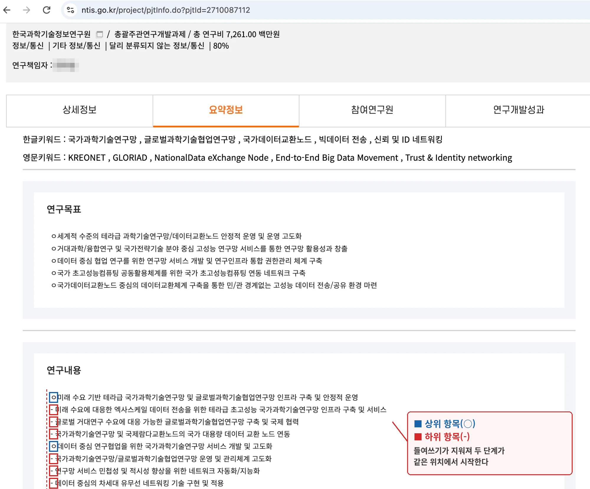

○ 머리문자는 글자라서 그대로 남습니다. 그러나 `-` 하위 항목의 **들여쓰기는 날아갑니다.** 단계가 공백으로만 표현돼 있었는데 웹 폼이 앞 공백을 지우니, 하위 항목이 상위와 같은 높이로 평평해집니다. 리스트가 아니었으니 보존할 구조도 없었던 것입니다.

여기에 이 조사의 두 주장이 한 화면에 겹칩니다. 첫째, 개조식 목록은 [기계가 읽을 리스트가 아니라 글자 장식](appendix-b-doe.md)입니다. 둘째, 같은 내용을 [HWPX 보고서로 만들고 다시 NTIS에 복붙](appendix-a-countries.md)하는데, 그 과정에서 그나마 공백으로 있던 단계 구조마저 사라집니다. **종이 판형에 굳힌 가짜 구조는 시스템으로 옮길 때 남지 않습니다.** 처음부터 목록을 구조(리스트)로 두고 보고서·시스템이 그 구조를 각자 렌더링했다면, 이런 손실도 복붙도 없습니다.

## 비교 요약

| 국가 | 목차 | 요약·초록 | 본문 강조 | 표를 쓰는 곳 |
| --- | --- | --- | --- | --- |
| 한국 | **표 테두리로 감쌈** | 식별·예산·초록을 한 표에 | **1×1 표로 강조** | 거의 모든 곳 (양식·중첩·블록·강조) |
| 미국 (ESnet) | 색 밴드·번호체계 | 서술 | 제목 단계 | 수치 데이터만 |
| 일본 | KAKEN 필드 렌더 | 概要 웹 필드 | 서술 | 데이터·산업재산권 행 |
| 중국 | 표준 목차 | 辑要页 메타데이터 | 서술 | 데이터·경제효익 표 |
| EU | CORDIS 필드 렌더 | Results in Brief 서술 | 서술 | 데이터 |
| 영국 | GtR 레코드 목록 | GtR 초록 서술 | 서술 | 데이터 레코드 |

## 함의

한국 보고서에서 표는 데이터를 담는 그릇이라기보다 판형을 짜는 수단입니다. 요약도 목차도 강조도 표로 두르니, 기계가 "표는 데이터"라는 상식으로 읽으면 전부 오독합니다. 해외처럼 표를 수치 데이터에만 쓰면, 표가 곧 데이터가 되어 사람도 기계도 바로 읽을 수 있습니다. 서술은 서술로, 목차는 제목 구조로, 강조는 서식으로 두는 것이 [이 조사가 말하는 입력·출력 분리](index.md)의 가장 눈에 보이는 실천입니다.

## 자료

- KISTI 연차보고서 표 사례(보존): [영문 SUMMARY(표로 감쌈)](sources/korea/kisti-kreonet-summary-boxed_2026-11-26.png) · [목차(표로 감쌈)](sources/korea/kisti-kreonet-toc-boxed_2026-11-26.png) · [초록(중첩 표)](sources/korea/kisti-kreonet-abstract_2026-11-26.png) · [정량성과(양식 표)](sources/korea/kisti-kreonet-quant-table_2026-11-26.png)
- ESnet 보고서 목차·본문: [목차](sources/usa/esnet-hep-rr-toc_2026-11-26.png) · [본문](sources/usa/esnet-hep-rr-body_2026-11-26.png)
