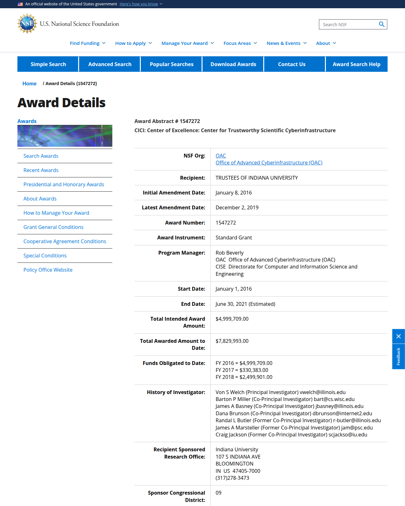
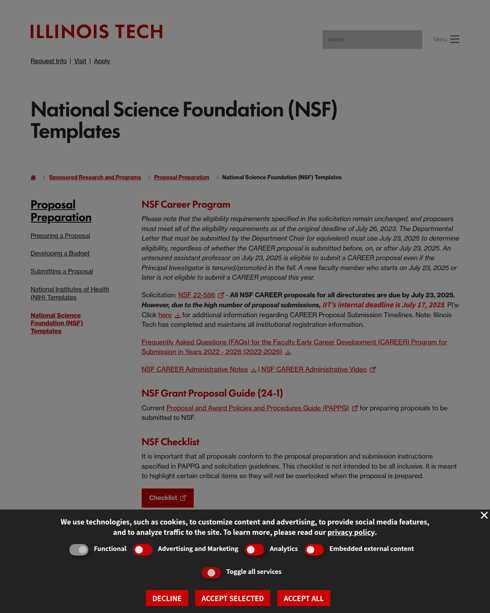
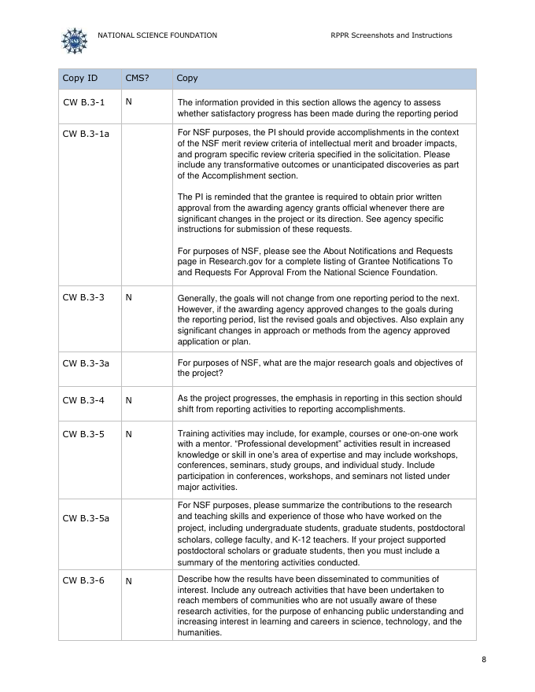
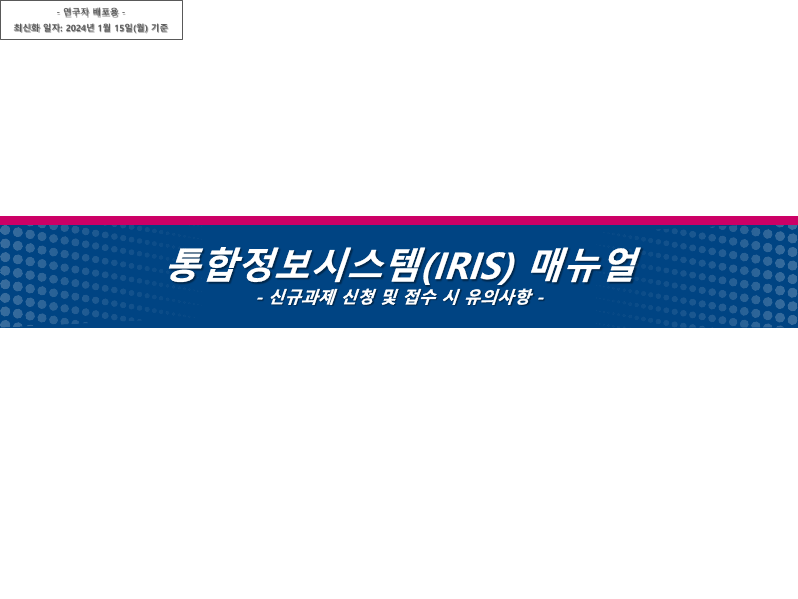

# 별첨 F. 아카이브·식별자와 연구지원 안내

> [!NOTE]
> 보고서와 메타데이터가 쌓이는 국가별 아카이브, 과제를 가리키는 식별자, 그리고 지원기관·대학이 작성과 제출을 안내하는 방식을 모았습니다. 핵심 리포트 3·5절의 근거입니다.

> [!NOTE]
> 보고서를 가볍게 하는 비결은 "넣지 않는 것"입니다. 미국은 메타데이터·협력자·회계를 보고서 안에 넣지 않고, 각각 **구조화된 폼과 공개 DB**에 둡니다. 그래서 보고서(서술)와 메타데이터(검색·관리)가 분리되고, 각 조각이 구조화돼 기계가 읽습니다. 이 분리가 쌓이는 곳이 R&D 보고서 아카이브입니다.

## 미국 — 보고서에 안 넣고 구조화된 곳에 둔다

### 메타데이터는 award DB에

NSF 과제의 메타데이터는 과제계획서나 보고서가 아니라 [Award Search](https://www.nsf.gov/awardsearch/show-award/?AWD_ID=1547272)에 **필드:값**으로 있습니다. 기관·수혜자·개정일·과제번호·과제유형·사업관리자·기간·총액·**연도별 집행액**·연구책임자 목록(이메일 포함)·소관부서·지역구까지, 한국이 보고서 병합표에 욱여넣는 바로 그 정보가 여기 구조화돼 있습니다.



### 식별자 하나가 페이지이자 API

NSF에서 과제 식별자(award ID)는 사람용 웹페이지이면서 동시에 **인증 없는 공개 API 엔드포인트**입니다.

```text
사람용  https://www.nsf.gov/awardsearch/show-award/?AWD_ID=<번호>
기계용  https://api.nsf.gov/services/v1/awards/<번호>.json   (인증 불요)
```

API 응답에는 과제 메타데이터와 **산출 논문 목록이 DOI와 함께** 담깁니다. 다년 과제 전체가 식별자 하나이고, 연차별 배정액·변경이력은 그 안의 속성(필드)입니다. 번호를 매년 바꾸지 않습니다.

공개(open)와 참조 가능(referenceable)은 다릅니다. 로그인·팝업 뒤에 있으면 공개돼 있어도 기계가 가리킬 수 없습니다. **식별자가 곧 주소이고 주소가 곧 API일 때**, 아카이브에 쌓인 과제가 비로소 기계가 읽고 이어 붙일 수 있는 참조 대상이 됩니다. 과제–논문–데이터–연구자를 잇는 성과 그래프는 이런 영구 식별자 위에서만 자동으로 만들어집니다.

### 보고서 템플릿은 가볍다

[NSF Project Report Template](https://resources.research.gov/common/attachment/Desktop/NSF%20Project%20Report%20Template.pdf)은 성과·참여자·영향을 서술로 받을 뿐, 협력자 명단(COA)이나 회계·예산 표를 묻지 않습니다. 그런 정보는 이미 award DB와 별도 폼에 있으니, 보고서에 중복해 넣지 않습니다.

### 협력자는 구조화 스프레드시트 + 생성기로

협력자 정보(COA, Collaborators & Other Affiliations)는 서술이 아니라 **정해진 엑셀 스프레드시트 템플릿**으로 받습니다(2017년 표준화). 구조가 고정돼 있으니 커뮤니티가 자동 생성 도구까지 만들었습니다.

- [coapy](https://andrew-s-rosen.github.io/coapy/) · [coauthors_nsf (BrunaLab)](https://github.com/BrunaLab/coauthors_nsf) — 논문 목록에서 공저자·소속을 뽑아 COA 양식으로 변환
- [UW-Madison COA Builder](https://coa-builder.services.dsi.wisc.edu/) — 웹에서 바로 생성

정보를 구조화해 받으니, 사람이 손으로 표를 채우는 대신 **도구가 자동으로 채웁니다.** 서식을 사람·도구로 떠넘기지 않고 구조로 다룬 결과입니다.

## 국가별 R&D 보고서 아카이브

분리·구조화된 보고서와 메타데이터가 쌓이는 공개 아카이브입니다.

| 나라 | 아카이브 | 성격·규모 |
| --- | --- | --- |
| 미국 DOE | [OSTI.gov](https://www.osti.gov/) | DOE 연구결과 **약 400만 건**(1948~), 대부분 전문 연결. 영구식별자·개발자 API 제공 |
| 미국 연방 | [NTRL (NTIS)](https://ntrl.ntis.gov/NTRL/) | 연방 기술보고서 **약 300만 건**(1964~), 전문 약 80만 건 |
| 미국 NASA | [NTRS](https://ntrs.nasa.gov/) | NASA·NACA 성과 메타데이터 **440만 건**, 전문 약 50만 건 |
| 미국 NSF | [Award Search](https://www.nsf.gov/awardsearch/) · Research.gov | 과제 메타데이터 필드 + 일반인용 POR 공개 |
| 중국 | [NSTRS 国家科技报告服务系统](https://www.nstrs.cn/) | ISTIC 운영. 辑要页 메타데이터 공개(전문은 등록) |
| EU | [CORDIS](https://cordis.europa.eu/) · [OpenAIRE](https://www.openaire.eu/) | 과제 결과·공개 산출물, 메타데이터 집계 |
| 영국 | [Gateway to Research](https://gtr.ukri.org/) | UKRI 과제 성과 레코드 공개 |
| 일본 | [KAKEN](https://kaken.nii.ac.jp/) · [J-STAGE](https://www.jstage.jst.go.jp/) | 科研費 과제 페이지, 학술지 전문 |
| 한국 | [ScienceON](https://scienceon.kisti.re.kr/) · [NTIS](https://www.ntis.go.kr/) | KISTI 운영. 국가 R&D 보고서 원문·메타데이터 |

OSTI가 가장 널리 알려진 전용 아카이브이고, NTRL은 연방 전체를 가장 넓게 모으며, NASA NTRS는 항공우주 분야의 대표 저장소입니다.

## 함의 — 아카이브는 있는데, 담기는 것이 구조화되지 않았다

한국도 [ScienceON·NTIS](https://scienceon.kisti.re.kr/)라는 훌륭한 국가 R&D 아카이브를 운영합니다. 이 조사의 기준 보고서도 거기서 받았습니다. 문제는 아카이브가 아니라 **담기는 보고서 자체**입니다. 보고서가 병합표·구획표로 비구조화돼 있어, 아카이브는 메타데이터 일부와 평문만 추출할 뿐 표·구조는 살리지 못합니다.

미국처럼 메타데이터는 과제 DB에 두고(보고서에 중복하지 않고), 보고서는 [구조화된 소스](appendix-c-gbt.md)로 쓰면, 같은 아카이브가 필드 단위 검색과 재표현을 할 수 있습니다. 그릇(아카이브)은 이미 있으니, [담기는 것(보고서)을 구조화](appendix-e-tables.md)하는 일이 남았습니다.

## 자료

- NSF Award 예시: [Award 1547272](https://www.nsf.gov/awardsearch/show-award/?AWD_ID=1547272) · [보존 화면](sources/usa/nsf-award-1547272_2026-11-26.png)
- NSF COA 생성기 소개: [Carpenter-Singh Lab 블로그](https://carpenter-singh-lab.broadinstitute.org/blog/compiling-collaborators-nsf-collaborators-and-other-affiliations-coa-form)
- 아카이브 화면 보존: [OSTI.gov](sources/usa/osti-gov_2026-11-26.png) · [NTRL](sources/usa/ntrl-ntis_2026-11-26.png) · [NSTRS](sources/china/nstrs-top_2026-11-26.png)

## 연구지원 안내 — 대학과 지원기관은 과제 과정을 어떻게 돕나

> [!NOTE]
> 연구자가 과제를 따고(제안), 데이터·장비를 등록하고, 보고서를 내는 전 과정을, 각국 대학의 연구지원부서(Office of Sponsored Programs · 研究支援 · 산학협력단)가 지원기관별 **템플릿과 절차 안내**로 돕습니다. 이 페이지는 그런 안내 사이트를 나라별로 모아, 실제 작성·제출이 어떻게 안내되는지 보여줍니다.

### 전형 — 미국 대학 연구지원처

주신 예시인 [일리노이공대(IIT) 연구지원처(OSRP)의 NSF 템플릿 페이지](https://www.iit.edu/osrp/proposal-preparation/national-science-foundation-nsf-templates)가 전형입니다. "제안 준비 → 예산 작성 → 제출 → NIH/NSF 템플릿" 순으로 메뉴가 서고, NSF PAPPG(제안 정책·절차 가이드)·체크리스트·양식을 funder 기준 그대로 연결합니다.



지원기관(NSF·NIH)이 제안서 구조·보고 양식·제출 시스템을 정해 두니, 대학 안내는 그 구조를 가리키기만 하면 됩니다. 연구자는 "어느 템플릿을 어디에 내는가"를 한 페이지에서 알 수 있습니다.

### 국가별 연구지원 안내 사이트

| 나라 | 지원기관 | 대학·기관 연구지원 안내 (예) | 무엇을 안내 |
| --- | --- | --- | --- |
| 미국 | NSF·NIH | [IIT OSRP](https://www.iit.edu/osrp/proposal-preparation/national-science-foundation-nsf-templates) · [UCLA ORA(NIH RPPR)](https://medschool.ucla.edu/) | 제안 템플릿·예산·제출·진도보고(RPPR) |
| 일본 | 科研費(JSPS) | [JSPS 전자신청 操作手引](https://www-shinsei.jsps.go.jp/kaken/kakenhi_taiken/taiken_free/) · [法政大 科研費 매뉴얼](https://www.hosei.ac.jp/) | 응모~교부~실적보고 연간 흐름 |
| 중국 | 과기보고 | [东南大学 科技处](https://kjc.seu.edu.cn/) · [清华대 GB/T 7713.3](https://lib.tsinghua.edu.cn/wj/GBT7713_3-2014.pdf) | 과기보고 작성규칙·공개유예 |
| EU | Horizon Europe | [Heidelberg 정기보고 템플릿](https://backend.uni-heidelberg.de/de/dokumente/horizon-europe-periodic-report-template/download) · 대학 EU office | Part A/B 작성·제출 |
| 영국 | UKRI·NIHR | [Cambridge Research Services](https://www.research-services.admin.cam.ac.uk/manage-project/share-your-research/research-outcomes-and-researchfish) · [Warwick RIS](https://warwick.ac.uk/services/ris/systems/researchfish/) | Researchfish 성과보고 |
| 한국 | 국가R&D | [동서대 산학협력단](https://uni.dongseo.ac.kr/sanhak/?pCode=rndinfo) · [연세대 연구처](https://yis.yonsei.ac.kr/) | 과제 절차·장비 등록·NTIS 제출 |

(각 링크는 대표 예시이며, 기관마다 안내 페이지가 따로 있습니다. 원문 사이트는 개편이 잦아 접속이 안 될 수 있습니다.)

### 지원기관이 만든 단계별 가이드

대학 안내의 바탕에는 지원기관이 직접 만든 단계별(스크린샷) 가이드가 있습니다. 이걸 보면 완성도와 성격이 갈립니다.

**미국 NSF** — [Research.gov RPPR Screenshots and Instructions](https://resources.research.gov/common/attachment/Desktop/NSF_RGov_RPPR_ScreenshotsandInstructions.pdf)(35쪽)는 화면 캡처뿐 아니라 **각 입력 필드의 안내 문구(Copy Deck)**까지 지원기관이 관리합니다. 보고는 "시스템 필드를 안내대로 채우는 것"이고, 그 안내가 시스템 안에 들어 있습니다.



**일본 JSPS** — 科研費電子申請システム의 연구자용·기관용 操作手引이 응모부터 실적보고까지 조작을 단계로 설명합니다.

**한국** — 있습니다. 다만 성격이 다릅니다. IRIS 매뉴얼(연구자 배포용)을 **전문기관마다 따로** 만듭니다(예: 한국콘텐츠진흥원의 "IRIS 신규과제 신청 및 접수 시 유의사항", 2024).



그런데 이 매뉴얼들은 (1) 전문기관(KOCCA·KISTEP·IITP·한국연구재단 등)마다 흩어져 있고, (2) 대부분 신청·접수 중심이며, (3) 실적·보고 단계의 공개된 "따라하기" 단일 문서는 찾기 어렵고, (4) 안내가 설명하는 것은 대체로 **한글(HWPX) 보고서를 어느 화면에서 첨부해 올리나**이지 보고서 작성 자체가 아닙니다.

실적·결과보고 쪽은 어떨까요. 공개 검색으로는 "실적/최종보고 제출 따라하기" 단일 문서가 잘 잡히지 않습니다. 관련 매뉴얼은 IRIS 자료실(사용 매뉴얼·온라인 매뉴얼)과 전문기관 공지에 흩어져 있고, 공개되는 배포본은 대부분 신청·접수 중심입니다. 결국 "따라하기 문서가 아예 없다"기보다 **흩어져 있고 신청에 치우쳐 있으며, 보고서 단계의 안내는 결국 'HWPX 보고서를 첨부해 올려라'로 수렴**합니다.

핵심 차이는 이렇습니다. NSF의 가이드는 "**시스템의 필드를 이렇게 채워라**"입니다 — 필드 안내가 시스템 안에 있습니다. 한국의 가이드는 "**한글로 쓴 보고서를 이 화면에서 첨부해 올려라**"입니다 — 시스템은 문서를 넣는 통로입니다. 앞서 본 [워크플로](appendix-a-countries.md)(웹폼·엑셀·HWPX 삼중 입력)가 안내 문서의 성격에도 그대로 드러납니다.

> [!NOTE]
> 한국도 멈춰 있지는 않습니다. 2026년 11월 과기정통부는 IRIS를 전면 개편해, 해외 논문 DB와 연결해 **논문 고유번호만 입력하면 제목·저자·학술지가 자동 완성**되도록 바꿨습니다(이전에는 연구자가 일일이 입력). 성과(메타데이터) 등록이 NSF의 My NCBI·ORCID 방식으로 가는 중입니다([SBS](https://news.sbs.co.kr/english/article.do?news_id=N1008825059) · [디지털투데이](https://www.digitaltoday.co.kr/en/view/97123/)). 다만 이 개편은 **시스템의 성과 등록 화면**을 고친 것이지, 보고서(HWPX 서술·병합표) 자체의 형식을 바꾼 것은 아닙니다. 보고서는 여전히 별도 HWPX로 작성해 첨부합니다. 2027년부터 IRIS·Ezbaro·RCMS·NTIS 4대 시스템을 통합하고 운영을 KISTI가 맡으니, 구조·식별 체계를 정할 시점이 겹칩니다.

### 읽히는 차이

대학 안내는 결국 "**지원기관이 정한 서식을 어떻게 채우고 어디에 내는가**"를 설명합니다. 그래서 안내의 모양은 지원기관이 정한 구조를 그대로 비춥니다.

- **미국·일본·중국**은 지원기관이 구조를 정해 둡니다 — 미국은 템플릿과 award DB·RPPR 필드, 일본은 전자신청 필드와 Word 서식, 중국은 [GB/T 7713.3 작성규칙](appendix-c-gbt.md). 그래서 대학 안내도 "이 템플릿을 이 시스템에 낸다"로 깔끔합니다.
- **한국**은 서식이 지원기관 공고와 NTIS에 흩어져 있고 보고서가 [비구조화](appendix-e-tables.md)입니다. 그래서 대학 산학협력단 안내도 "한글 서식을 받아 채워 PDF로 올리고, 장비는 NTIS에 따로 등록하라"에 머뭅니다. 연구자가 [같은 정보를 여러 번](appendix-a-countries.md) 만드는 [워크플로](appendix-a-countries.md)가 대학 안내 문서에도 그대로 드러납니다.

같은 "연구지원 안내"라도, 지원기관이 구조를 정해 둔 나라에서는 안내가 한 장으로 끝나고, 그렇지 않은 나라에서는 안내가 흩어진 서식과 시스템을 이어 붙이는 설명이 됩니다.
