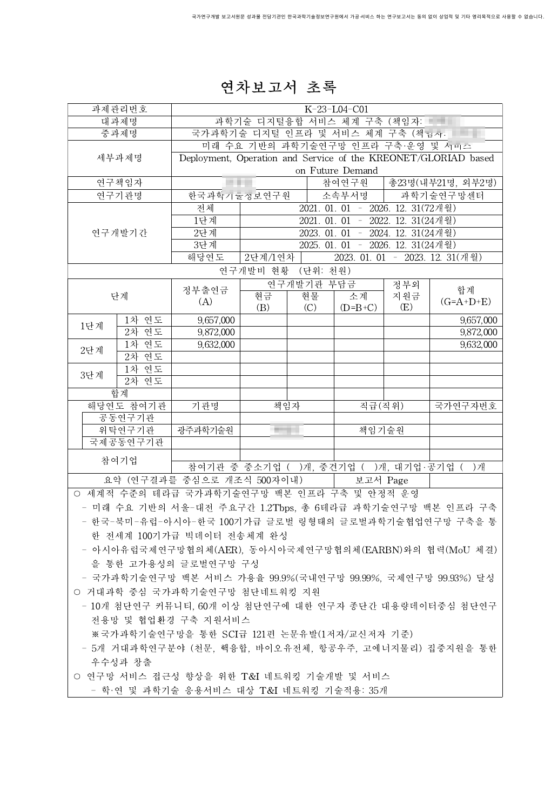
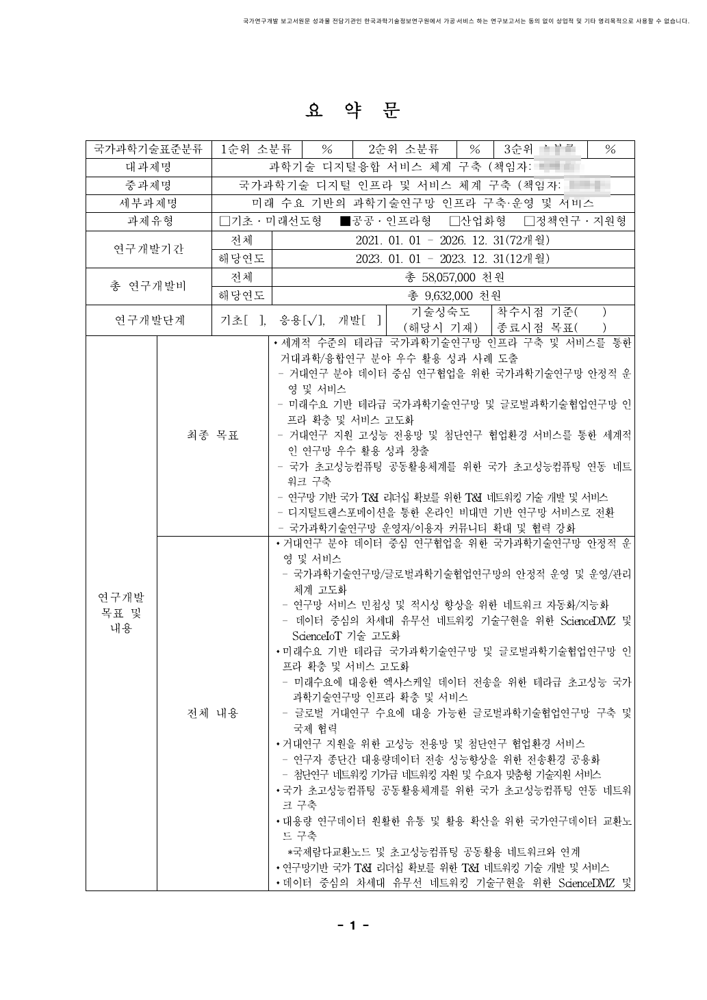
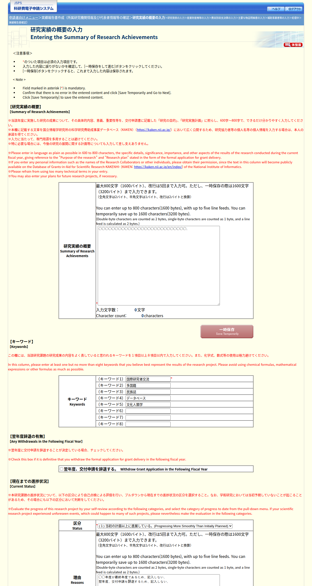

# 초록·요약문 — 서지 메타데이터와 서술을 한 표에 vs 나누어

- 작성일: 2026.11.
- 작성자: 장민석 (msjang@kisti.re.kr)

> [!NOTE]
> [비교 리포트](report.md)가 성과 표를, [미국 DoE 심층](findings-usa-doe.md)이 본문 구조를 봤다면, 이 문서는 보고서 맨 앞의 **초록·요약문**을 비교합니다. 한국 보고서에서 이 부분이 가장 많은 종류의 정보를 한 표에 담습니다.

## 한국 — 초록과 요약문, 두 통짜 표

한국 연차보고서는 앞머리에 "초록"과 "요약문" 두 표를 둡니다. 둘 다 성격이 다른 정보를 한 표에 병합합니다.

### 초록

이 한 표가 담는 것을 풀어 보면 이렇습니다.

- **식별정보** — 과제관리번호, 대·중·세부과제명(국·영문), 연구책임자, 연구기관·부서
- **단계별 기간** — 전체·1~3단계·해당연도를 행으로 나눈 날짜
- **연구개발비 현황** — 단계 × 정부출연금(A)·현금(B)·현물(C)·소계(D=B+C)·정부외지원금(E)·합계(G=A+D+E). 표 안에 **수식이 박힌 회계 표**입니다
- **참여기관** — 기관명·책임자·직급·국가연구자번호를 행으로 받는 또 다른 표
- **참여기업** — 중소·중견·대기업 개수
- **요약** — "연구결과를 중심으로 개조식 500자 이내"라는 단서가 붙은 서술을, 표 맨 아래 칸에 □·○·- 머리문자로 적습니다

### 요약문

요약문도 같은 방식입니다. 국가과학기술표준분류 코드, 과제유형 체크박스(□기초·■공공·□산업화·□정책), 총연구개발비, 연구개발단계·기술성숙도를 표 상단에 넣고, 최종목표를 그 아래 서술 칸에 개조식으로 적습니다.

## 이 표가 실제로 하는 일

초록 표 하나가 세 가지 서로 다른 문서를 겸합니다.

1. **데이터베이스 레코드** — 과제번호·과제명·기관·기간·책임자. 관리·식별 메타데이터입니다
2. **재무제표** — 단계별 연구개발비와 A~G 수식. 스프레드시트에 있어야 할 것입니다
3. **초록** — 연구 결과를 요약한 서술

성격이 다른 세 가지가 한 표에 병합되어 있어, 기계가 "이 칸이 식별정보인가, 금액인가, 서술인가"를 구분하기 어렵습니다. 셀 병합과 수식 칸이 많을수록 PDF·HWP에서 각 칸의 의미를 되살리기 어렵습니다.

## 해외 — 메타데이터는 필드, 요약은 서술

이번에 본 해외 체계는 같은 정보를 **메타데이터(필드)**와 **요약(서술)**으로 나눕니다.

**일본.** 식별정보·배분액·기간·기관은 시스템 필드로 받고, 요약은 "研究実績の概要"를 별도 웹 필드(600–800자)로 받습니다. KAKEN 과제 페이지가 둘을 각각 렌더링하므로, 서지와 서술이 처음부터 분리되어 있습니다.

**중국.** 한국 초록과 가장 닮은 쪽입니다. 과기보고서는 표지 다음에 "辑要页(documentation page)"를 두는데, 서지 메타데이터와 초록·키워드를 한 페이지에 모읍니다. 다만 이 페이지는 국가표준 [GB/T 7713.3](sources/china/gbt-7713-3-2014_2026-11-26.txt.md)의 필수 요소이고, 각 항목이 과기보고 메타데이터 표준(GB/T 30535)의 요소와 짝을 이룹니다. 한국처럼 한 페이지에 모으되, "창의적 표"가 아니라 **메타데이터 요소**로 형식화한 점이 다릅니다.

**미국.** RPPR은 식별정보·예산을 구조화 필드로 받고, 일반인용 요약은 Project Outcomes Report로 따로 받습니다. POR은 200–800단어 서술 텍스트이고 표 서식이 없습니다. 식별·예산(필드)과 요약(서술)이 아예 다른 입력입니다.

**EU.** CORDIS 과제 페이지가 식별·기간·예산·기관을 필드로 렌더링하고, 일반인용 요약은 "Results in Brief"라는 별도 서술로 보여줍니다.

**영국.** Gateway to Research가 과제 메타데이터를 필드로, 과제 초록을 서술로 각각 렌더링합니다.

## 비교 요약

| 국가 | 식별·예산·기관 | 요약·초록 | 한 표에 섞는가 |
| --- | --- | --- | --- |
| 한국 | 초록·요약문 표 안 | 같은 표 맨 아래 개조식 칸 | **섞음** (통짜 표, 수식 포함) |
| 일본 | 시스템 필드 → KAKEN | 概要 웹 필드 → KAKEN | 분리 |
| 중국 | 辑要页 메타데이터 | 辑要页 초록 | 한 페이지지만 메타데이터로 표준화 |
| 미국 | RPPR 필드 | POR 서술(표 없음) | 분리 |
| EU | CORDIS 필드 | Results in Brief 서술 | 분리 |
| 영국 | GtR 필드 | GtR 초록 | 분리 |

## 함의

한국 초록 표는 데이터베이스 레코드와 재무제표와 초록을 한 장에 합친 것입니다. 해외는 앞의 둘(식별·예산·기관)을 필드로 두고 초록을 서술로 나눕니다. 그 분리 덕에 공개 DB(KAKEN·CORDIS·Gateway to Research)가 레코드를 필드 단위로 렌더링하고, 요약은 사람이 읽을 서술로 따로 둡니다. [비교 리포트](report.md)에서 본 입력과 출력의 분리가, 보고서 맨 앞 초록에서도 같은 원리로 나타납니다.

## 자료

- KISTI 연차보고서 초록·요약문(보존): [초록 쪽](sources/korea/kisti-kreonet-abstract_2026-11-26.png) · [요약문 쪽](sources/korea/kisti-kreonet-summary_2026-11-26.png) · [전체 텍스트](sources/korea/kisti-kreonet-report_2026-11-26.txt.md)
- 중국 辑要页 규격: [GB/T 7713.3-2014](sources/china/gbt-7713-3-2014_2026-11-26.txt.md)
- 일본 概要 입력 화면: [JSPS 체험판](sources/japan/jsps-jisseki-gaiyo_2026-11-26.md)
