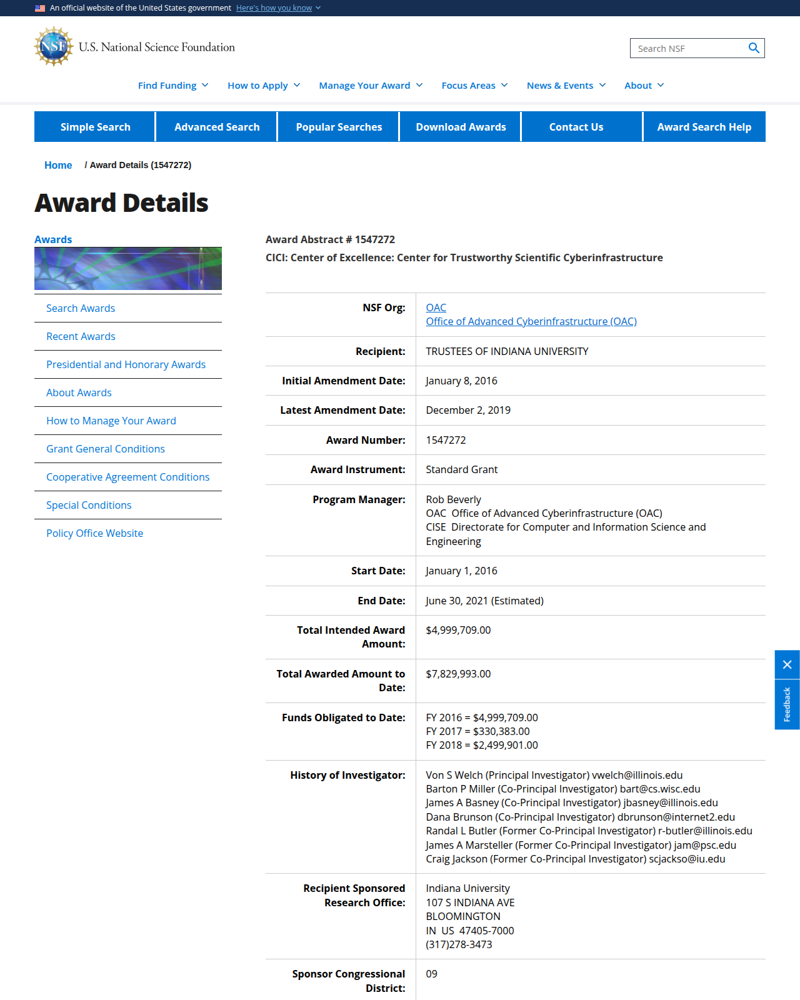

# R&D 보고서 아카이브 — 메타데이터는 어디에 두나

- 작성일: 2026.11.
- 작성자: 장민석 (msjang@kisti.re.kr)

> [!NOTE]
> 보고서를 가볍게 하는 비결은 "넣지 않는 것"입니다. 미국은 메타데이터·협력자·회계를 보고서 안에 넣지 않고, 각각 **구조화된 폼과 공개 DB**에 둡니다. 그래서 보고서(서술)와 메타데이터(검색·관리)가 분리되고, 각 조각이 구조화돼 기계가 읽습니다. 이 분리가 쌓이는 곳이 R&D 보고서 아카이브입니다.

## 미국 — 보고서에 안 넣고 구조화된 곳에 둔다

### 메타데이터는 award DB에

NSF 과제의 메타데이터는 과제계획서나 보고서가 아니라 [Award Search](https://www.nsf.gov/awardsearch/show-award/?AWD_ID=1547272)에 **필드:값**으로 있습니다. 기관·수혜자·개정일·과제번호·과제유형·사업관리자·기간·총액·**연도별 집행액**·연구책임자 목록(이메일 포함)·소관부서·지역구까지, 한국이 보고서 병합표에 욱여넣는 바로 그 정보가 여기 구조화돼 있습니다.



### 식별자 하나가 페이지이자 API

NSF에서 과제 식별자(award ID)는 사람용 웹페이지이면서 동시에 **인증 없는 공개 API 엔드포인트**입니다.

```text
사람용  https://www.nsf.gov/awardsearch/show-award/?AWD_ID=<번호>
기계용  https://api.nsf.gov/services/v1/awards/<번호>.json   (인증 불요)
```

API 응답에는 과제 메타데이터와 **산출 논문 목록이 DOI와 함께** 담깁니다. 다년 과제 전체가 식별자 하나이고, 연차별 배정액·변경이력은 그 안의 속성(필드)입니다. 번호를 매년 바꾸지 않습니다.

공개(open)와 참조 가능(referenceable)은 다릅니다. 로그인·팝업 뒤에 있으면 공개돼 있어도 기계가 가리킬 수 없습니다. **식별자가 곧 주소이고 주소가 곧 API일 때**, 아카이브에 쌓인 과제가 비로소 기계가 읽고 이어 붙일 수 있는 참조 대상이 됩니다. 과제–논문–데이터–연구자를 잇는 성과 그래프는 이런 영구 식별자 위에서만 자동으로 만들어집니다.

### 보고서 템플릿은 가볍다

[NSF Project Report Template](https://resources.research.gov/common/attachment/Desktop/NSF%20Project%20Report%20Template.pdf)은 성과·참여자·영향을 서술로 받을 뿐, 협력자 명단(COA)이나 회계·예산 표를 묻지 않습니다. 그런 정보는 이미 award DB와 별도 폼에 있으니, 보고서에 중복해 넣지 않습니다.

### 협력자는 구조화 스프레드시트 + 생성기로

협력자 정보(COA, Collaborators & Other Affiliations)는 서술이 아니라 **정해진 엑셀 스프레드시트 템플릿**으로 받습니다(2017년 표준화). 구조가 고정돼 있으니 커뮤니티가 자동 생성 도구까지 만들었습니다.

- [coapy](https://andrew-s-rosen.github.io/coapy/) · [coauthors_nsf (BrunaLab)](https://github.com/BrunaLab/coauthors_nsf) — 논문 목록에서 공저자·소속을 뽑아 COA 양식으로 변환
- [UW-Madison COA Builder](https://coa-builder.services.dsi.wisc.edu/) — 웹에서 바로 생성

정보를 구조화해 받으니, 사람이 손으로 표를 채우는 대신 **도구가 자동으로 채웁니다.** 서식을 사람·도구로 떠넘기지 않고 구조로 다룬 결과입니다.

## 국가별 R&D 보고서 아카이브

분리·구조화된 보고서와 메타데이터가 쌓이는 공개 아카이브입니다.

| 나라 | 아카이브 | 성격·규모 |
| --- | --- | --- |
| 미국 DOE | [OSTI.gov](https://www.osti.gov/) | DOE 연구결과 **약 400만 건**(1948~), 대부분 전문 연결. 영구식별자·개발자 API 제공 |
| 미국 연방 | [NTRL (NTIS)](https://ntrl.ntis.gov/NTRL/) | 연방 기술보고서 **약 300만 건**(1964~), 전문 약 80만 건 |
| 미국 NASA | [NTRS](https://ntrs.nasa.gov/) | NASA·NACA 성과 메타데이터 **440만 건**, 전문 약 50만 건 |
| 미국 NSF | [Award Search](https://www.nsf.gov/awardsearch/) · Research.gov | 과제 메타데이터 필드 + 일반인용 POR 공개 |
| 중국 | [NSTRS 国家科技报告服务系统](https://www.nstrs.cn/) | ISTIC 운영. 辑要页 메타데이터 공개(전문은 등록) |
| EU | [CORDIS](https://cordis.europa.eu/) · [OpenAIRE](https://www.openaire.eu/) | 과제 결과·공개 산출물, 메타데이터 집계 |
| 영국 | [Gateway to Research](https://gtr.ukri.org/) | UKRI 과제 성과 레코드 공개 |
| 일본 | [KAKEN](https://kaken.nii.ac.jp/) · [J-STAGE](https://www.jstage.jst.go.jp/) | 科研費 과제 페이지, 학술지 전문 |
| 한국 | [ScienceON](https://scienceon.kisti.re.kr/) · [NTIS](https://www.ntis.go.kr/) | KISTI 운영. 국가 R&D 보고서 원문·메타데이터 |

OSTI가 가장 널리 알려진 전용 아카이브이고, NTRL은 연방 전체를 가장 넓게 모으며, NASA NTRS는 항공우주 분야의 대표 저장소입니다.

## 함의 — 아카이브는 있는데, 담기는 것이 구조화되지 않았다

한국도 [ScienceON·NTIS](https://scienceon.kisti.re.kr/)라는 훌륭한 국가 R&D 아카이브를 운영합니다. 이 조사의 기준 보고서도 거기서 받았습니다. 문제는 아카이브가 아니라 **담기는 보고서 자체**입니다. 보고서가 병합표·구획표로 비구조화돼 있어, 아카이브는 메타데이터 일부와 평문만 추출할 뿐 표·구조는 살리지 못합니다.

미국처럼 메타데이터는 과제 DB에 두고(보고서에 중복하지 않고), 보고서는 [구조화된 소스](findings-gbt.md)로 쓰면, 같은 아카이브가 필드 단위 검색과 재표현을 할 수 있습니다. 그릇(아카이브)은 이미 있으니, [담기는 것(보고서)을 구조화](findings-tables.md)하는 일이 남았습니다.

## 자료

- NSF Award 예시: [Award 1547272](https://www.nsf.gov/awardsearch/show-award/?AWD_ID=1547272) · [보존 화면](sources/usa/nsf-award-1547272_2026-11-26.png)
- NSF COA 생성기 소개: [Carpenter-Singh Lab 블로그](https://carpenter-singh-lab.broadinstitute.org/blog/compiling-collaborators-nsf-collaborators-and-other-affiliations-coa-form)
- 아카이브 화면 보존: [OSTI.gov](sources/usa/osti-gov_2026-11-26.png) · [NTRL](sources/usa/ntrl-ntis_2026-11-26.png) · [NSTRS](sources/china/nstrs-top_2026-11-26.png)
