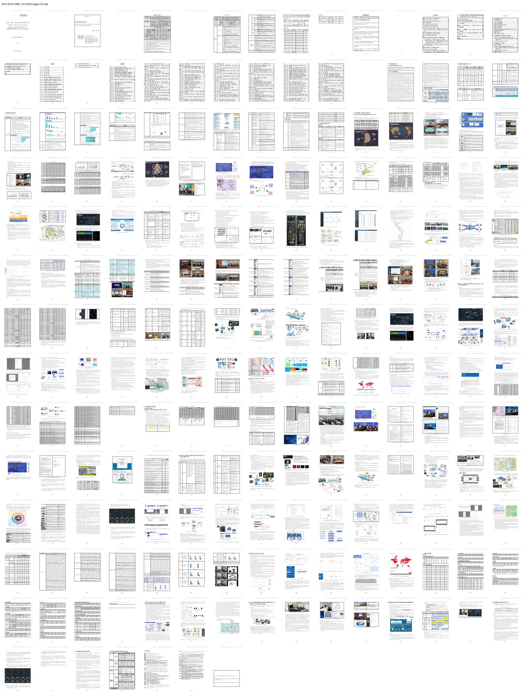
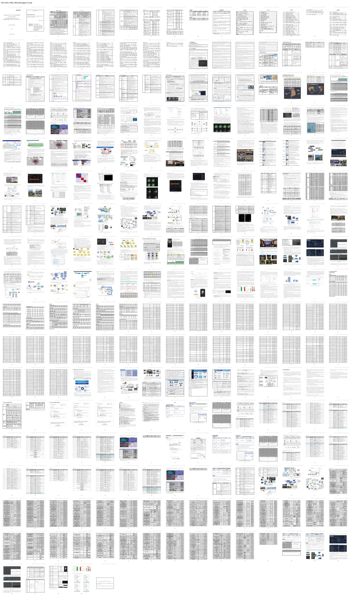
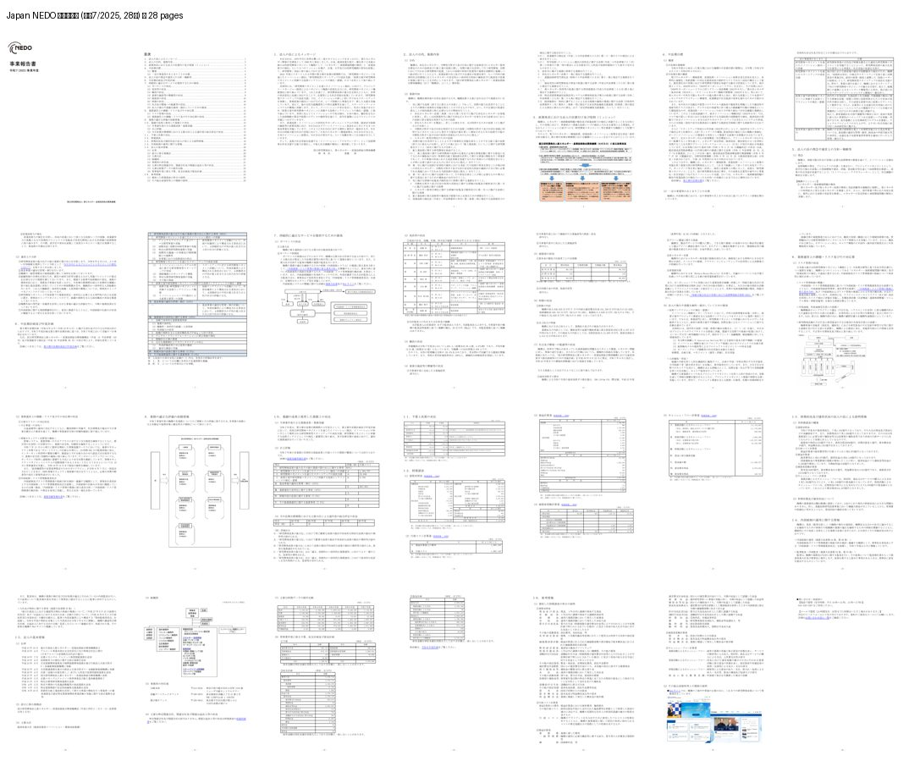
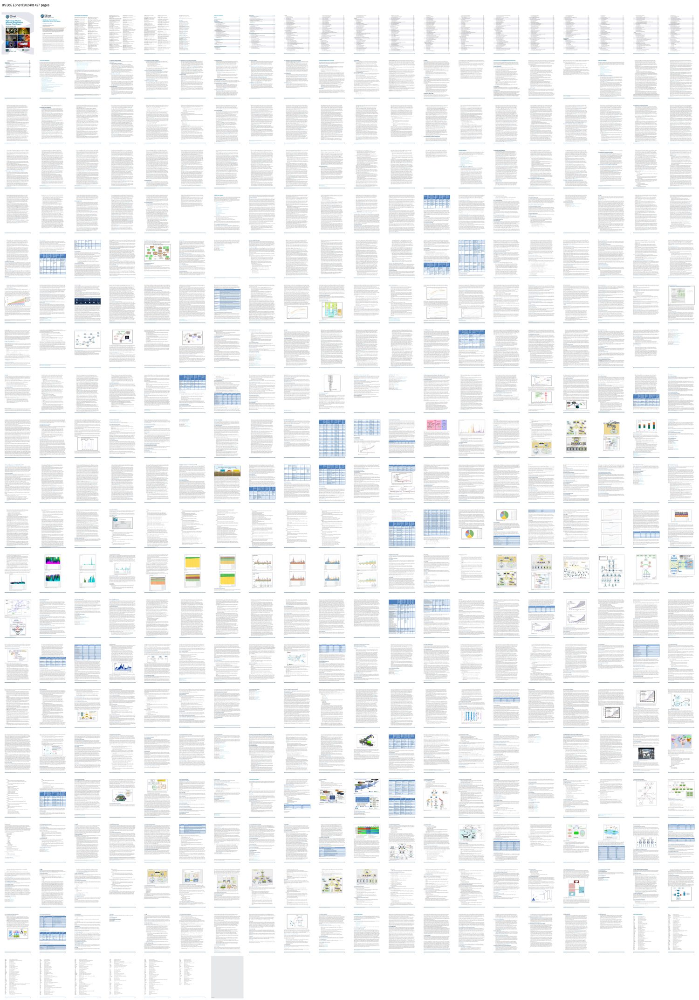

# 국가별 R&D 보고서 버드뷰

- 작성일: 2026.11.
- 작성자: 장민석 (msjang@kisti.re.kr)

> [!NOTE]
> 각국의 실제 공개 R&D 보고서를 전 쪽 썸네일 격자로 깔아, 보고서 전체가 표인지 서술인지 한 화면에서 비교합니다. 나라마다 공개되는 보고서의 종류가 조금씩 달라(각 캡션에 명시) 1:1 대조는 아니지만, 판형의 경향은 또렷이 드러납니다. 썸네일은 [`tools/birdview.py`](tools/birdview.py)로 누구나 다시 만들 수 있습니다.

## 한국 — KISTI 연차보고서

연차보고서(단계·최종). 앞머리(초록·요약문·SUMMARY·목차)가 테두리 친 표와 박스이고, 본문은 표·도표·스크린샷이 빼곡합니다. 순수 서술만 있는 쪽이 드뭅니다.

**2024 (202쪽)**

**2025 (260쪽)** — 패턴은 같고 분량이 29% 늘었는데, 늘어난 부분이 대부분 **뒤쪽 3분의 1을 차지하는 "표의 벽"**(정량적 연구개발성과·부록)입니다. 쪽이 바뀌어도 눈금만 이어집니다.

## 일본 — NEDO 사업보고서

[NEDO 事業報告書](sources/japan/nedo-report_2026-11-26.txt.md)(令和7/2025 사업연도, 28쪽). 목차는 박스 없이 평범하고, 본문은 대부분 서술이며 수지·지표 데이터표가 간간이 섞입니다. 한국식 "표의 벽"이나 박스로 감싼 목차는 없습니다. 분량도 28쪽으로, 한국 연차보고서(200~260쪽)와 크게 다릅니다.

> [!NOTE]
> 처음에는 NEDO 종료시 평가보고서(86쪽)를 썼으나, 본문 가운데 22~65쪽이 공개용 PPT 슬라이드(한 장씩 손으로 만든 발표자료)라 "문서" 비교에 섞기 부적절했습니다. 그래서 순수 문서형 사업보고서로 바꿨습니다. (버드뷰 도구도 가로 슬라이드가 섞여도 제 비율대로 보이게 고쳤습니다.)

## 미국 — DoE ESnet 보고서

[ESnet HEP Network Requirements Review](sources/usa/esnet-hep-rr-toc_2026-11-26.md)(2024, 427쪽). 쪽수는 가장 많지만 거의 전부 회색 서술(흐르는 본문)이고, 표는 가끔 데이터를 담을 때만 파란 테두리로 나옵니다. 표의 벽도, 박스 목차도 없습니다.

## EU·중국 — 완료 보고서가 공개되지 않는다

EU와 중국은 완료된 과제 보고서의 공개 PDF를 구하지 못했습니다. 이 "공개 여부" 차이 자체가 관찰점입니다.

- **EU**: 완료된 정기·최종 보고서는 Funding & Tenders Portal 안에만 있고 일반에 공개되지 않습니다. 공개되는 얼굴은 CORDIS의 "Results in Brief"라는 **짧은 일반인용 서술 요약**이지, 수백 쪽 표 보고서가 아닙니다. 보고서 자체를 버드뷰할 대상이 없는 셈입니다.
- **중국**: 국가 과기보고는 ISTIC의 国家科技报告服务系统(NSTRS)에서 공개되지만 전문 열람·다운로드에 등록이 필요해, 공개 PDF를 바로 받지 못했습니다. [辑要页 메타데이터](findings-abstract.md)는 공개됩니다.

한국·미국은 완료 보고서 전문이 공개 DB(ScienceON·es.net)에서 바로 내려받히는데, EU·중국은 그렇지 않다는 점도 체계의 차이입니다.

## 한 줄 결론

버드뷰를 나란히 놓으면 판형의 경향이 설명 없이 드러납니다.

- **한국**: 앞머리 박스 + 본문 표밭 + (2025엔) 뒤쪽 표의 벽 — 표가 거의 모든 것을 담습니다
- **미국**: 서술의 바다에 데이터 표가 점점이
- **일본**: 28쪽짜리 서술 위주 문서, 표는 수지·지표 데이터표로만

표를 데이터일 때만 쓰는가, 거의 모든 것에 쓰는가 — 썸네일 격자의 패턴만으로 갈립니다. 자세한 분석은 [표 사용](findings-tables.md)에 있습니다.
