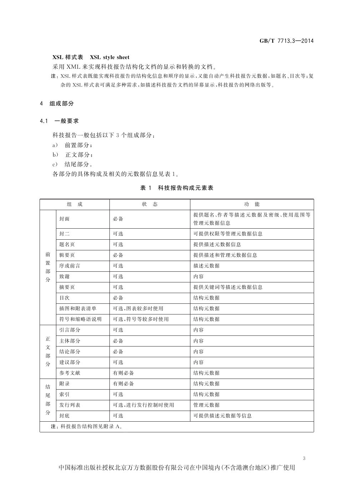
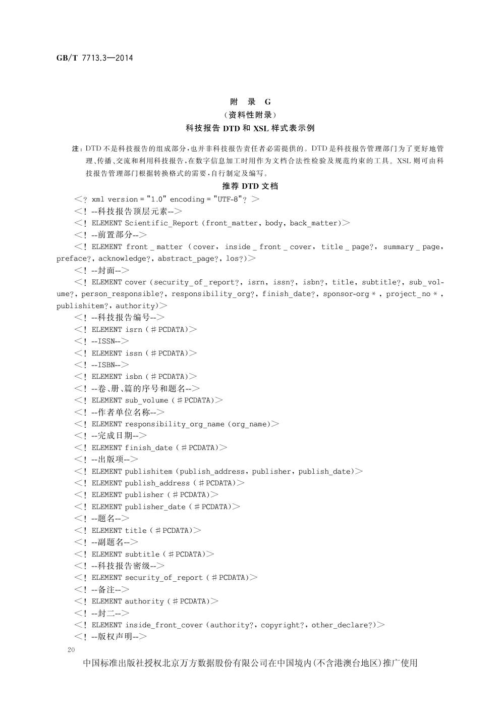
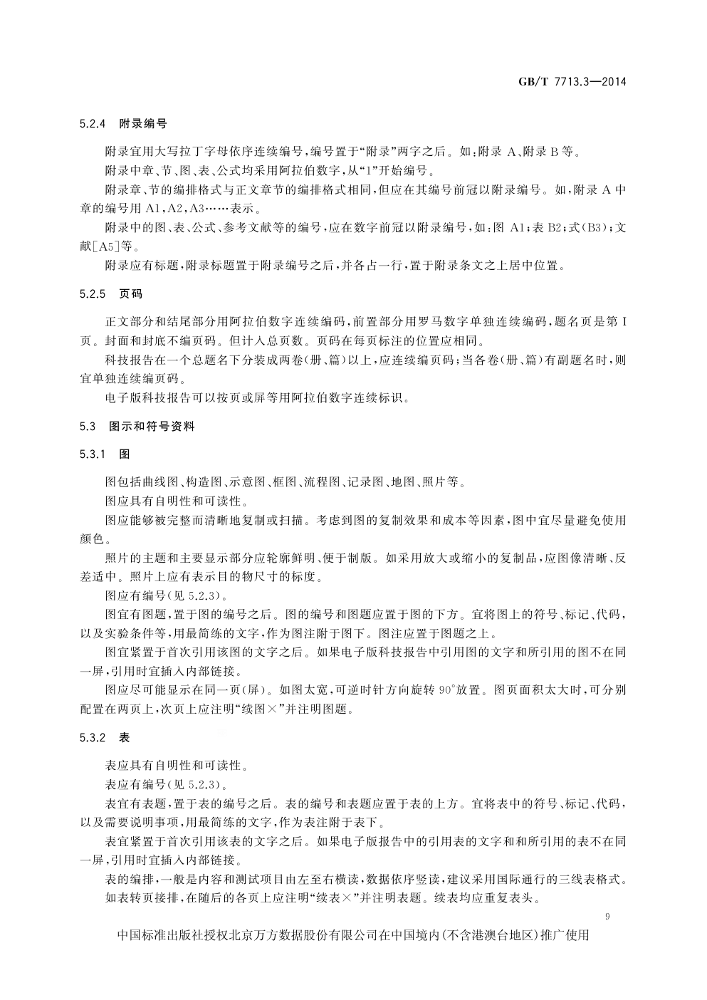

# 중국 GB/T 7713.3 — 10년 전에 표준화된 기계가독 보고서

- 작성일: 2026.11.
- 작성자: 장민석 (msjang@kisti.re.kr)

> [!NOTE]
> 이 조사가 주장하는 것(보고서를 구조화 데이터로 다루고, 메타데이터를 붙이고, 내용과 판형을 분리하고, 표는 데이터일 때만 깔끔하게)을 중국은 **2014년 국가표준 [GB/T 7713.3](sources/china/gbt-7713-3-2014_2026-11-26.txt.md)**에 이미 담아 두었습니다. 과기보고 작성규칙이라는 이름의, 사실상 "기계가독 보고서 설계 표준"입니다.

## 보고서를 메타데이터로 본다

GB/T 7713.3은 보고서의 각 구성요소를 **상태(필수/선택)와 기능(어떤 메타데이터를 제공하는가)**으로 규정합니다. 메타데이터를 "검색·관리·사용·보존을 위한 구조화 데이터"로 정의하고, 네 가지를 필수로 둡니다.

- **서술 메타데이터**(描述) — 책임자·제목·키워드
- **구조 메타데이터**(结构) — 그림·표, 목차 목록
- **관리·이용 메타데이터**(管理) — 소프트웨어 종류·버전·사용 허가·이용 권한
- **보존 메타데이터**(保存) — 載體 형식, 보존 판식, 이관·변환 포맷



위 표 1이 그 매핑입니다. 표지=서술·관리 메타데이터, 辑要页(필수)=서술·관리 메타데이터, 목차=구조 메타데이터 하는 식입니다. 그리고 이 표 자체가 **표를 어떻게 써야 하는지의 모범**입니다. 구성·상태·기능 3열에 세로 병합 없이, 딱 필요한 만큼만. 한국 보고서의 병합·중첩 양식형 표와 정반대입니다.

## 내용은 XML로, 판형은 XSL로 — 2014년에

가장 놀라운 부분은 부록 G입니다. 표준이 과기보고용 **DTD(XML 스키마)**와 **XSL 양식표**를 직접 제시합니다.



```xml
<?xml version="1.0" encoding="UTF-8"?>
<!-- 科技报告顶层元素 -->
<!ELEMENT Scientific_Report (front_matter, body, back_matter)>
<!ELEMENT front_matter (cover, inside_front_cover, title_page?, summary_page, ...)>
<!ELEMENT cover (security_of_report?, isrn, issn?, title, subtitle, ...,
                 finish_date?, sponsor-org*, project_no*, ..., authority)>
<!ELEMENT title (#PCDATA)>
<!ELEMENT finish_date (#PCDATA)>
```

표준의 설명은 이렇습니다. **DTD**는 관리기관이 "디지털 정보 가공 시 문서의 적법성 검증과 규범 제약 도구"로 쓰고, **XSL**은 "구조화 문서의 표시와 변환"을 맡으며 **제목·목차 같은 메타데이터를 자동으로 생성**하고 화면 표시·네트워크 출판까지 처리합니다.

이것은 정확히 이 조사가 제안하는 구조입니다. 보고서의 내용을 `<title>`·`<project_no>`·`<finish_date>`처럼 **구조화해 한 번 쓰고**, 목차·번호·판형은 **출력 단계(XSL)에서 자동으로 생성**합니다. 사람이 종이 판형에 데이터를 박아 넣는 대신, 데이터는 구조로 두고 판형은 변환으로 얻습니다.

## 편집 규칙이 곧 기계가독·가독 규칙

제5장 편집 규칙에는 [미국 DoE 보고서 분석](findings-usa-doe.md)에서 뽑은 시사점과 같은 원칙이 이미 명문화돼 있습니다.



- **표는 3선표(三线表)로.** "데이터 표는 국제 통용 3선표 형식을 권장한다"고 적습니다. 3선표는 위·아래·머리글 아래 세 줄만 긋고 **세로 괘선과 병합이 없는** 가장 기계가독적인 표 형식입니다. 한국 보고서의 병합·중첩 양식형 표와 정반대입니다
- **문서 내 링크.** "전자판에서 인용한 그림·표가 같은 화면에 없으면 내부 링크를 삽입한다"고 규정합니다. [DoE 시사점 5](findings-usa-doe.md)(문서 내 링크)와 같습니다
- **십진 번호·왼쪽 정렬.** 제목 단계를 `5.2.4`·`5.3.1`처럼 일관된 십진 번호로, 왼쪽 정렬로 씁니다. [DoE 시사점 3](findings-usa-doe.md)(번호·정렬 일관성)과 같습니다
- **그림은 색을 지양**(복제 품질), **그림·표는 자명성·가독성**을 갖추도록 규정합니다

## 함의 — 한국에 없는 것

중국이 2014년에 표준으로 정한 것을 한국은 아직 갖고 있지 않습니다. 한국 연구보고서에는 보고서를 구조화 데이터로 다루는 작성 표준도, 辑要页 같은 필수 메타데이터 페이지도, 3선표 권장도, XML·XSL 분리도 없습니다. 대신 [초록은 창의적 병합표](findings-abstract.md)이고, [서술 챕터조차 양식·구획 표가 20% 안팎](findings-tables.md)입니다.

이 조사의 정책적 함의는 분명합니다. 한국도 보고서를 "종이 판형"이 아니라 "구조화 데이터 + 메타데이터"로 다루는 작성 표준을 세우고, 내용(구조화 소스)과 출력(판형·목차·번호)을 분리하면 됩니다. 새로 발명할 것도 아닙니다. GB/T 7713.3이 10년 전에 이미 길을 보여 주었습니다.

## 자료

- [GB/T 7713.3-2014 전문(보존)](sources/china/gbt-7713-3-2014_2026-11-26.txt.md) · [원문 PDF](sources/china/gbt-7713-3-2014_2026-11-26.pdf)
- 보존 쪽 이미지: [표 1 구성요소](sources/china/gbt-7713-3-table1_2026-11-26.png) · [부록 G DTD/XSL](sources/china/gbt-7713-3-dtd_2026-11-26.png) · [제5장 편집규칙](sources/china/gbt-7713-3-section5_2026-11-26.png)
