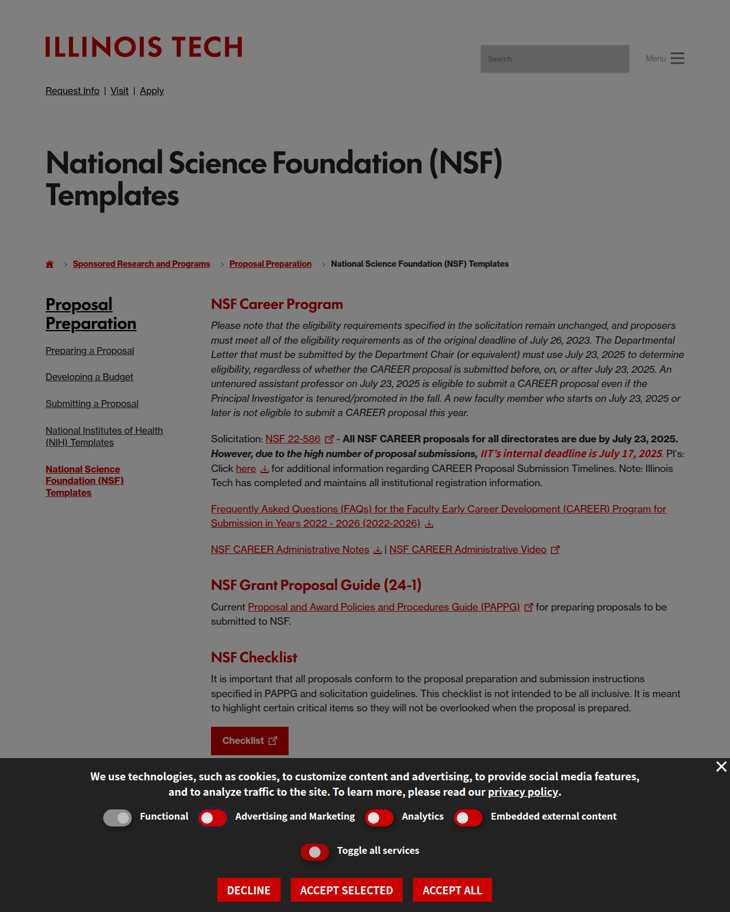
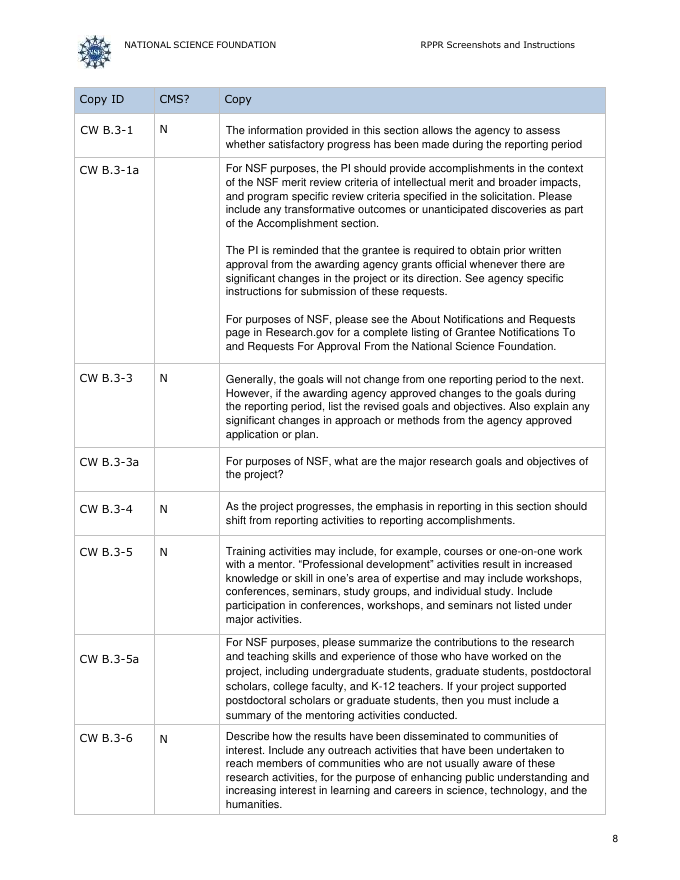
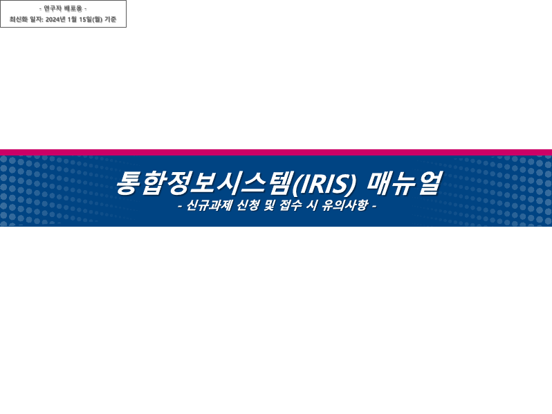

# 연구지원 안내 — 대학은 과제 과정을 어떻게 돕나

- 작성일: 2026.11.
- 작성자: 장민석 (msjang@kisti.re.kr)

> [!NOTE]
> 연구자가 과제를 따고(제안), 데이터·장비를 등록하고, 보고서를 내는 전 과정을, 각국 대학의 연구지원부서(Office of Sponsored Programs · 研究支援 · 산학협력단)가 지원기관별 **템플릿과 절차 안내**로 돕습니다. 이 페이지는 그런 안내 사이트를 나라별로 모아, 실제 작성·제출이 어떻게 안내되는지 보여줍니다.

## 전형 — 미국 대학 연구지원처

주신 예시인 [일리노이공대(IIT) 연구지원처(OSRP)의 NSF 템플릿 페이지](https://www.iit.edu/osrp/proposal-preparation/national-science-foundation-nsf-templates)가 전형입니다. "제안 준비 → 예산 작성 → 제출 → NIH/NSF 템플릿" 순으로 메뉴가 서고, NSF PAPPG(제안 정책·절차 가이드)·체크리스트·양식을 funder 기준 그대로 연결합니다.

지원기관(NSF·NIH)이 제안서 구조·보고 양식·제출 시스템을 정해 두니, 대학 안내는 그 구조를 가리키기만 하면 됩니다. 연구자는 "어느 템플릿을 어디에 내는가"를 한 페이지에서 알 수 있습니다.

## 국가별 연구지원 안내 사이트

| 나라 | 지원기관 | 대학·기관 연구지원 안내 (예) | 무엇을 안내 |
| --- | --- | --- | --- |
| 미국 | NSF·NIH | [IIT OSRP](https://www.iit.edu/osrp/proposal-preparation/national-science-foundation-nsf-templates) · [UCLA ORA(NIH RPPR)](https://medschool.ucla.edu/) | 제안 템플릿·예산·제출·진도보고(RPPR) |
| 일본 | 科研費(JSPS) | [JSPS 전자신청 操作手引](https://www-shinsei.jsps.go.jp/kaken/kakenhi_taiken/taiken_free/) · [法政大 科研費 매뉴얼](https://www.hosei.ac.jp/) | 응모~교부~실적보고 연간 흐름 |
| 중국 | 과기보고 | [东南大学 科技处](https://kjc.seu.edu.cn/) · [清华대 GB/T 7713.3](https://lib.tsinghua.edu.cn/wj/GBT7713_3-2014.pdf) | 과기보고 작성규칙·공개유예 |
| EU | Horizon Europe | [Heidelberg 정기보고 템플릿](https://backend.uni-heidelberg.de/de/dokumente/horizon-europe-periodic-report-template/download) · 대학 EU office | Part A/B 작성·제출 |
| 영국 | UKRI·NIHR | [Cambridge Research Services](https://www.research-services.admin.cam.ac.uk/manage-project/share-your-research/research-outcomes-and-researchfish) · [Warwick RIS](https://warwick.ac.uk/services/ris/systems/researchfish/) | Researchfish 성과보고 |
| 한국 | 국가R&D | [동서대 산학협력단](https://uni.dongseo.ac.kr/sanhak/?pCode=rndinfo) · [연세대 연구처](https://yis.yonsei.ac.kr/) | 과제 절차·장비 등록·NTIS 제출 |

(각 링크는 대표 예시이며, 기관마다 안내 페이지가 따로 있습니다. 원문 사이트는 개편이 잦아 접속이 안 될 수 있습니다.)

## 지원기관이 만든 단계별 가이드

대학 안내의 바탕에는 지원기관이 직접 만든 단계별(스크린샷) 가이드가 있습니다. 이걸 보면 완성도와 성격이 갈립니다.

**미국 NSF** — [Research.gov RPPR Screenshots and Instructions](https://resources.research.gov/common/attachment/Desktop/NSF_RGov_RPPR_ScreenshotsandInstructions.pdf)(35쪽)는 화면 캡처뿐 아니라 **각 입력 필드의 안내 문구(Copy Deck)**까지 지원기관이 관리합니다. 보고는 "시스템 필드를 안내대로 채우는 것"이고, 그 안내가 시스템 안에 들어 있습니다.

**일본 JSPS** — 科研費電子申請システム의 연구자용·기관용 操作手引이 응모부터 실적보고까지 조작을 단계로 설명합니다.

**한국** — 있습니다. 다만 성격이 다릅니다. IRIS 매뉴얼(연구자 배포용)을 **전문기관마다 따로** 만듭니다(예: 한국콘텐츠진흥원의 "IRIS 신규과제 신청 및 접수 시 유의사항", 2024).

그런데 이 매뉴얼들은 (1) 전문기관(KOCCA·KISTEP·IITP·한국연구재단 등)마다 흩어져 있고, (2) 대부분 신청·접수 중심이며, (3) 실적·보고 단계의 공개된 "따라하기" 단일 문서는 찾기 어렵고, (4) 안내가 설명하는 것은 대체로 **한글(HWPX) 보고서를 어느 화면에서 첨부해 올리나**이지 보고서 작성 자체가 아닙니다.

핵심 차이는 이렇습니다. NSF의 가이드는 "**시스템의 필드를 이렇게 채워라**"입니다 — 필드 안내가 시스템 안에 있습니다. 한국의 가이드는 "**한글로 쓴 보고서를 이 화면에서 첨부해 올려라**"입니다 — 시스템은 문서를 넣는 통로입니다. 앞서 본 [워크플로](report.md)(웹폼·엑셀·HWPX 삼중 입력)가 안내 문서의 성격에도 그대로 드러납니다.

## 읽히는 차이

대학 안내는 결국 "**지원기관이 정한 서식을 어떻게 채우고 어디에 내는가**"를 설명합니다. 그래서 안내의 모양은 지원기관이 정한 구조를 그대로 비춥니다.

- **미국·일본·중국**은 지원기관이 구조를 정해 둡니다 — 미국은 템플릿과 award DB·RPPR 필드, 일본은 전자신청 필드와 Word 서식, 중국은 [GB/T 7713.3 작성규칙](findings-gbt.md). 그래서 대학 안내도 "이 템플릿을 이 시스템에 낸다"로 깔끔합니다.
- **한국**은 서식이 지원기관 공고와 NTIS에 흩어져 있고 보고서가 [비구조화](findings-tables.md)입니다. 그래서 대학 산학협력단 안내도 "한글 서식을 받아 채워 PDF로 올리고, 장비는 NTIS에 따로 등록하라"에 머뭅니다. 연구자가 [같은 정보를 여러 번](report.md) 만드는 [워크플로](report.md)가 대학 안내 문서에도 그대로 드러납니다.

같은 "연구지원 안내"라도, 지원기관이 구조를 정해 둔 나라에서는 안내가 한 장으로 끝나고, 그렇지 않은 나라에서는 안내가 흩어진 서식과 시스템을 이어 붙이는 설명이 됩니다.
