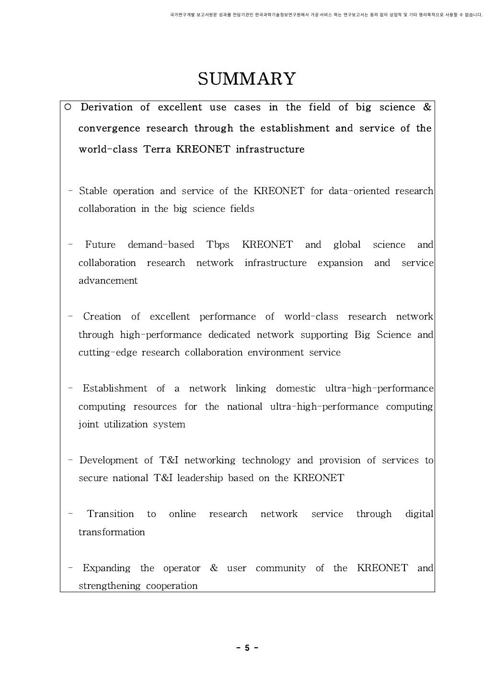
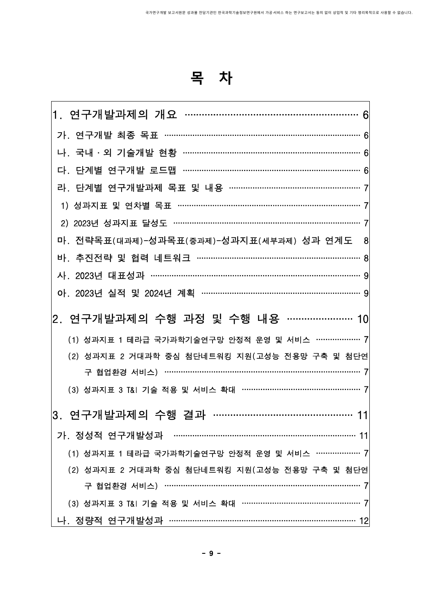
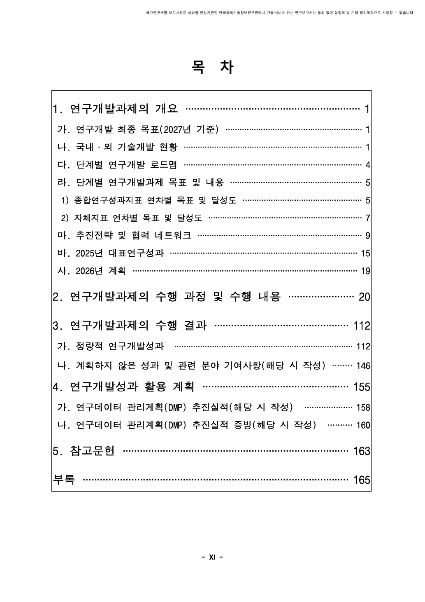
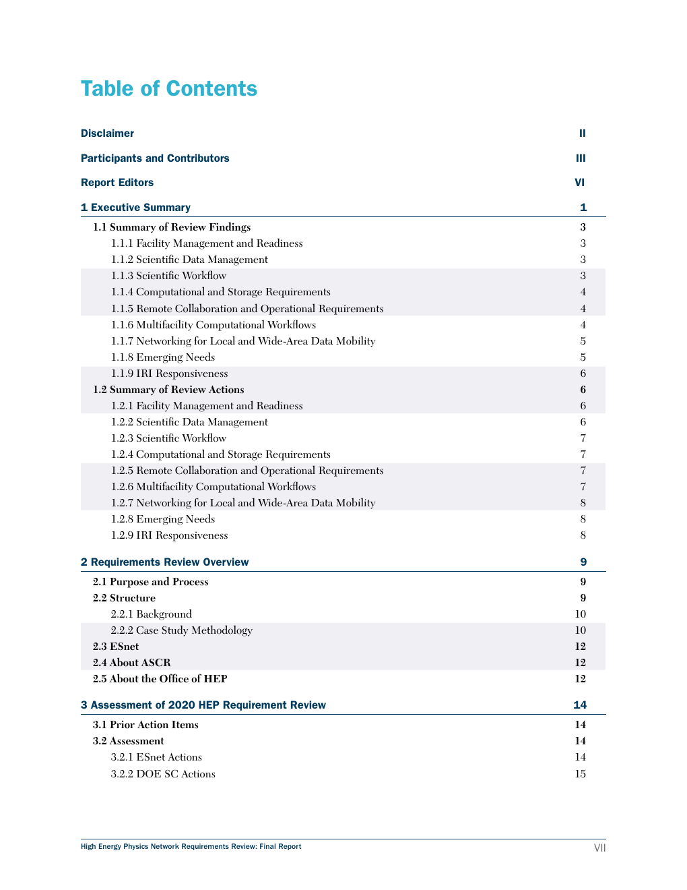

# 표 사용 — 한국은 왜 거의 모든 것을 표로 만드는가

- 작성일: 2026.11.
- 작성자: 장민석 (msjang@kisti.re.kr)

> [!NOTE]
> [비교 리포트](report.md)가 성과 표를, [초록·요약문](findings-abstract.md)이 보고서 앞머리를 봤다면, 이 문서는 한 가지에 집중합니다. 한국 보고서는 표를 **데이터를 담을 때만이 아니라 거의 모든 곳에** 씁니다. 그 쓰임을 유형별로 모아 해외와 비교합니다.

## 한국 보고서의 표 — 규모와 유형

기준으로 삼은 KISTI 연차보고서는 약 200쪽에 **표 24개, 그림 149개**가 있고, 앞부분 20쪽 가까이가 표입니다. 표는 네 가지 방식으로 쓰입니다. 뒤의 셋은 표가 데이터를 담는 그릇이 아니라 판형을 짜는 수단입니다.

### 1. 양식형 표 — 칸 이름이 미리 박힌 표

[사업화 계획 및 무역 수지 개선 효과](report.md), [정량적 연구개발성과](findings-usa-doe.md) 표가 여기 해당합니다. 칸이 좁아 논문 제목이 글자 단위로 끊기고, 해당 사항이 없어도 빈 표가 그대로 실립니다.

### 2. 복합·중첩 표 — 표 안에 표, 수식이 박힌 칸

[연차보고서 초록](findings-abstract.md)이 대표적입니다. 식별정보·참여기관·연구개발비 현황을 한 표에 넣는데, 연구개발비 칸은 정부출연금(A)·현금(B)·현물(C)·소계(D=B+C)·합계(G=A+D+E)처럼 **수식이 박힌 회계 표가 표 안에 중첩**되어 있습니다.

### 3. 구획 기반 표 — 본문과 목차를 표 테두리로 감쌈

가장 눈에 띄는 쓰임입니다. 보고서의 영문 SUMMARY와 목차가 **단일 셀 표 테두리 안에** 들어가 있습니다. 담긴 것은 데이터가 아니라 서술과 목차입니다.

### 4. 강조용 표 — 한 문장·목록을 표로 둘러 강조

본문에서 한 문장이나 한 목록을 강조하려고 1×1 셀 표로 둘러싸는 쓰임입니다. 표가 강조 도구로 쓰입니다.

### 1년 뒤에도 줄지 않았다 (2025년 보고서)

[2025년 보고서](findings-abstract.md)에서 초록 양식이 일부 바뀌었지만, 표로 감싸는 쓰임은 줄지 않았습니다. 2025년 보고서에서도 **영문 SUMMARY와 목차는 여전히 표 테두리 안에** 있습니다.

목차 자체도 달라지지 않은 점이 있습니다.

- **여전히 1쪽**입니다. 1~5장과 부록 전체가 한 쪽에 들어가고, 항목은 대부분 양식 칸 이름(개요·수행 과정·수행 결과·활용 계획·참고문헌)이라 목차만 보고는 이 과제가 무엇을 했는지 알기 어렵습니다
- 오히려 **앙상해졌습니다**. 2024년 목차에 있던 "전략목표(대과제)-**성과목표**(중과제)-성과지표(세부과제) 성과 연계도" 항목이 2025년 목차에서는 사라졌습니다. 내용을 드러내던 줄이 하나 줄어든 셈입니다

표로 감싸는 방식도, 목차가 양식 칸 이름에 머무는 것도 1년 사이 그대로였습니다. 양식 개정이 판형을 손볼 뿐 구조를 바꾸지 않는다는 [초록에서 본 패턴](findings-abstract.md)이 목차에서도 똑같이 나타납니다.

## 왜 문제인가 — 표는 기계에게 "여기는 데이터"라는 신호다

표는 기계에게 "이것은 행과 열로 의미가 나뉜 tabular data"라는 신호입니다. 그런데 서술을, 목차를, 강조하려는 한 문장을 표로 감싸면, 기계는 **데이터가 아닌 것을 데이터로** 읽습니다. 셀 병합이 겹치고 표 안에 표가 들어가고 수식 칸이 섞이면, PDF·HWP에서 "이 칸이 무슨 데이터인가"를 되살리는 일이 사실상 불가능해집니다. 표를 많이 쓸수록 기계가 읽을 수 있는 구조는 오히려 줄어듭니다.

## 해외 — 표는 데이터일 때만

미국 DoE 산하 ESnet 보고서는 427쪽인데 앞부분에 표가 거의 없습니다. 수치를 나란히 보여야 할 때만 간단한 표를 씁니다. 목차는 표로 감싸지 않고 **색 밴드와 일관된 번호체계**로 구분합니다.

같은 자리에서 한국 보고서는 목차를 표로 감싸고(위 이미지 참조), 미국 보고서는 표 없이 색과 번호로 구분합니다. 나머지 나라도 마찬가지입니다. 일본·중국·미국·EU·영국은 성과를 필드나 레코드로 받고 본문은 서술로 쓰며, 표는 수치가 실제로 표일 때만 씁니다. 그래서 공개 DB가 데이터를 필드 단위로 렌더링할 수 있습니다.

## 비교 요약

| 국가 | 목차 | 요약·초록 | 본문 강조 | 표를 쓰는 곳 |
| --- | --- | --- | --- | --- |
| 한국 | **표 테두리로 감쌈** | 식별·예산·초록을 한 표에 | **1×1 표로 강조** | 거의 모든 곳 (양식·중첩·블록·강조) |
| 미국 (ESnet) | 색 밴드·번호체계 | 서술 | 제목 단계 | 수치 데이터만 |
| 일본 | KAKEN 필드 렌더 | 概要 웹 필드 | 서술 | 데이터·산업재산권 행 |
| 중국 | 표준 목차 | 辑要页 메타데이터 | 서술 | 데이터·경제효익 표 |
| EU | CORDIS 필드 렌더 | Results in Brief 서술 | 서술 | 데이터 |
| 영국 | GtR 레코드 목록 | GtR 초록 서술 | 서술 | 데이터 레코드 |

## 함의

한국 보고서에서 표는 데이터를 담는 그릇이라기보다 판형을 짜는 수단입니다. 요약도 목차도 강조도 표로 두르니, 기계가 "표는 데이터"라는 상식으로 읽으면 전부 오독합니다. 해외처럼 표를 수치 데이터에만 쓰면, 표가 곧 데이터가 되어 사람도 기계도 바로 읽을 수 있습니다. 서술은 서술로, 목차는 제목 구조로, 강조는 서식으로 두는 것이 [이 조사가 말하는 입력·출력 분리](index.md)의 가장 눈에 보이는 실천입니다.

## 자료

- KISTI 연차보고서 표 사례(보존): [영문 SUMMARY(표로 감쌈)](sources/korea/kisti-kreonet-summary-boxed_2026-11-26.png) · [목차(표로 감쌈)](sources/korea/kisti-kreonet-toc-boxed_2026-11-26.png) · [초록(중첩 표)](sources/korea/kisti-kreonet-abstract_2026-11-26.png) · [정량성과(양식 표)](sources/korea/kisti-kreonet-quant-table_2026-11-26.png)
- ESnet 보고서 목차·본문: [목차](sources/usa/esnet-hep-rr-toc_2026-11-26.png) · [본문](sources/usa/esnet-hep-rr-body_2026-11-26.png)
