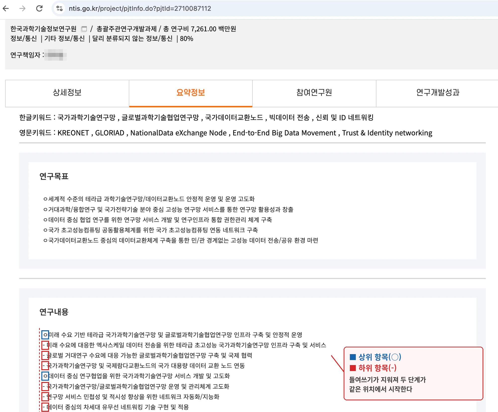
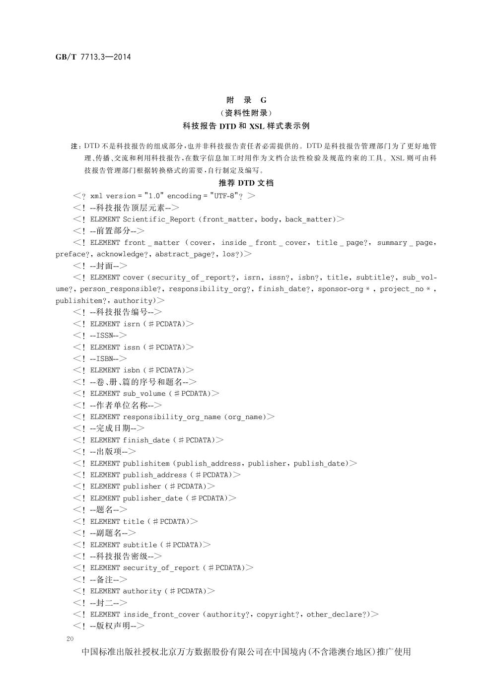

# 해외 R&D 보고 체계와 기계가독성 조사

**성과는 시스템 필드로, 보고서는 구조화된 서술로**

- 작성일: 2026.11.
- 작성자: 장민석 (msjang@kisti.re.kr)

> [!NOTE]
> "AI/Machine-Ready 보고서 양식" 과제 제안의 밑자료입니다. 이 쪽은 결론과 근거만 짧게 담은 핵심 리포트이고, 나라별 상세·측정 자료·원문 보존본은 [별첨](appendix.md)에 있습니다.

## 요약

1. 한국 연구보고서는 과제 메타데이터와 성과를 **종이 판형의 양식형 표**에 다시 입력하게 하고, 그 보고서를 다시 시스템에 복사해 붙입니다. 같은 정보가 여러 번 입력되고, 그 과정에서 구조가 사라집니다.
2. 일본·중국·미국·EU·영국은 같은 정보를 **시스템 필드로 한 번 받고**, 보고서와 공개 페이지는 그 필드에서 자동으로 만듭니다. 중국은 2014년 국가표준으로 보고서를 XML로 규정했고, 미국 NSF는 과제번호 하나를 웹 페이지이자 공개 API로 씁니다.
3. 2026년 11월 IRIS 개편으로 논문 성과 등록은 DOI 자동 완성으로 바뀌기 시작했고, 2027년에는 4대 과제관리 시스템이 통합됩니다. 남은 대상은 보고서 본체이며, 지금이 구조를 정할 시점입니다.

## 1. 문제: 정보를 종이 판형에 가둔다

한국 연구보고서의 "사업화 계획 및 무역 수지 개선 효과" 표는 사업화 기간·예산·매출 전망·시장점유율·수입대체·수출을 3단 병합 헤더 한 장에 담습니다. 사람에게도 읽기 어렵고, 기계는 이 표에서 어느 숫자가 어느 연도의 무엇인지 복원하지 못합니다.


측정해 보면 이런 표는 예외가 아닙니다. 출연연 중 하나인 KISTI의 연차보고서(2024년 202쪽, 2025년 260쪽)를 쪽마다 재어, 표 영역을 기계 가독성에 따라 네 단계로 색칠하고 챕터별 비율을 냈습니다. 측정 방법과 국가별 비교는 [별첨 E](appendix-e-tables.md)에 있습니다.

<p style="font-size:13.5px;line-height:1.9"><b>기계 가독성 · 사용 권장도</b> (왼쪽일수록 좋음)<br>
<span style="color:#2f9e44">■</span> <b>데이터표</b>: 기계 가독 높음, <b>사용 권장</b> (조밀한 다열 격자, 엑셀 처리 가능)<br>
<span style="color:#f1b70a">■</span> <b>콜아웃·강조 박스</b>: 가독 높음 (글 한 덩어리). HWP 글상자로 넣으면 표가 아니게 되어 교체<br>
<span style="color:#ec7014">■</span> <b>구획</b>: 차라리 나음 (큰 박스지만 안은 글이라 추출 가능, 글상자로 교체 가능)<br>
<span style="color:#d62828">■</span> <b>양식형 표</b>: <b>가장 지양</b> (셀 병합·수식으로 데이터가 갇혀, 데이터처럼 보이나 파싱하면 틀린 값)<br>
<span style="color:#9aa0a6">■</span> 표 아님(서술·그림)</p>

<style>
.tcat td{vertical-align:top;font-size:13.5px}
.tcat td:first-child{text-align:left;white-space:nowrap}
.tcat thead th{text-align:center}
</style>

<table class="tcat"><thead><tr><th>챕터</th><th>2024</th><th>2025</th></tr></thead><tbody>
<tr><td style="text-align:left">1. 개요</td><td><div style="display:flex;border-radius:3px;overflow:hidden"><div style="width:21.2%;background:#2f9e44;height:17px"></div><div style="width:7.7%;background:#ec7014;height:17px"></div><div style="width:32.6%;background:#d62828;height:17px"></div><div style="width:38.5%;background:#eef0f2;height:17px"></div></div><div style="font-size:12px;color:#5b6068;margin-top:2px">전체 62% · 🟢21 🟡0 🟠8 🔴33 (14쪽)</div></td><td><div style="display:flex;border-radius:3px;overflow:hidden"><div style="width:8.4%;background:#2f9e44;height:17px"></div><div style="width:21.4%;background:#ec7014;height:17px"></div><div style="width:39.4%;background:#d62828;height:17px"></div><div style="width:30.8%;background:#eef0f2;height:17px"></div></div><div style="font-size:12px;color:#5b6068;margin-top:2px">전체 69% · 🟢8 🟡0 🟠21 🔴39 (19쪽)</div></td></tr>
<tr><td style="text-align:left">2. 수행 과정·내용</td><td><div style="display:flex;border-radius:3px;overflow:hidden"><div style="width:13.9%;background:#2f9e44;height:17px"></div><div style="width:0.6%;background:#f1b70a;height:17px"></div><div style="width:1.3%;background:#ec7014;height:17px"></div><div style="width:15.3%;background:#d62828;height:17px"></div><div style="width:68.9%;background:#eef0f2;height:17px"></div></div><div style="font-size:12px;color:#5b6068;margin-top:2px">전체 31% · 🟢14 🟡1 🟠1 🔴15 (84쪽)</div></td><td><div style="display:flex;border-radius:3px;overflow:hidden"><div style="width:14.6%;background:#2f9e44;height:17px"></div><div style="width:1.1%;background:#f1b70a;height:17px"></div><div style="width:9.6%;background:#d62828;height:17px"></div><div style="width:74.7%;background:#eef0f2;height:17px"></div></div><div style="font-size:12px;color:#5b6068;margin-top:2px">전체 25% · 🟢15 🟡1 🟠0 🔴10 (92쪽)</div></td></tr>
<tr><td style="text-align:left">3. 정성적 성과</td><td><div style="display:flex;border-radius:3px;overflow:hidden"><div style="width:6.1%;background:#2f9e44;height:17px"></div><div style="width:0.7%;background:#f1b70a;height:17px"></div><div style="width:2.3%;background:#ec7014;height:17px"></div><div style="width:19.5%;background:#d62828;height:17px"></div><div style="width:71.3%;background:#eef0f2;height:17px"></div></div><div style="font-size:12px;color:#5b6068;margin-top:2px">전체 29% · 🟢6 🟡1 🟠2 🔴20 (53쪽)</div></td><td><span style="color:#9aa0a6">—</span></td></tr>
<tr><td style="text-align:left">3. 정량적 성과*</td><td><div style="display:flex;border-radius:3px;overflow:hidden"><div style="width:10.8%;background:#2f9e44;height:17px"></div><div style="width:3.3%;background:#f1b70a;height:17px"></div><div style="width:2.4%;background:#d62828;height:17px"></div><div style="width:83.5%;background:#eef0f2;height:17px"></div></div><div style="font-size:12px;color:#5b6068;margin-top:2px">전체 16% · 🟢11 🟡3 🟠0 🔴2 (7쪽)</div></td><td><div style="display:flex;border-radius:3px;overflow:hidden"><div style="width:67.5%;background:#2f9e44;height:17px"></div><div style="width:0.7%;background:#f1b70a;height:17px"></div><div style="width:1.8%;background:#d62828;height:17px"></div><div style="width:30.0%;background:#eef0f2;height:17px"></div></div><div style="font-size:12px;color:#5b6068;margin-top:2px">전체 70% · 🟢68 🟡1 🟠0 🔴2 (34쪽)</div></td></tr>
<tr><td style="text-align:left">3. 계획외·기여</td><td><div style="display:flex;border-radius:3px;overflow:hidden"><div style="width:2.6%;background:#2f9e44;height:17px"></div><div style="width:15.6%;background:#d62828;height:17px"></div><div style="width:81.8%;background:#eef0f2;height:17px"></div></div><div style="font-size:12px;color:#5b6068;margin-top:2px">전체 18% · 🟢3 🟡0 🟠0 🔴16 (10쪽)</div></td><td><div style="display:flex;border-radius:3px;overflow:hidden"><div style="width:9.1%;background:#2f9e44;height:17px"></div><div style="width:24.5%;background:#d62828;height:17px"></div><div style="width:66.4%;background:#eef0f2;height:17px"></div></div><div style="font-size:12px;color:#5b6068;margin-top:2px">전체 34% · 🟢9 🟡0 🟠0 🔴24 (9쪽)</div></td></tr>
<tr><td style="text-align:left">4. 활용 계획</td><td><div style="display:flex;border-radius:3px;overflow:hidden"><div style="width:38.1%;background:#2f9e44;height:17px"></div><div style="width:61.9%;background:#eef0f2;height:17px"></div></div><div style="font-size:12px;color:#5b6068;margin-top:2px">전체 38% · 🟢38 🟡0 🟠0 🔴0 (2쪽)</div></td><td><div style="display:flex;border-radius:3px;overflow:hidden"><div style="width:9.6%;background:#2f9e44;height:17px"></div><div style="width:3.0%;background:#d62828;height:17px"></div><div style="width:87.4%;background:#eef0f2;height:17px"></div></div><div style="font-size:12px;color:#5b6068;margin-top:2px">전체 13% · 🟢10 🟡0 🟠0 🔴3 (8쪽)</div></td></tr>
<tr><td style="text-align:left">부록*</td><td><span style="color:#9aa0a6">—</span></td><td><div style="display:flex;border-radius:3px;overflow:hidden"><div style="width:53.8%;background:#2f9e44;height:17px"></div><div style="width:0.5%;background:#f1b70a;height:17px"></div><div style="width:6.4%;background:#d62828;height:17px"></div><div style="width:39.3%;background:#eef0f2;height:17px"></div></div><div style="font-size:12px;color:#5b6068;margin-top:2px">전체 61% · 🟢54 🟡0 🟠0 🔴6 (73쪽)</div></td></tr>
<tr style="background:#f6f8fa;font-weight:700"><td style="text-align:left">서술 챕터 평균<br><span style="font-weight:400;font-size:12px;color:#5b6068">정량성과·부록 제외</span></td><td><div style="display:flex;border-radius:3px;overflow:hidden"><div style="width:11.6%;background:#2f9e44;height:17px"></div><div style="width:0.5%;background:#f1b70a;height:17px"></div><div style="width:2.1%;background:#ec7014;height:17px"></div><div style="width:18.0%;background:#d62828;height:17px"></div><div style="width:67.8%;background:#eef0f2;height:17px"></div></div><div style="font-size:12px;color:#5b6068;margin-top:2px">전체 32% · 🟢12 🟡1 🟠2 🔴18 (163쪽)</div></td><td><div style="display:flex;border-radius:3px;overflow:hidden"><div style="width:13.0%;background:#2f9e44;height:17px"></div><div style="width:0.8%;background:#f1b70a;height:17px"></div><div style="width:3.2%;background:#ec7014;height:17px"></div><div style="width:14.6%;background:#d62828;height:17px"></div><div style="width:68.4%;background:#eef0f2;height:17px"></div></div><div style="font-size:12px;color:#5b6068;margin-top:2px">전체 32% · 🟢13 🟡1 🟠3 🔴15 (128쪽)</div></td></tr>
</tbody></table>

- 가장 지양할 양식형 표(빨강)가 서술 챕터의 15~18%를 차지합니다(2024년 18%, 2025년 15%). 사업화 표, 초록, 개요의 목표 표가 여기에 해당합니다.
- 과제를 서술로 소개해야 할 "개요" 챕터는 양식형과 구획을 더한 비율이 1년 사이 41%에서 60%로 늘었습니다.
- 데이터표(초록)는 정량적 성과와 부록에 몰려 있습니다. 표가 본래 있어야 할 자리입니다.

같은 일을 하는 해외 기관과 견주면 차이가 분명합니다. 일본에서 연구망 SINET을 운영하는 국립정보학연구소(NII)의 연차보고서는 280쪽으로 분량이 비슷하지만, 양식형 표 점유율은 5.2%입니다. 연구업적 110쪽을 병합 표가 아닌 서지 목록으로 싣고, 표는 결산·명단 같은 실제 데이터에만 씁니다. 미국 ESnet은 연차보고서를 48쪽 홍보물로 내고 기술 내용은 서술 위주의 별도 보고서로 나눕니다([별첨 E](appendix-e-tables.md#한눈에-보기-같은-일을-하는-기관의-보고서-버드뷰)).

| 기관(연구망) | 보고서 | 쪽수 | 양식형 표 점유율 |
|---|---|---|---|
| KISTI (KREONET) | 연구망 운영 과제 연차보고서 2024·2025 | 202·260 | 14.6%·9.5% |
| NII (SINET) | 国立情報学研究所年報 2024 | 280 | 5.2% |
| ESnet | Annual Report 2024 / 요구사항 검토 보고서 | 48 / 427 | 표가 거의 없음 |

목록도 구조가 아닙니다. 보고서의 개조식 목록은 ○ 아래에 - 항목을 한 단계 들여 써서 위계를 나타냅니다. 그러나 ○와 -는 글자이고, 들여쓰기는 앞쪽 공백일 뿐입니다. "이 항목은 저 항목의 하위"라는 정보는 어디에도 저장되지 않습니다.

<div style="display:flex;flex-wrap:wrap;gap:10px;margin:10px 0"><div style="flex:1;min-width:260px;border:1px solid #d0d7de;border-radius:6px;padding:8px 12px"><div style="font-size:12px;color:#868e96;margin-bottom:4px">보고서(HWPX)에서 보이는 모양</div><div style="font-size:13px;line-height:1.7"><span style="color:#1864ab">○</span> 테라급 연구망 인프라 구축 및 안정적 운영<br>&nbsp;&nbsp;&nbsp;&nbsp;<span style="color:#b02a2a">-</span> 엑사스케일 데이터 전송용 인프라 구축<br>&nbsp;&nbsp;&nbsp;&nbsp;<span style="color:#b02a2a">-</span> 글로벌 협업연구망 구축 및 국제 협력<br><span style="color:#1864ab">○</span> 데이터 중심 연구협업 서비스 개발<br>&nbsp;&nbsp;&nbsp;&nbsp;<span style="color:#b02a2a">-</span> 연구망 운영·관리체계 고도화</div></div><div style="align-self:center;color:#adb5bd;font-size:13px">복사해<br>붙이면</div><div style="flex:1;min-width:260px;border:1px solid #f1aeb5;background:#fff5f5;border-radius:6px;padding:8px 12px"><div style="font-size:12px;color:#868e96;margin-bottom:4px">NTIS 요약정보에 남는 모양</div><div style="font-size:13px;line-height:1.7"><span style="color:#1864ab">○</span> 테라급 연구망 인프라 구축 및 안정적 운영<br><span style="color:#b02a2a">-</span> 엑사스케일 데이터 전송용 인프라 구축<br><span style="color:#b02a2a">-</span> 글로벌 협업연구망 구축 및 국제 협력<br><span style="color:#1864ab">○</span> 데이터 중심 연구협업 서비스 개발<br><span style="color:#b02a2a">-</span> 연구망 운영·관리체계 고도화</div></div></div>

실제 NTIS 화면이 그렇습니다. 웹 입력칸이 앞쪽 공백을 지우자 상위 항목(○, 파란 상자)과 하위 항목(-, 빨간 상자)이 같은 위치에서 시작합니다. 위계가 처음부터 공백으로만 표현돼 있었으니 옮기는 과정에서 남을 구조도 없었습니다. 목록을 "목록 안의 하위 목록"이라는 구조로 저장했다면 보고서와 웹 화면 어디서나 위계가 유지됩니다.



## 2. 해외: 필드로 받고, 보고서는 만든다

### 2.1 정보 유형별 보관 위치

정보 종류별로 각국이 그 정보를 어디에 두는지 표시했습니다. 한국은 관리 메타데이터와 성과를 보고서 표에 적고 시스템에도 다시 입력하지만(빨강), 해외는 대부분 시스템 필드(초록)에 두고 보고서에는 연구 내용 서술(노랑)만 남깁니다. 나라별 근거는 [별첨 A](appendix-a-countries.md)에 있습니다.

<style>
.whereinfo td{padding:5px 7px}
.whereinfo td:first-child{text-align:left}
</style>

<p style="font-size:13px"><b>어디에 있나</b> &nbsp;
<span style="background:#e6f4ea;color:#1e7a34;padding:2px 6px;border-radius:3px">시스템·DB 필드(구조화)</span> &nbsp;
<span style="background:#fdf4d6;color:#8a6d1a;padding:2px 6px;border-radius:3px">보고서 서술</span> &nbsp;
<span style="background:#fde4e4;color:#b02a2a;padding:2px 6px;border-radius:3px">보고서 표에 적고 시스템에도 다시 입력(이중 입력)</span> &nbsp;
<span style="background:#f1f3f5;color:#868e96;padding:2px 6px;border-radius:3px">없음·별도</span></p>

<table class="whereinfo"><thead><tr><th>정보</th><th>한국</th><th>일본</th><th>중국</th><th>미국</th><th>EU</th><th>영국</th></tr></thead><tbody>
<tr><td colspan="7" style="background:#eef1f4;font-weight:700;font-size:12.5px;text-align:left">① 관리·식별 메타데이터 — 시스템에 둘 것</td></tr>
<tr><td style="text-align:left;font-size:12.5px;white-space:nowrap">분류정보</td><td style="background:#fde4e4;color:#b02a2a;font-size:12px;text-align:center">요약문 표</td><td style="background:#e6f4ea;color:#1e7a34;font-size:12px;text-align:center">시스템</td><td style="background:#e6f4ea;color:#1e7a34;font-size:12px;text-align:center">辑要页</td><td style="background:#e6f4ea;color:#1e7a34;font-size:12px;text-align:center">award DB</td><td style="background:#e6f4ea;color:#1e7a34;font-size:12px;text-align:center">Portal</td><td style="background:#e6f4ea;color:#1e7a34;font-size:12px;text-align:center">레코드</td></tr>
<tr><td style="text-align:left;font-size:12.5px;white-space:nowrap">기간정보</td><td style="background:#fde4e4;color:#b02a2a;font-size:12px;text-align:center">초록 표</td><td style="background:#e6f4ea;color:#1e7a34;font-size:12px;text-align:center">KAKEN</td><td style="background:#e6f4ea;color:#1e7a34;font-size:12px;text-align:center">辑要页</td><td style="background:#e6f4ea;color:#1e7a34;font-size:12px;text-align:center">award DB</td><td style="background:#e6f4ea;color:#1e7a34;font-size:12px;text-align:center">Portal</td><td style="background:#e6f4ea;color:#1e7a34;font-size:12px;text-align:center">레코드</td></tr>
<tr><td style="text-align:left;font-size:12.5px;white-space:nowrap">예산·회계</td><td style="background:#fde4e4;color:#b02a2a;font-size:12px;text-align:center">초록 중첩표</td><td style="background:#e6f4ea;color:#1e7a34;font-size:12px;text-align:center">결산 화면</td><td style="background:#e6f4ea;color:#1e7a34;font-size:12px;text-align:center">辑要页</td><td style="background:#e6f4ea;color:#1e7a34;font-size:12px;text-align:center">award DB</td><td style="background:#e6f4ea;color:#1e7a34;font-size:12px;text-align:center">재무보고</td><td style="background:#e6f4ea;color:#1e7a34;font-size:12px;text-align:center">레코드</td></tr>
<tr><td style="text-align:left;font-size:12.5px;white-space:nowrap">참여인력</td><td style="background:#fde4e4;color:#b02a2a;font-size:12px;text-align:center">초록 표</td><td style="background:#e6f4ea;color:#1e7a34;font-size:12px;text-align:center">시스템</td><td style="background:#e6f4ea;color:#1e7a34;font-size:12px;text-align:center">辑要页</td><td style="background:#e6f4ea;color:#1e7a34;font-size:12px;text-align:center">award DB</td><td style="background:#e6f4ea;color:#1e7a34;font-size:12px;text-align:center">Portal</td><td style="background:#e6f4ea;color:#1e7a34;font-size:12px;text-align:center">레코드</td></tr>
<tr><td style="text-align:left;font-size:12.5px;white-space:nowrap">참여기관·기업</td><td style="background:#fde4e4;color:#b02a2a;font-size:12px;text-align:center">초록 표</td><td style="background:#e6f4ea;color:#1e7a34;font-size:12px;text-align:center">시스템</td><td style="background:#e6f4ea;color:#1e7a34;font-size:12px;text-align:center">辑要页</td><td style="background:#e6f4ea;color:#1e7a34;font-size:12px;text-align:center">award DB</td><td style="background:#e6f4ea;color:#1e7a34;font-size:12px;text-align:center">Portal</td><td style="background:#e6f4ea;color:#1e7a34;font-size:12px;text-align:center">레코드</td></tr>
<tr><td style="text-align:left;font-size:12.5px;white-space:nowrap">협력자(COA류)</td><td style="background:#f1f3f5;color:#868e96;font-size:12px;text-align:center">—</td><td style="background:#e6f4ea;color:#1e7a34;font-size:12px;text-align:center">시스템</td><td style="background:#f1f3f5;color:#868e96;font-size:12px;text-align:center">—</td><td style="background:#e6f4ea;color:#1e7a34;font-size:12px;text-align:center">COA 시트</td><td style="background:#e6f4ea;color:#1e7a34;font-size:12px;text-align:center">Portal</td><td style="background:#e6f4ea;color:#1e7a34;font-size:12px;text-align:center">레코드</td></tr>
<tr><td style="text-align:left;font-size:12.5px;white-space:nowrap">보안등급·공개</td><td style="background:#e6f4ea;color:#1e7a34;font-size:12px;text-align:center">시스템 분류</td><td style="background:#f1f3f5;color:#868e96;font-size:12px;text-align:center">—</td><td style="background:#e6f4ea;color:#1e7a34;font-size:12px;text-align:center">GB/T 30534</td><td style="background:#e6f4ea;color:#1e7a34;font-size:12px;text-align:center">시스템</td><td style="background:#e6f4ea;color:#1e7a34;font-size:12px;text-align:center">Portal</td><td style="background:#e6f4ea;color:#1e7a34;font-size:12px;text-align:center">레코드</td></tr>
<tr><td colspan="7" style="background:#eef1f4;font-weight:700;font-size:12.5px;text-align:left">② 성과 메타데이터 — 구조화할 것</td></tr>
<tr><td style="text-align:left;font-size:12.5px;white-space:nowrap">정량실적(논문·특허)</td><td style="background:#fde4e4;color:#b02a2a;font-size:12px;text-align:center">정량성과 표</td><td style="background:#e6f4ea;color:#1e7a34;font-size:12px;text-align:center">웹 필드 예/아니오</td><td style="background:#fdf4d6;color:#8a6d1a;font-size:12px;text-align:center">보고서 본문</td><td style="background:#e6f4ea;color:#1e7a34;font-size:12px;text-align:center">RPPR 필드</td><td style="background:#e6f4ea;color:#1e7a34;font-size:12px;text-align:center">Continuous Rep.</td><td style="background:#e6f4ea;color:#1e7a34;font-size:12px;text-align:center">Researchfish</td></tr>
<tr><td style="text-align:left;font-size:12.5px;white-space:nowrap">성과지표·연차 목표</td><td style="background:#fde4e4;color:#b02a2a;font-size:12px;text-align:center">성과지표 표</td><td style="background:#e6f4ea;color:#1e7a34;font-size:12px;text-align:center">KAKEN 진척도</td><td style="background:#fdf4d6;color:#8a6d1a;font-size:12px;text-align:center">서술</td><td style="background:#e6f4ea;color:#1e7a34;font-size:12px;text-align:center">마일스톤</td><td style="background:#e6f4ea;color:#1e7a34;font-size:12px;text-align:center">마일스톤</td><td style="background:#e6f4ea;color:#1e7a34;font-size:12px;text-align:center">레코드</td></tr>
<tr><td style="text-align:left;font-size:12.5px;white-space:nowrap">초록·요약</td><td style="background:#fde4e4;color:#b02a2a;font-size:12px;text-align:center">초록·요약문 표</td><td style="background:#e6f4ea;color:#1e7a34;font-size:12px;text-align:center">概要 필드</td><td style="background:#e6f4ea;color:#1e7a34;font-size:12px;text-align:center">辑要页</td><td style="background:#fdf4d6;color:#8a6d1a;font-size:12px;text-align:center">POR 서술</td><td style="background:#fdf4d6;color:#8a6d1a;font-size:12px;text-align:center">Results in Brief</td><td style="background:#fdf4d6;color:#8a6d1a;font-size:12px;text-align:center">GtR 초록</td></tr>
<tr><td colspan="7" style="background:#eef1f4;font-weight:700;font-size:12.5px;text-align:left">③ 서술 내용 — 보고서가 담을 것 (연구 내용이 핵심)</td></tr>
<tr><td style="text-align:left;font-size:12.5px;white-space:nowrap">연구 목표(최종·단계별)</td><td style="background:#fde4e4;color:#b02a2a;font-size:12px;text-align:center">요약문·개요 표</td><td style="background:#fdf4d6;color:#8a6d1a;font-size:12px;text-align:center">신청서 서술</td><td style="background:#fdf4d6;color:#8a6d1a;font-size:12px;text-align:center">서술</td><td style="background:#fdf4d6;color:#8a6d1a;font-size:12px;text-align:center">서술</td><td style="background:#fdf4d6;color:#8a6d1a;font-size:12px;text-align:center">Part B</td><td style="background:#f1f3f5;color:#868e96;font-size:12px;text-align:center">제안 단계</td></tr>
<tr><td style="text-align:left;font-size:12.5px;white-space:nowrap">국내외 기술 동향</td><td style="background:#fdf4d6;color:#8a6d1a;font-size:12px;text-align:center">개요 서술</td><td style="background:#fdf4d6;color:#8a6d1a;font-size:12px;text-align:center">서술</td><td style="background:#fdf4d6;color:#8a6d1a;font-size:12px;text-align:center">서술</td><td style="background:#fdf4d6;color:#8a6d1a;font-size:12px;text-align:center">서술</td><td style="background:#fdf4d6;color:#8a6d1a;font-size:12px;text-align:center">Part B</td><td style="background:#f1f3f5;color:#868e96;font-size:12px;text-align:center">별도(출판물)</td></tr>
<tr><td style="text-align:left;font-size:12.5px;white-space:nowrap"><b>연구 내용·방법</b></td><td style="background:#fdf4d6;color:#8a6d1a;font-size:12px;text-align:center">서술(+표 섞임)</td><td style="background:#fdf4d6;color:#8a6d1a;font-size:12px;text-align:center">성과보고 서술</td><td style="background:#fdf4d6;color:#8a6d1a;font-size:12px;text-align:center">본문</td><td style="background:#fdf4d6;color:#8a6d1a;font-size:12px;text-align:center">RPPR 서술</td><td style="background:#fdf4d6;color:#8a6d1a;font-size:12px;text-align:center">Part B 서술</td><td style="background:#fdf4d6;color:#8a6d1a;font-size:12px;text-align:center">key findings 필드</td></tr>
<tr><td style="text-align:left;font-size:12.5px;white-space:nowrap">기대효과</td><td style="background:#fde4e4;color:#b02a2a;font-size:12px;text-align:center">활용·요약 표</td><td style="background:#fdf4d6;color:#8a6d1a;font-size:12px;text-align:center">서술</td><td style="background:#fdf4d6;color:#8a6d1a;font-size:12px;text-align:center">서술</td><td style="background:#fdf4d6;color:#8a6d1a;font-size:12px;text-align:center">POR 서술</td><td style="background:#fdf4d6;color:#8a6d1a;font-size:12px;text-align:center">Part B</td><td style="background:#e6f4ea;color:#1e7a34;font-size:12px;text-align:center">임팩트 레코드</td></tr>
<tr><td style="text-align:left;font-size:12.5px;white-space:nowrap">사업화·시장 전망</td><td style="background:#fde4e4;color:#b02a2a;font-size:12px;text-align:center">사업화 표</td><td style="background:#f1f3f5;color:#868e96;font-size:12px;text-align:center">없음</td><td style="background:#fdf4d6;color:#8a6d1a;font-size:12px;text-align:center">추천서(별도)</td><td style="background:#e6f4ea;color:#1e7a34;font-size:12px;text-align:center">SBIR DB(실적)</td><td style="background:#fdf4d6;color:#8a6d1a;font-size:12px;text-align:center">IPR·혁신 범주</td><td style="background:#e6f4ea;color:#1e7a34;font-size:12px;text-align:center">스핀아웃 레코드</td></tr>
<tr><td style="text-align:left;font-size:12.5px;white-space:nowrap">활용 계획</td><td style="background:#fde4e4;color:#b02a2a;font-size:12px;text-align:center">활용 표</td><td style="background:#fdf4d6;color:#8a6d1a;font-size:12px;text-align:center">서술</td><td style="background:#fdf4d6;color:#8a6d1a;font-size:12px;text-align:center">서술</td><td style="background:#fdf4d6;color:#8a6d1a;font-size:12px;text-align:center">POR 서술</td><td style="background:#fdf4d6;color:#8a6d1a;font-size:12px;text-align:center">Part B 서술</td><td style="background:#e6f4ea;color:#1e7a34;font-size:12px;text-align:center">임팩트 레코드</td></tr>
<tr><td colspan="7" style="background:#eef1f4;font-weight:700;font-size:12.5px;text-align:left">④ 구조 메타데이터</td></tr>
<tr><td style="text-align:left;font-size:12.5px;white-space:nowrap">참고문헌</td><td style="background:#e6f4ea;color:#1e7a34;font-size:12px;text-align:center">구조 메타</td><td style="background:#e6f4ea;color:#1e7a34;font-size:12px;text-align:center">구조 메타</td><td style="background:#e6f4ea;color:#1e7a34;font-size:12px;text-align:center">결미부</td><td style="background:#e6f4ea;color:#1e7a34;font-size:12px;text-align:center">구조 메타</td><td style="background:#e6f4ea;color:#1e7a34;font-size:12px;text-align:center">구조 메타</td><td style="background:#e6f4ea;color:#1e7a34;font-size:12px;text-align:center">구조 메타</td></tr>
</tbody></table>

한국 표가 묻는 3년 후·5년 후 매출과 시장점유율 **전망**도 차이입니다. 이번에 본 해외 보고 체계는 모두 이미 일어난 실적만 받습니다.

### 2.2 보고 절차와 공동연구 취합 방식

공동연구기관이 여럿일 때 성과를 어디서 모으는지가 갈립니다. 한국은 전문기관 PM의 요청을 받아 기관마다 엑셀과 원고를 작성하고, 주관기관이 이를 파일로 합친 뒤 대표자가 웹폼 등록과 HWPX 보고서 작성을 따로 진행합니다. 해외는 참여기관이나 공동연구자가 같은 시스템에 직접 입력하거나(EU·영국), 기관마다 자기 과제를 따로 보고하고 시스템이 묶습니다(미국). 문서로 모으는 것은 서술 부분에 그칩니다. 아래 흐름은 일반적인 경우를 단순화한 것이며, 사업과 기관마다 세부 절차가 다릅니다.

<p style="font-size:13px"><b>단계 색</b> &nbsp;<span style="background:#e7f0fb;color:#1864ab;padding:2px 6px;border-radius:3px">시스템 입력</span> &nbsp;<span style="background:#fdf0e6;color:#b5651d;padding:2px 6px;border-radius:3px">문서 작성(엑셀·한글·Word)</span> &nbsp;<span style="background:#fde4e4;color:#b02a2a;padding:2px 6px;border-radius:3px">수작업 취합·재입력</span> &nbsp;<span style="background:#e6f4ea;color:#1e7a34;padding:2px 6px;border-radius:3px">시스템 자동(연결·생성·공개)</span> &nbsp;<span style="background:#f1f3f5;color:#495057;padding:2px 6px;border-radius:3px">요청·권한·게시</span></p>

<style>
.wf{border-collapse:collapse;width:100%}
.wf td{border-top:1px solid #e3e6ea;padding:12px 6px;vertical-align:top}
</style>

<table class="wf"><tbody>
<tr><td style="white-space:nowrap;font-weight:700;font-size:13px;vertical-align:top">🇰🇷 한국</td><td><div style="display:flex;flex-wrap:wrap;gap:6px;align-items:stretch"><div style="flex:1;min-width:118px;display:flex;flex-direction:column;gap:5px"><div style="font-size:11px;color:#868e96;text-align:center">① 요청</div><div style="background:#f1f3f5;color:#495057;border-radius:6px;padding:6px 9px;text-align:center;font-size:12px;line-height:1.35"><b>전문기관 PM</b><br><span style="font-size:11px">제출 양식·엑셀 서식 배포</span></div></div><div style="color:#adb5bd;font-size:16px;align-self:center">→</div><div style="flex:1;min-width:118px;display:flex;flex-direction:column;gap:5px"><div style="font-size:11px;color:#868e96;text-align:center">② 기관별 작성</div><div style="background:#fdf0e6;color:#b5651d;border-radius:6px;padding:6px 9px;text-align:center;font-size:12px;line-height:1.35"><b>공동연구기관 A</b><br><span style="font-size:11px">엑셀·원고</span></div><div style="background:#fdf0e6;color:#b5651d;border-radius:6px;padding:6px 9px;text-align:center;font-size:12px;line-height:1.35"><b>공동연구기관 B</b><br><span style="font-size:11px">엑셀·원고</span></div><div style="background:#fdf0e6;color:#b5651d;border-radius:6px;padding:6px 9px;text-align:center;font-size:12px;line-height:1.35"><b>…</b><br><span style="font-size:11px">기관 수만큼</span></div></div><div style="color:#adb5bd;font-size:16px;align-self:center">→</div><div style="flex:1;min-width:118px;display:flex;flex-direction:column;gap:5px"><div style="font-size:11px;color:#868e96;text-align:center">③ 취합</div><div style="background:#fde4e4;color:#b02a2a;border-radius:6px;padding:6px 9px;text-align:center;font-size:12px;line-height:1.35"><b>주관기관 통합</b><br><span style="font-size:11px">엑셀 병합·원고 합본</span></div></div><div style="color:#adb5bd;font-size:16px;align-self:center">→</div><div style="flex:1;min-width:118px;display:flex;flex-direction:column;gap:5px"><div style="font-size:11px;color:#868e96;text-align:center">④ 병렬 진행</div><div style="background:#fde4e4;color:#b02a2a;border-radius:6px;padding:6px 9px;text-align:center;font-size:12px;line-height:1.35"><b>IRIS·NTIS 웹폼</b><br><span style="font-size:11px">통합 문서를 보고 대표자가 웹폼에 다시 입력</span></div><div style="background:#fdf0e6;color:#b5651d;border-radius:6px;padding:6px 9px;text-align:center;font-size:12px;line-height:1.35"><b>한글 HWPX 보고서</b><br><span style="font-size:11px">합본 원고 편집 후 PDF 변환</span></div><div style="font-size:10.5px;color:#868e96;text-align:center">서로 연결되지 않음</div></div><div style="color:#adb5bd;font-size:16px;align-self:center">→</div><div style="flex:1;min-width:118px;display:flex;flex-direction:column;gap:5px"><div style="font-size:11px;color:#868e96;text-align:center">⑤ 공개</div><div style="background:#f1f3f5;color:#495057;border-radius:6px;padding:6px 9px;text-align:center;font-size:12px;line-height:1.35"><b>NTIS·ScienceON</b></div></div></div><div style="font-size:12px;color:#5b6068;margin-top:5px">→ 취합이 시스템 밖(엑셀·한글 파일)에서 일어나고, 웹폼과 보고서는 같은 원천을 공유하지 않음</div></td></tr>
<tr><td style="white-space:nowrap;font-weight:700;font-size:13px;vertical-align:top">🇺🇸 미국<br><span style="font-weight:400;font-size:11px">NSF</span></td><td><div style="display:flex;flex-wrap:wrap;gap:6px;align-items:stretch"><div style="flex:1;min-width:118px;display:flex;flex-direction:column;gap:5px"><div style="font-size:11px;color:#868e96;text-align:center">① 기관별 입력</div><div style="background:#e7f0fb;color:#1864ab;border-radius:6px;padding:6px 9px;text-align:center;font-size:12px;line-height:1.35"><b>기관마다 별도 award</b><br><span style="font-size:11px">공동연구도 기관별 PI가 Research.gov에 각자 보고</span></div><div style="background:#e6f4ea;color:#1e7a34;border-radius:6px;padding:6px 9px;text-align:center;font-size:12px;line-height:1.35"><b>논문</b><br><span style="font-size:11px">NSF-PAR 기탁으로 award에 연결</span></div></div><div style="color:#adb5bd;font-size:16px;align-self:center">→</div><div style="flex:1;min-width:118px;display:flex;flex-direction:column;gap:5px"><div style="font-size:11px;color:#868e96;text-align:center">② 연결</div><div style="background:#e6f4ea;color:#1e7a34;border-radius:6px;padding:6px 9px;text-align:center;font-size:12px;line-height:1.35"><b>award 묶음</b><br><span style="font-size:11px">주관기관이 공동연구 award를 시스템에서 연결</span></div></div><div style="color:#adb5bd;font-size:16px;align-self:center">→</div><div style="flex:1;min-width:118px;display:flex;flex-direction:column;gap:5px"><div style="font-size:11px;color:#868e96;text-align:center">③ 제출</div><div style="background:#e7f0fb;color:#1864ab;border-radius:6px;padding:6px 9px;text-align:center;font-size:12px;line-height:1.35"><b>PI·co-PI 작성</b><br><span style="font-size:11px">PI가 정확성을 인증하고 제출</span></div><div style="background:#fdf0e6;color:#b5651d;border-radius:6px;padding:6px 9px;text-align:center;font-size:12px;line-height:1.35"><b>POR</b><br><span style="font-size:11px">일반인용 요약 서술</span></div></div><div style="color:#adb5bd;font-size:16px;align-self:center">→</div><div style="flex:1;min-width:118px;display:flex;flex-direction:column;gap:5px"><div style="font-size:11px;color:#868e96;text-align:center">④ 공개</div><div style="background:#e6f4ea;color:#1e7a34;border-radius:6px;padding:6px 9px;text-align:center;font-size:12px;line-height:1.35"><b>Award Search·API</b><br><span style="font-size:11px">필드 자동 공개</span></div></div></div><div style="font-size:12px;color:#5b6068;margin-top:5px">→ 취합할 엑셀이 없음. 기관마다 자기 award를 직접 보고하고, 묶음은 시스템이 연결</div></td></tr>
<tr><td style="white-space:nowrap;font-weight:700;font-size:13px;vertical-align:top">🇪🇺 EU<br><span style="font-weight:400;font-size:11px">Horizon Europe</span></td><td><div style="display:flex;flex-wrap:wrap;gap:6px;align-items:stretch"><div style="flex:1;min-width:118px;display:flex;flex-direction:column;gap:5px"><div style="font-size:11px;color:#868e96;text-align:center">① 참여기관 수시 입력</div><div style="background:#e7f0fb;color:#1864ab;border-radius:6px;padding:6px 9px;text-align:center;font-size:12px;line-height:1.35"><b>Continuous Reporting</b><br><span style="font-size:11px">각 참여기관이 성과물·논문을 같은 포털에 직접 입력</span></div><div style="background:#e7f0fb;color:#1864ab;border-radius:6px;padding:6px 9px;text-align:center;font-size:12px;line-height:1.35"><b>기관별 재무제표</b><br><span style="font-size:11px">참여기관이 각자 작성</span></div></div><div style="color:#adb5bd;font-size:16px;align-self:center">→</div><div style="flex:1;min-width:118px;display:flex;flex-direction:column;gap:5px"><div style="font-size:11px;color:#868e96;text-align:center">② 서술 취합</div><div style="background:#fdf0e6;color:#b5651d;border-radius:6px;padding:6px 9px;text-align:center;font-size:12px;line-height:1.35"><b>Part B 서술</b><br><span style="font-size:11px">참여기관이 기고하고 코디네이터가 업로드</span></div></div><div style="color:#adb5bd;font-size:16px;align-self:center">→</div><div style="flex:1;min-width:118px;display:flex;flex-direction:column;gap:5px"><div style="font-size:11px;color:#868e96;text-align:center">③ 자동 생성</div><div style="background:#e6f4ea;color:#1e7a34;border-radius:6px;padding:6px 9px;text-align:center;font-size:12px;line-height:1.35"><b>Part A</b><br><span style="font-size:11px">검토 잠금 시점의 입력값으로 생성</span></div></div><div style="color:#adb5bd;font-size:16px;align-self:center">→</div><div style="flex:1;min-width:118px;display:flex;flex-direction:column;gap:5px"><div style="font-size:11px;color:#868e96;text-align:center">④ 공개</div><div style="background:#e6f4ea;color:#1e7a34;border-radius:6px;padding:6px 9px;text-align:center;font-size:12px;line-height:1.35"><b>CORDIS</b><br><span style="font-size:11px">요약·성과 목록 자동</span></div></div></div><div style="font-size:12px;color:#5b6068;margin-top:5px">→ 참여기관이 같은 시스템에 직접 입력. 코디네이터가 문서로 모으는 것은 서술(Part B)뿐</div></td></tr>
<tr><td style="white-space:nowrap;font-weight:700;font-size:13px;vertical-align:top">🇬🇧 영국<br><span style="font-weight:400;font-size:11px">UKRI</span></td><td><div style="display:flex;flex-wrap:wrap;gap:6px;align-items:stretch"><div style="flex:1;min-width:118px;display:flex;flex-direction:column;gap:5px"><div style="font-size:11px;color:#868e96;text-align:center">① 권한 부여</div><div style="background:#f1f3f5;color:#495057;border-radius:6px;padding:6px 9px;text-align:center;font-size:12px;line-height:1.35"><b>PI</b><br><span style="font-size:11px">공동연구자에게 award 접근 권한 부여</span></div></div><div style="color:#adb5bd;font-size:16px;align-self:center">→</div><div style="flex:1;min-width:118px;display:flex;flex-direction:column;gap:5px"><div style="font-size:11px;color:#868e96;text-align:center">② 각자 입력</div><div style="background:#e7f0fb;color:#1864ab;border-radius:6px;padding:6px 9px;text-align:center;font-size:12px;line-height:1.35"><b>Researchfish 레코드</b><br><span style="font-size:11px">공동연구자·대리인이 성과를 직접 추가</span></div></div><div style="color:#adb5bd;font-size:16px;align-self:center">→</div><div style="flex:1;min-width:118px;display:flex;flex-direction:column;gap:5px"><div style="font-size:11px;color:#868e96;text-align:center">③ 제출</div><div style="background:#e7f0fb;color:#1864ab;border-radius:6px;padding:6px 9px;text-align:center;font-size:12px;line-height:1.35"><b>PI 검토·제출</b><br><span style="font-size:11px">제출은 PI만 가능</span></div></div><div style="color:#adb5bd;font-size:16px;align-self:center">→</div><div style="flex:1;min-width:118px;display:flex;flex-direction:column;gap:5px"><div style="font-size:11px;color:#868e96;text-align:center">④ 공개</div><div style="background:#e6f4ea;color:#1e7a34;border-radius:6px;padding:6px 9px;text-align:center;font-size:12px;line-height:1.35"><b>Gateway to Research</b><br><span style="font-size:11px">레코드 자동 공개</span></div></div></div><div style="font-size:12px;color:#5b6068;margin-top:5px">→ 보고서 문서 없이 레코드만 모음(UKRI 기준, NIHR 등은 별도 최종보고서)</div></td></tr>
<tr><td style="white-space:nowrap;font-weight:700;font-size:13px;vertical-align:top">🇯🇵 일본<br><span style="font-weight:400;font-size:11px">科研費</span></td><td><div style="display:flex;flex-wrap:wrap;gap:6px;align-items:stretch"><div style="flex:1;min-width:118px;display:flex;flex-direction:column;gap:5px"><div style="font-size:11px;color:#868e96;text-align:center">① 참여자 식별</div><div style="background:#e6f4ea;color:#1e7a34;border-radius:6px;padding:6px 9px;text-align:center;font-size:12px;line-height:1.35"><b>연구자번호</b><br><span style="font-size:11px">분담자는 신청 때 e-Rad 번호로 등록돼 있음</span></div></div><div style="color:#adb5bd;font-size:16px;align-self:center">→</div><div style="flex:1;min-width:118px;display:flex;flex-direction:column;gap:5px"><div style="font-size:11px;color:#868e96;text-align:center">② 대표자 입력</div><div style="background:#e7f0fb;color:#1864ab;border-radius:6px;padding:6px 9px;text-align:center;font-size:12px;line-height:1.35"><b>전자신청 시스템</b><br><span style="font-size:11px">대표자가 분담자 경비·소속과 성과를 필드에 입력</span></div><div style="background:#fdf0e6;color:#b5651d;border-radius:6px;padding:6px 9px;text-align:center;font-size:12px;line-height:1.35"><b>Word 서식</b><br><span style="font-size:11px">연구 개요 서술</span></div></div><div style="color:#adb5bd;font-size:16px;align-self:center">→</div><div style="flex:1;min-width:118px;display:flex;flex-direction:column;gap:5px"><div style="font-size:11px;color:#868e96;text-align:center">③ 자동 생성</div><div style="background:#e6f4ea;color:#1e7a34;border-radius:6px;padding:6px 9px;text-align:center;font-size:12px;line-height:1.35"><b>보고서 1쪽</b><br><span style="font-size:11px">입력 필드로 생성</span></div></div><div style="color:#adb5bd;font-size:16px;align-self:center">→</div><div style="flex:1;min-width:118px;display:flex;flex-direction:column;gap:5px"><div style="font-size:11px;color:#868e96;text-align:center">④ 공개</div><div style="background:#e6f4ea;color:#1e7a34;border-radius:6px;padding:6px 9px;text-align:center;font-size:12px;line-height:1.35"><b>KAKEN</b><br><span style="font-size:11px">과제·성과 페이지</span></div></div></div><div style="font-size:12px;color:#5b6068;margin-top:5px">→ 취합은 대표자가 하지만 입력처는 시스템 필드 하나</div></td></tr>
<tr><td style="white-space:nowrap;font-weight:700;font-size:13px;vertical-align:top">🇨🇳 중국<br><span style="font-weight:400;font-size:11px">국가과기계획</span></td><td><div style="display:flex;flex-wrap:wrap;gap:6px;align-items:stretch"><div style="flex:1;min-width:118px;display:flex;flex-direction:column;gap:5px"><div style="font-size:11px;color:#868e96;text-align:center">① 과제(课题)별 작성</div><div style="background:#e7f0fb;color:#1864ab;border-radius:6px;padding:6px 9px;text-align:center;font-size:12px;line-height:1.35"><b>과제 수행기관</b><br><span style="font-size:11px">국가과기관리정보시스템에 검수 자료 제출</span></div></div><div style="color:#adb5bd;font-size:16px;align-self:center">→</div><div style="flex:1;min-width:118px;display:flex;flex-direction:column;gap:5px"><div style="font-size:11px;color:#868e96;text-align:center">② 종합</div><div style="background:#e7f0fb;color:#1864ab;border-radius:6px;padding:6px 9px;text-align:center;font-size:12px;line-height:1.35"><b>项目 주관기관</b><br><span style="font-size:11px">과제 결과를 시스템에서 종합</span></div></div><div style="color:#adb5bd;font-size:16px;align-self:center">→</div><div style="flex:1;min-width:118px;display:flex;flex-direction:column;gap:5px"><div style="font-size:11px;color:#868e96;text-align:center">③ 과기보고</div><div style="background:#fdf0e6;color:#b5651d;border-radius:6px;padding:6px 9px;text-align:center;font-size:12px;line-height:1.35"><b>GB/T 7713.3 구조</b><br><span style="font-size:11px">辑要页에 메타데이터</span></div></div><div style="color:#adb5bd;font-size:16px;align-self:center">→</div><div style="flex:1;min-width:118px;display:flex;flex-direction:column;gap:5px"><div style="font-size:11px;color:#868e96;text-align:center">④ 공개</div><div style="background:#e6f4ea;color:#1e7a34;border-radius:6px;padding:6px 9px;text-align:center;font-size:12px;line-height:1.35"><b>NSTRS</b><br><span style="font-size:11px">보고서·메타데이터 이관</span></div></div></div><div style="font-size:12px;color:#5b6068;margin-top:5px">→ 하위 과제마다 시스템에 제출하고 상위에서 종합(공개 매뉴얼 기준 개략)</div></td></tr>
</tbody></table>

<p style="font-size:12px;color:#666">근거: NSF <a href="https://www.nsf.gov/policies/pappg/award-reporting-requirements">보고 요건(PAPPG)</a> · <a href="https://resources.research.gov/common/robohelp/public/WebHelp/Project_Reports.htm">Research.gov 보고 안내</a> · EU <a href="https://webgate.ec.europa.eu/funding-tenders-opportunities/spaces/OM/pages/1867968/Continuous+reporting+on+milestones+deliverables">Continuous Reporting</a> · <a href="https://webgate.ec.europa.eu/funding-tenders-opportunities/spaces/OM/pages/1867970/Reports+and+payment+requests">Reports & payment requests</a> · Researchfish <a href="https://www.imperial.ac.uk/research-and-innovation/research-office/research-outcomes-outputs-and-impact/the-researchfish-system/researchfish-faqs-for-pis/">Imperial FAQ</a> · <a href="https://warwick.ac.uk/services/ris/systems/researchfish/researchfish_delegate_research_team_access.pdf">Warwick 팀 접근 안내</a> · 科研費 <a href="https://www-shinsei.jsps.go.jp/kaken/kakenhi_taiken/taiken_free/kofu/shinsei/pages/jissekiH/inputHojojigyosha.html">전자신청 체험판(실적보고 입력)</a>. 중국은 <a href="appendix-a-countries.md">별첨 A</a>의 공개 매뉴얼 기준.</p>

## 3. 모범 두 가지

**중국 GB/T 7713.3-2014.** 과학기술보고 국가표준이 보고서를 서술·구조·관리·보존 메타데이터의 묶음으로 정의하고, 부록에 보고서용 DTD(XML 스키마)와 XSL 양식표를 싣습니다. 내용은 XML로, 판형은 XSL로 분리한 설계를 2014년에 표준으로 정했습니다. 원문은 [보존 PDF](sources/china/gbt-7713-3-2014_2026-11-26.pdf), 전문의 한국어 참고 번역은 [별첨 C-1](appendix-c1-gbt-ko.md), 상세 분석은 [별첨 C](appendix-c-gbt.md)에 있습니다.



**미국 NSF award.** 과제 메타데이터는 보고서가 아니라 Award DB에 필드로 있고, 과제번호 하나가 사람용 페이지이면서 인증 없는 공개 API입니다. API 응답에는 산출 논문이 DOI와 함께 담깁니다([별첨 F](appendix-f-archives.md)).

```text
사람용  https://www.nsf.gov/awardsearch/show-award/?AWD_ID=<번호>
기계용  https://api.nsf.gov/services/v1/awards/<번호>.json
```

## 4. 제안

<div style="display:flex;flex-wrap:wrap;gap:8px;align-items:stretch;margin:12px 0 6px"><div style="flex:1;min-width:180px;display:flex;flex-direction:column;gap:6px"><div style="font-size:12px;font-weight:700;color:#495057">① 한 번 입력 (시스템)</div><div style="background:#e6f4ea;color:#1e7a34;border-radius:6px;padding:7px 10px;font-size:12.5px;line-height:1.4"><b>과제 메타데이터</b><br><span style="font-size:11.5px">과제번호·기간·예산·기관·참여자</span></div><div style="background:#e6f4ea;color:#1e7a34;border-radius:6px;padding:7px 10px;font-size:12.5px;line-height:1.4"><b>성과 레코드</b><br><span style="font-size:11.5px">DOI·특허번호·사업화 실적, 식별자로 자동 완성</span></div></div><div style="align-self:center;color:#adb5bd;font-size:20px;padding:0 2px">→</div><div style="flex:1;min-width:180px;display:flex;flex-direction:column;gap:6px"><div style="font-size:12px;font-weight:700;color:#495057">② 연구자가 쓰는 것</div><div style="background:#fdf4d6;color:#8a6d1a;border-radius:6px;padding:7px 10px;font-size:12.5px;line-height:1.4"><b>연구 내용 서술</b><br><span style="font-size:11.5px">구조화 소스: 제목·목록·데이터표·그림·각주가 구조로 존재</span></div></div><div style="align-self:center;color:#adb5bd;font-size:20px;padding:0 2px">→</div><div style="flex:1;min-width:180px;display:flex;flex-direction:column;gap:6px"><div style="font-size:12px;font-weight:700;color:#495057">③ 자동 생성 (렌더링)</div><div style="background:#e7f0fb;color:#1864ab;border-radius:6px;padding:7px 10px;font-size:12.5px;line-height:1.4"><b>공개 과제 페이지</b><br><span style="font-size:11.5px">과제번호 = 영구 주소</span></div><div style="background:#e7f0fb;color:#1864ab;border-radius:6px;padding:7px 10px;font-size:12.5px;line-height:1.4"><b>공개 API (JSON)</b><br><span style="font-size:11.5px">같은 번호로 기계가 조회</span></div><div style="background:#e7f0fb;color:#1864ab;border-radius:6px;padding:7px 10px;font-size:12.5px;line-height:1.4"><b>HWPX·PDF 보고서</b><br><span style="font-size:11.5px">표지·요약·성과표를 필드에서 채움</span></div></div></div><p style="font-size:12.5px;color:#666">같은 원천에서 여러 출력을 만든다. 보고서는 입력 창구가 아니라 출력물 가운데 하나다.</p>

1. **메타데이터는 시스템 필드로 옮긴다.** 과제번호·기간·예산·참여자·성과 목록은 시스템이 보유하고, 보고서의 표지·요약·성과표는 그 필드에서 자동으로 채운다. 연구자는 같은 정보를 다시 입력하지 않는다.
2. **과제번호를 영구 주소이자 공개 API로 만든다.** 다년 과제 전체를 번호 하나로 가리키고, 연차별 값은 그 안의 속성으로 둔다. 과제·논문·데이터·연구자를 잇는 연결은 이 식별자 위에서 자동으로 만들어진다.
3. **보고서 본체는 구조화 소스로 쓰고 판형은 렌더링한다.** 제목·목록·데이터표·그림·각주가 구조로 존재하는 소스에서 HWPX·PDF·웹 페이지를 각각 생성한다. HWPX 출력은 [pypandoc-hwpx](https://github.com/msjang/pypandoc-hwpx)로 실증하고 있다.
4. **표는 데이터일 때만 쓴다.** 양식형 표는 필드나 데이터표로 펴고, 구획·강조용 표는 제목과 글상자로 바꾼다. 사업화 전망처럼 계속 받아야 하는 수치는 연도·항목·단위·값을 갖춘 필드로 받고, 보고서에는 그 필드로 만든 단순한 데이터표를 싣는다.

## 5. 왜 지금인가

- **현장의 요구가 공개적으로 제기됐습니다.** 우종학 교수는 2026년 3월 공개 글에서 IRIS에 논문 7편을 등록하는 16단계를 묘사하며 "같은 정보를 제안서·연차보고·최종보고·성과등록에 네 번 입력한다", "DOI 같은 것만 넣으면 안 될까"라고 물었습니다([별첨 G](appendix-g-voices.md)).
- **성과 등록은 바뀌기 시작했습니다.** 2026년 11월 IRIS 개편으로 DOI·ISSN만 넣으면 서지정보가 자동 완성됩니다. 다만 이는 성과 등록 화면의 변화이고, 보고서 형식은 그대로입니다.
- **2027년 IRIS·Ezbaro·RCMS·NTIS 4대 시스템이 통합되고 운영을 KISTI가 맡습니다.** 필드와 식별 체계를 정하는 시점과 겹칩니다.

## 별첨

| 별첨 | 내용 |
|---|---|
| [A. 국가별 상세 비교](appendix-a-countries.md) | 일본·중국·미국·EU·영국의 입력·보고서·재표현 |
| [B. 미국 DoE·ESnet 심층](appendix-b-doe.md) | ESnet 보고서와 KISTI 연차보고서의 구조 비교, 시사점 6가지 |
| [C. 중국 GB/T 7713.3](appendix-c-gbt.md) | 메타데이터 4종, DTD·XSL, 그림·표·수식 규정 |
| [C-1. GB/T 7713.3 한국어 참고 번역](appendix-c1-gbt-ko.md) | 표준 전문의 비공식 한국어 번역 |
| [D. 초록·요약문](appendix-d-abstract.md) | 서지정보와 요약을 한 표에 섞는 한국과 나누는 해외, 2024→2025 |
| [E. 표 사용 분석](appendix-e-tables.md) | 표 4분류, 챕터별 신호등, 국가별 버드뷰, NTIS 복사·붙여넣기 |
| [F. 아카이브·식별자·연구지원 안내](appendix-f-archives.md) | 국가별 아카이브, NSF award·API, 대학·지원기관 안내 |
| [G. 현장의 목소리](appendix-g-voices.md) | 2026년 공개 논의와 IRIS 개편 |
| [H. 조사 방법·도구·남은 질문](appendix-h-methods.md) | 한계, 측정 도구, 로그인 전용 화면 |
| [출처](sources.md) | 인용 원문의 URL·수집일·보존 사본 |

> [!WARNING]
> 작성자 개인의 조사 결과이며 소속 기관의 공식 입장이 아닙니다. 각국 제도의 해석에 오류가 있을 수 있으니 인용 전 원문을 확인하시기 바랍니다. 조사 문서는 [CC BY 4.0](https://creativecommons.org/licenses/by/4.0/deed.ko)이며, 인용한 각국 서식·문언의 권리는 각 권리자에게 있습니다.
