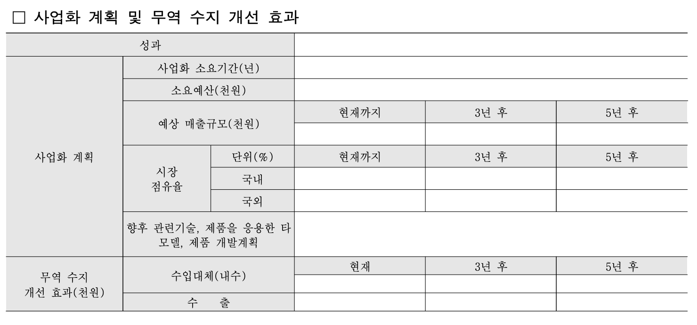
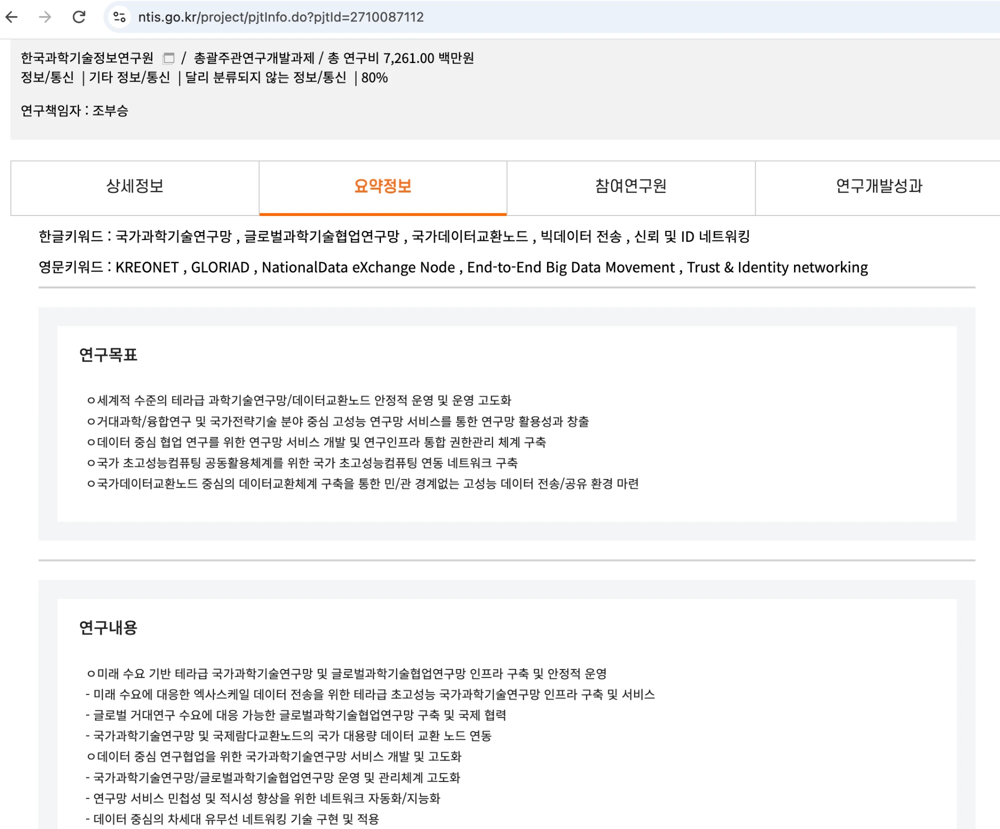

# 해외 R&D 보고 체계와 기계가독성 조사

**성과는 시스템 필드로, 보고서는 구조화된 서술로**

- 작성일: 2026.11.
- 작성자: 장민석 (msjang@kisti.re.kr)

> [!NOTE]
> "AI/Machine-Ready 보고서 양식" 과제 제안의 밑자료입니다. 이 쪽은 결론과 근거만 짧게 담은 핵심 리포트이고, 나라별 상세·측정 자료·원문 보존본은 [별첨](appendix.md)에 있습니다.

## 요약

1. 한국 연구보고서는 과제 메타데이터와 성과를 **종이 판형의 양식형 표**에 다시 입력하게 하고, 그 보고서를 다시 시스템에 복사해 붙입니다. 같은 정보가 여러 번 입력되고, 그 과정에서 구조가 사라집니다.
2. 일본·중국·미국·EU·영국은 같은 정보를 **시스템 필드로 한 번 받고**, 보고서와 공개 페이지는 그 필드에서 자동으로 만듭니다. 중국은 2014년 국가표준으로 보고서를 XML로 규정했고, 미국 NSF는 과제번호 하나를 웹 페이지이자 공개 API로 씁니다.
3. 2026년 11월 IRIS 개편으로 논문 성과 등록은 DOI 자동 완성으로 바뀌기 시작했고, 2027년에는 4대 과제관리 시스템이 통합됩니다. 남은 대상은 보고서 본체이며, 지금이 구조를 정할 시점입니다.

## 1. 문제: 정보를 종이 판형에 가둔다

한국 연구보고서의 "사업화 계획 및 무역 수지 개선 효과" 표는 사업화 기간·예산·매출 전망·시장점유율·수입대체·수출을 3단 병합 헤더 한 장에 담습니다. 사람에게도 읽기 어렵고, 기계는 이 표에서 어느 숫자가 어느 연도의 무엇인지 복원하지 못합니다.



측정해 보면 이런 표는 예외가 아닙니다. KISTI 연차보고서(2024년 202쪽, 2025년 260쪽)를 쪽마다 재어 표를 네 가지로 나눴습니다([별첨 E](appendix-e-tables.md)).

| 유형 | 판정 | 내용 |
|---|---|---|
| 데이터표 | 권장 | 행·열이 곧 데이터인 표 |
| 콜아웃 | 글상자로 교체 | 한 문장·목록을 강조하려고 두른 표 |
| 구획 | 제목·글상자로 교체 | 본문·목차를 테두리로 감싼 표 |
| 양식형 | 가장 지양 | 칸 이름이 미리 박힌 병합 표 |

- 서술 챕터의 15~18%가 양식형 표입니다(2024년 18%, 2025년 15%).
- 과제를 서술로 소개해야 할 "개요" 챕터는 양식형과 구획을 더한 비율이 1년 사이 41%에서 60%로 늘었습니다.

목록도 구조가 아닙니다. 개조식 머리문자(□ ○ - ·)는 글자이고 단계는 공백으로만 표시됩니다. 보고서 내용을 NTIS 과제 요약에 복사해 붙이면 들여쓰기가 지워져 하위 항목이 상위 항목과 같은 높이로 평평해집니다.



## 2. 해외: 필드로 받고, 보고서는 만든다

정보 종류별로 각국이 그 정보를 어디에 두는지 표시했습니다. 한국은 관리 메타데이터와 성과까지 보고서 표(빨강)에 두지만, 해외는 대부분 시스템 필드(초록)에 두고 보고서에는 연구 내용 서술(노랑)만 남깁니다. 나라별 근거는 [별첨 A](appendix-a-countries.md)에 있습니다.

<style>
.whereinfo td{padding:5px 7px}
.whereinfo td:first-child{text-align:left}
</style>

<p style="font-size:13px"><b>어디에 있나</b> &nbsp;
<span style="background:#e6f4ea;color:#1e7a34;padding:2px 6px;border-radius:3px">시스템·DB 필드(구조화)</span> &nbsp;
<span style="background:#fdf4d6;color:#8a6d1a;padding:2px 6px;border-radius:3px">보고서 서술</span> &nbsp;
<span style="background:#fde4e4;color:#b02a2a;padding:2px 6px;border-radius:3px">보고서 표·양식(종이에 굳힘)</span> &nbsp;
<span style="background:#f1f3f5;color:#868e96;padding:2px 6px;border-radius:3px">없음·별도</span></p>

<table class="whereinfo"><thead><tr><th>정보</th><th>한국</th><th>일본</th><th>중국</th><th>미국</th><th>EU</th><th>영국</th></tr></thead><tbody>
<tr><td colspan="7" style="background:#eef1f4;font-weight:700;font-size:12.5px;text-align:left">① 관리·식별 메타데이터 — 시스템에 둘 것</td></tr>
<tr><td style="text-align:left;font-size:12.5px;white-space:nowrap">분류정보</td><td style="background:#fde4e4;color:#b02a2a;font-size:12px;text-align:center">요약문 표</td><td style="background:#e6f4ea;color:#1e7a34;font-size:12px;text-align:center">시스템</td><td style="background:#e6f4ea;color:#1e7a34;font-size:12px;text-align:center">辑要页</td><td style="background:#e6f4ea;color:#1e7a34;font-size:12px;text-align:center">award DB</td><td style="background:#e6f4ea;color:#1e7a34;font-size:12px;text-align:center">Portal</td><td style="background:#e6f4ea;color:#1e7a34;font-size:12px;text-align:center">레코드</td></tr>
<tr><td style="text-align:left;font-size:12.5px;white-space:nowrap">기간정보</td><td style="background:#fde4e4;color:#b02a2a;font-size:12px;text-align:center">초록 표</td><td style="background:#e6f4ea;color:#1e7a34;font-size:12px;text-align:center">KAKEN</td><td style="background:#e6f4ea;color:#1e7a34;font-size:12px;text-align:center">辑要页</td><td style="background:#e6f4ea;color:#1e7a34;font-size:12px;text-align:center">award DB</td><td style="background:#e6f4ea;color:#1e7a34;font-size:12px;text-align:center">Portal</td><td style="background:#e6f4ea;color:#1e7a34;font-size:12px;text-align:center">레코드</td></tr>
<tr><td style="text-align:left;font-size:12.5px;white-space:nowrap">예산·회계</td><td style="background:#fde4e4;color:#b02a2a;font-size:12px;text-align:center">초록 중첩표</td><td style="background:#e6f4ea;color:#1e7a34;font-size:12px;text-align:center">결산 화면</td><td style="background:#e6f4ea;color:#1e7a34;font-size:12px;text-align:center">辑要页</td><td style="background:#e6f4ea;color:#1e7a34;font-size:12px;text-align:center">award DB</td><td style="background:#e6f4ea;color:#1e7a34;font-size:12px;text-align:center">재무보고</td><td style="background:#e6f4ea;color:#1e7a34;font-size:12px;text-align:center">레코드</td></tr>
<tr><td style="text-align:left;font-size:12.5px;white-space:nowrap">참여인력</td><td style="background:#fde4e4;color:#b02a2a;font-size:12px;text-align:center">초록 표</td><td style="background:#e6f4ea;color:#1e7a34;font-size:12px;text-align:center">시스템</td><td style="background:#e6f4ea;color:#1e7a34;font-size:12px;text-align:center">辑要页</td><td style="background:#e6f4ea;color:#1e7a34;font-size:12px;text-align:center">award DB</td><td style="background:#e6f4ea;color:#1e7a34;font-size:12px;text-align:center">Portal</td><td style="background:#e6f4ea;color:#1e7a34;font-size:12px;text-align:center">레코드</td></tr>
<tr><td style="text-align:left;font-size:12.5px;white-space:nowrap">참여기관·기업</td><td style="background:#fde4e4;color:#b02a2a;font-size:12px;text-align:center">초록 표</td><td style="background:#e6f4ea;color:#1e7a34;font-size:12px;text-align:center">시스템</td><td style="background:#e6f4ea;color:#1e7a34;font-size:12px;text-align:center">辑要页</td><td style="background:#e6f4ea;color:#1e7a34;font-size:12px;text-align:center">award DB</td><td style="background:#e6f4ea;color:#1e7a34;font-size:12px;text-align:center">Portal</td><td style="background:#e6f4ea;color:#1e7a34;font-size:12px;text-align:center">레코드</td></tr>
<tr><td style="text-align:left;font-size:12.5px;white-space:nowrap">협력자(COA류)</td><td style="background:#f1f3f5;color:#868e96;font-size:12px;text-align:center">—</td><td style="background:#e6f4ea;color:#1e7a34;font-size:12px;text-align:center">시스템</td><td style="background:#f1f3f5;color:#868e96;font-size:12px;text-align:center">—</td><td style="background:#e6f4ea;color:#1e7a34;font-size:12px;text-align:center">COA 시트</td><td style="background:#e6f4ea;color:#1e7a34;font-size:12px;text-align:center">Portal</td><td style="background:#e6f4ea;color:#1e7a34;font-size:12px;text-align:center">레코드</td></tr>
<tr><td style="text-align:left;font-size:12.5px;white-space:nowrap">보안등급·공개</td><td style="background:#e6f4ea;color:#1e7a34;font-size:12px;text-align:center">시스템 분류</td><td style="background:#f1f3f5;color:#868e96;font-size:12px;text-align:center">—</td><td style="background:#e6f4ea;color:#1e7a34;font-size:12px;text-align:center">GB/T 30534</td><td style="background:#e6f4ea;color:#1e7a34;font-size:12px;text-align:center">시스템</td><td style="background:#e6f4ea;color:#1e7a34;font-size:12px;text-align:center">Portal</td><td style="background:#e6f4ea;color:#1e7a34;font-size:12px;text-align:center">레코드</td></tr>
<tr><td colspan="7" style="background:#eef1f4;font-weight:700;font-size:12.5px;text-align:left">② 성과 메타데이터 — 구조화할 것</td></tr>
<tr><td style="text-align:left;font-size:12.5px;white-space:nowrap">정량실적(논문·특허)</td><td style="background:#fde4e4;color:#b02a2a;font-size:12px;text-align:center">정량성과 표</td><td style="background:#e6f4ea;color:#1e7a34;font-size:12px;text-align:center">웹 필드 예/아니오</td><td style="background:#fdf4d6;color:#8a6d1a;font-size:12px;text-align:center">보고서 본문</td><td style="background:#e6f4ea;color:#1e7a34;font-size:12px;text-align:center">RPPR 필드</td><td style="background:#e6f4ea;color:#1e7a34;font-size:12px;text-align:center">Continuous Rep.</td><td style="background:#e6f4ea;color:#1e7a34;font-size:12px;text-align:center">Researchfish</td></tr>
<tr><td style="text-align:left;font-size:12.5px;white-space:nowrap">성과지표·연차 목표</td><td style="background:#fde4e4;color:#b02a2a;font-size:12px;text-align:center">성과지표 표</td><td style="background:#e6f4ea;color:#1e7a34;font-size:12px;text-align:center">KAKEN 진척도</td><td style="background:#fdf4d6;color:#8a6d1a;font-size:12px;text-align:center">서술</td><td style="background:#e6f4ea;color:#1e7a34;font-size:12px;text-align:center">마일스톤</td><td style="background:#e6f4ea;color:#1e7a34;font-size:12px;text-align:center">마일스톤</td><td style="background:#e6f4ea;color:#1e7a34;font-size:12px;text-align:center">레코드</td></tr>
<tr><td style="text-align:left;font-size:12.5px;white-space:nowrap">초록·요약</td><td style="background:#fde4e4;color:#b02a2a;font-size:12px;text-align:center">초록·요약문 표</td><td style="background:#e6f4ea;color:#1e7a34;font-size:12px;text-align:center">概要 필드</td><td style="background:#e6f4ea;color:#1e7a34;font-size:12px;text-align:center">辑要页</td><td style="background:#fdf4d6;color:#8a6d1a;font-size:12px;text-align:center">POR 서술</td><td style="background:#fdf4d6;color:#8a6d1a;font-size:12px;text-align:center">Results in Brief</td><td style="background:#fdf4d6;color:#8a6d1a;font-size:12px;text-align:center">GtR 초록</td></tr>
<tr><td colspan="7" style="background:#eef1f4;font-weight:700;font-size:12.5px;text-align:left">③ 서술 내용 — 보고서가 담을 것 (연구 내용이 핵심)</td></tr>
<tr><td style="text-align:left;font-size:12.5px;white-space:nowrap">연구 목표(최종·단계별)</td><td style="background:#fde4e4;color:#b02a2a;font-size:12px;text-align:center">요약문·개요 표</td><td style="background:#fdf4d6;color:#8a6d1a;font-size:12px;text-align:center">신청서 서술</td><td style="background:#fdf4d6;color:#8a6d1a;font-size:12px;text-align:center">서술</td><td style="background:#fdf4d6;color:#8a6d1a;font-size:12px;text-align:center">서술</td><td style="background:#fdf4d6;color:#8a6d1a;font-size:12px;text-align:center">Part B</td><td style="background:#f1f3f5;color:#868e96;font-size:12px;text-align:center">제안 단계</td></tr>
<tr><td style="text-align:left;font-size:12.5px;white-space:nowrap">국내외 기술 동향</td><td style="background:#fdf4d6;color:#8a6d1a;font-size:12px;text-align:center">개요 서술</td><td style="background:#fdf4d6;color:#8a6d1a;font-size:12px;text-align:center">서술</td><td style="background:#fdf4d6;color:#8a6d1a;font-size:12px;text-align:center">서술</td><td style="background:#fdf4d6;color:#8a6d1a;font-size:12px;text-align:center">서술</td><td style="background:#fdf4d6;color:#8a6d1a;font-size:12px;text-align:center">Part B</td><td style="background:#f1f3f5;color:#868e96;font-size:12px;text-align:center">별도(출판물)</td></tr>
<tr><td style="text-align:left;font-size:12.5px;white-space:nowrap"><b>연구 내용·방법</b></td><td style="background:#fdf4d6;color:#8a6d1a;font-size:12px;text-align:center">서술(+표 섞임)</td><td style="background:#fdf4d6;color:#8a6d1a;font-size:12px;text-align:center">성과보고 서술</td><td style="background:#fdf4d6;color:#8a6d1a;font-size:12px;text-align:center">본문</td><td style="background:#fdf4d6;color:#8a6d1a;font-size:12px;text-align:center">RPPR 서술</td><td style="background:#fdf4d6;color:#8a6d1a;font-size:12px;text-align:center">Part B 서술</td><td style="background:#fdf4d6;color:#8a6d1a;font-size:12px;text-align:center">key findings 필드</td></tr>
<tr><td style="text-align:left;font-size:12.5px;white-space:nowrap">기대효과</td><td style="background:#fde4e4;color:#b02a2a;font-size:12px;text-align:center">활용·요약 표</td><td style="background:#fdf4d6;color:#8a6d1a;font-size:12px;text-align:center">서술</td><td style="background:#fdf4d6;color:#8a6d1a;font-size:12px;text-align:center">서술</td><td style="background:#fdf4d6;color:#8a6d1a;font-size:12px;text-align:center">POR 서술</td><td style="background:#fdf4d6;color:#8a6d1a;font-size:12px;text-align:center">Part B</td><td style="background:#e6f4ea;color:#1e7a34;font-size:12px;text-align:center">임팩트 레코드</td></tr>
<tr><td style="text-align:left;font-size:12.5px;white-space:nowrap">사업화·시장 전망</td><td style="background:#fde4e4;color:#b02a2a;font-size:12px;text-align:center">사업화 표</td><td style="background:#f1f3f5;color:#868e96;font-size:12px;text-align:center">없음</td><td style="background:#fdf4d6;color:#8a6d1a;font-size:12px;text-align:center">추천서(별도)</td><td style="background:#e6f4ea;color:#1e7a34;font-size:12px;text-align:center">SBIR DB(실적)</td><td style="background:#fdf4d6;color:#8a6d1a;font-size:12px;text-align:center">IPR·혁신 범주</td><td style="background:#e6f4ea;color:#1e7a34;font-size:12px;text-align:center">스핀아웃 레코드</td></tr>
<tr><td style="text-align:left;font-size:12.5px;white-space:nowrap">활용 계획</td><td style="background:#fde4e4;color:#b02a2a;font-size:12px;text-align:center">활용 표</td><td style="background:#fdf4d6;color:#8a6d1a;font-size:12px;text-align:center">서술</td><td style="background:#fdf4d6;color:#8a6d1a;font-size:12px;text-align:center">서술</td><td style="background:#fdf4d6;color:#8a6d1a;font-size:12px;text-align:center">POR 서술</td><td style="background:#fdf4d6;color:#8a6d1a;font-size:12px;text-align:center">Part B 서술</td><td style="background:#e6f4ea;color:#1e7a34;font-size:12px;text-align:center">임팩트 레코드</td></tr>
<tr><td colspan="7" style="background:#eef1f4;font-weight:700;font-size:12.5px;text-align:left">④ 구조 메타데이터</td></tr>
<tr><td style="text-align:left;font-size:12.5px;white-space:nowrap">참고문헌</td><td style="background:#e6f4ea;color:#1e7a34;font-size:12px;text-align:center">구조 메타</td><td style="background:#e6f4ea;color:#1e7a34;font-size:12px;text-align:center">구조 메타</td><td style="background:#e6f4ea;color:#1e7a34;font-size:12px;text-align:center">결미부</td><td style="background:#e6f4ea;color:#1e7a34;font-size:12px;text-align:center">구조 메타</td><td style="background:#e6f4ea;color:#1e7a34;font-size:12px;text-align:center">구조 메타</td><td style="background:#e6f4ea;color:#1e7a34;font-size:12px;text-align:center">구조 메타</td></tr>
</tbody></table>

보고 과정도 다릅니다. 한국은 웹폼·엑셀·한글 문서를 오가며 같은 내용을 다시 입력하고 변환합니다. 해외는 시스템에 한 번 입력하면 보고서와 공개 페이지가 자동으로 만들어집니다.

<p style="font-size:13px"><b>단계 색</b> &nbsp;
<span style="background:#e7f0fb;color:#1864ab;padding:2px 6px;border-radius:3px">웹폼·시스템 입력</span> &nbsp;
<span style="background:#fdf0e6;color:#b5651d;padding:2px 6px;border-radius:3px">수작업 문서(엑셀·한글·Word)</span> &nbsp;
<span style="background:#fde4e4;color:#b02a2a;padding:2px 6px;border-radius:3px">중복·변환·재제출</span> &nbsp;
<span style="background:#e6f4ea;color:#1e7a34;padding:2px 6px;border-radius:3px">시스템 자동(생성·공개)</span></p>

<style>
.wf{border-collapse:collapse;width:100%}
.wf td{border-top:1px solid #e3e6ea;padding:12px 6px;vertical-align:top}
</style>

<table class="wf"><tbody>
<tr><td style="white-space:nowrap;font-weight:700;font-size:13px;vertical-align:top">🇰🇷 한국</td><td><div style="display:flex;flex-wrap:wrap;gap:6px;align-items:stretch"><div style="background:#e7f0fb;color:#1864ab;border-radius:6px;padding:6px 9px;min-width:96px;max-width:150px;text-align:center;font-size:12px;line-height:1.35"><b>NTIS 웹폼 입력</b><br><span style="font-size:11px">과제·성과</span></div><div style="color:#adb5bd;font-size:16px;align-self:center">→</div><div style="background:#fdf0e6;color:#b5651d;border-radius:6px;padding:6px 9px;min-width:96px;max-width:150px;text-align:center;font-size:12px;line-height:1.35"><b>엑셀 작성</b><br><span style="font-size:11px">성과 집계</span></div><div style="color:#adb5bd;font-size:16px;align-self:center">→</div><div style="background:#fde4e4;color:#b02a2a;border-radius:6px;padding:6px 9px;min-width:96px;max-width:150px;text-align:center;font-size:12px;line-height:1.35"><b>PM에 제출</b><br><span style="font-size:11px">엑셀</span></div><div style="color:#adb5bd;font-size:16px;align-self:center">→</div><div style="background:#fdf0e6;color:#b5651d;border-radius:6px;padding:6px 9px;min-width:96px;max-width:150px;text-align:center;font-size:12px;line-height:1.35"><b>한글 HWPX 보고서</b><br><span style="font-size:11px">작성</span></div><div style="color:#adb5bd;font-size:16px;align-self:center">→</div><div style="background:#fde4e4;color:#b02a2a;border-radius:6px;padding:6px 9px;min-width:96px;max-width:150px;text-align:center;font-size:12px;line-height:1.35"><b>PDF 변환</b><br><span style="font-size:11px">→ NTIS·ScienceON 업로드</span></div></div><div style="font-size:12px;color:#5b6068;margin-top:5px">→ 같은 정보를 웹폼·엑셀·HWPX 보고서에 <b style="color:#b02a2a">세 번</b></div></td></tr>
<tr><td style="white-space:nowrap;font-weight:700;font-size:13px;vertical-align:top">🇺🇸 미국 (NSF)</td><td><div style="display:flex;flex-wrap:wrap;gap:6px;align-items:stretch"><div style="background:#fdf0e6;color:#b5651d;border-radius:6px;padding:6px 9px;min-width:96px;max-width:150px;text-align:center;font-size:12px;line-height:1.35"><b>COA 엑셀</b><br><span style="font-size:11px">생성기 활용</span></div><div style="color:#adb5bd;font-size:16px;align-self:center">→</div><div style="background:#fdf0e6;color:#b5651d;border-radius:6px;padding:6px 9px;min-width:96px;max-width:150px;text-align:center;font-size:12px;line-height:1.35"><b>과제계획서</b><br><span style="font-size:11px">→ Research.gov</span></div><div style="color:#adb5bd;font-size:16px;align-self:center">→</div><div style="background:#e7f0fb;color:#1864ab;border-radius:6px;padding:6px 9px;min-width:96px;max-width:150px;text-align:center;font-size:12px;line-height:1.35"><b>RPPR 웹폼 보고</b><br><span style="font-size:11px">논문 My Bibliography 연동</span></div><div style="color:#adb5bd;font-size:16px;align-self:center">→</div><div style="background:#e7f0fb;color:#1864ab;border-radius:6px;padding:6px 9px;min-width:96px;max-width:150px;text-align:center;font-size:12px;line-height:1.35"><b>POR 텍스트박스</b><br><span style="font-size:11px">일반인용 요약</span></div><div style="color:#adb5bd;font-size:16px;align-self:center">→</div><div style="background:#e6f4ea;color:#1e7a34;border-radius:6px;padding:6px 9px;min-width:96px;max-width:150px;text-align:center;font-size:12px;line-height:1.35"><b>메타데이터</b><br><span style="font-size:11px">award DB 자동</span></div></div><div style="font-size:12px;color:#5b6068;margin-top:5px">→ 메타데이터는 DB 자동, 중복 적음</div></td></tr>
<tr><td style="white-space:nowrap;font-weight:700;font-size:13px;vertical-align:top">🇯🇵 일본 (科研費)</td><td><div style="display:flex;flex-wrap:wrap;gap:6px;align-items:stretch"><div style="background:#e7f0fb;color:#1864ab;border-radius:6px;padding:6px 9px;min-width:96px;max-width:150px;text-align:center;font-size:12px;line-height:1.35"><b>전자신청 웹 입력</b><br><span style="font-size:11px">개요·발표·산재권 필드</span></div><div style="color:#adb5bd;font-size:16px;align-self:center">→</div><div style="background:#fdf0e6;color:#b5651d;border-radius:6px;padding:6px 9px;min-width:96px;max-width:150px;text-align:center;font-size:12px;line-height:1.35"><b>Word 서식 2쪽</b><br><span style="font-size:11px">작성·업로드</span></div><div style="color:#adb5bd;font-size:16px;align-self:center">→</div><div style="background:#e6f4ea;color:#1e7a34;border-radius:6px;padding:6px 9px;min-width:96px;max-width:150px;text-align:center;font-size:12px;line-height:1.35"><b>1쪽 자동 생성</b><br><span style="font-size:11px">+ KAKEN 공개</span></div></div><div style="font-size:12px;color:#5b6068;margin-top:5px">→ 시스템 입력이 보고서 1쪽으로 자동</div></td></tr>
<tr><td style="white-space:nowrap;font-weight:700;font-size:13px;vertical-align:top">🇨🇳 중국</td><td><div style="display:flex;flex-wrap:wrap;gap:6px;align-items:stretch"><div style="background:#e7f0fb;color:#1864ab;border-radius:6px;padding:6px 9px;min-width:96px;max-width:150px;text-align:center;font-size:12px;line-height:1.35"><b>과기관리 시스템</b><br><span style="font-size:11px">검수 자료 제출</span></div><div style="color:#adb5bd;font-size:16px;align-self:center">→</div><div style="background:#fdf0e6;color:#b5651d;border-radius:6px;padding:6px 9px;min-width:96px;max-width:150px;text-align:center;font-size:12px;line-height:1.35"><b>과기보고 작성</b><br><span style="font-size:11px">GB/T 7713.3·XML 권장</span></div><div style="color:#adb5bd;font-size:16px;align-self:center">→</div><div style="background:#e6f4ea;color:#1e7a34;border-radius:6px;padding:6px 9px;min-width:96px;max-width:150px;text-align:center;font-size:12px;line-height:1.35"><b>NSTRS 이관</b><br><span style="font-size:11px">辑要页 메타 자동</span></div></div><div style="font-size:12px;color:#5b6068;margin-top:5px">→ 표준 구조 + 메타데이터 자동</div></td></tr>
<tr><td style="white-space:nowrap;font-weight:700;font-size:13px;vertical-align:top">🇪🇺 EU (Horizon)</td><td><div style="display:flex;flex-wrap:wrap;gap:6px;align-items:stretch"><div style="background:#e7f0fb;color:#1864ab;border-radius:6px;padding:6px 9px;min-width:96px;max-width:150px;text-align:center;font-size:12px;line-height:1.35"><b>Portal 수시 입력</b><br><span style="font-size:11px">Continuous Reporting</span></div><div style="color:#adb5bd;font-size:16px;align-self:center">→</div><div style="background:#e6f4ea;color:#1e7a34;border-radius:6px;padding:6px 9px;min-width:96px;max-width:150px;text-align:center;font-size:12px;line-height:1.35"><b>Part A 자동</b><br><span style="font-size:11px">검토 잠금 시</span></div><div style="color:#adb5bd;font-size:16px;align-self:center">→</div><div style="background:#fdf0e6;color:#b5651d;border-radius:6px;padding:6px 9px;min-width:96px;max-width:150px;text-align:center;font-size:12px;line-height:1.35"><b>Part B 템플릿</b><br><span style="font-size:11px">서술·PDF 업로드</span></div><div style="color:#adb5bd;font-size:16px;align-self:center">→</div><div style="background:#e6f4ea;color:#1e7a34;border-radius:6px;padding:6px 9px;min-width:96px;max-width:150px;text-align:center;font-size:12px;line-height:1.35"><b>CORDIS 공개</b><br><span style="font-size:11px">요약·목록 자동</span></div></div><div style="font-size:12px;color:#5b6068;margin-top:5px">→ Part A는 입력값이 자동으로</div></td></tr>
<tr><td style="white-space:nowrap;font-weight:700;font-size:13px;vertical-align:top">🇬🇧 영국</td><td><div style="display:flex;flex-wrap:wrap;gap:6px;align-items:stretch"><div style="background:#e7f0fb;color:#1864ab;border-radius:6px;padding:6px 9px;min-width:96px;max-width:150px;text-align:center;font-size:12px;line-height:1.35"><b>Researchfish 레코드</b><br><span style="font-size:11px">연 1회 입력</span></div><div style="color:#adb5bd;font-size:16px;align-self:center">→</div><div style="background:#e6f4ea;color:#1e7a34;border-radius:6px;padding:6px 9px;min-width:96px;max-width:150px;text-align:center;font-size:12px;line-height:1.35"><b>GtR 공개</b><br><span style="font-size:11px">레코드 렌더</span></div></div><div style="font-size:12px;color:#5b6068;margin-top:5px">→ UKRI는 전통 최종보고서를 Researchfish로 대체 (NIHR 등은 별도 보고서)</div></td></tr>
</tbody></table>

한국 표가 묻는 3년 후·5년 후 매출과 시장점유율 **전망**도 차이입니다. 이번에 본 해외 보고 체계는 모두 이미 일어난 실적만 받습니다.

## 3. 모범 두 가지

**중국 GB/T 7713.3-2014.** 과학기술보고 국가표준이 보고서를 서술·구조·관리·보존 메타데이터의 묶음으로 정의하고, 부록에 보고서용 DTD(XML 스키마)와 XSL 양식표를 싣습니다. 내용은 XML로, 판형은 XSL로 분리한 설계를 2014년에 표준으로 정했습니다([별첨 C](appendix-c-gbt.md)).


**미국 NSF award.** 과제 메타데이터는 보고서가 아니라 Award DB에 필드로 있고, 과제번호 하나가 사람용 페이지이면서 인증 없는 공개 API입니다. API 응답에는 산출 논문이 DOI와 함께 담깁니다([별첨 F](appendix-f-archives.md)).

```text
사람용  https://www.nsf.gov/awardsearch/show-award/?AWD_ID=<번호>
기계용  https://api.nsf.gov/services/v1/awards/<번호>.json
```

## 4. 제안

<div style="display:flex;flex-wrap:wrap;gap:8px;align-items:stretch;margin:12px 0 6px"><div style="flex:1;min-width:180px;display:flex;flex-direction:column;gap:6px"><div style="font-size:12px;font-weight:700;color:#495057">① 한 번 입력 (시스템)</div><div style="background:#e6f4ea;color:#1e7a34;border-radius:6px;padding:7px 10px;font-size:12.5px;line-height:1.4"><b>과제 메타데이터</b><br><span style="font-size:11.5px">과제번호·기간·예산·기관·참여자</span></div><div style="background:#e6f4ea;color:#1e7a34;border-radius:6px;padding:7px 10px;font-size:12.5px;line-height:1.4"><b>성과 레코드</b><br><span style="font-size:11.5px">DOI·특허번호·사업화 실적, 식별자로 자동 완성</span></div></div><div style="align-self:center;color:#adb5bd;font-size:20px;padding:0 2px">→</div><div style="flex:1;min-width:180px;display:flex;flex-direction:column;gap:6px"><div style="font-size:12px;font-weight:700;color:#495057">② 연구자가 쓰는 것</div><div style="background:#fdf4d6;color:#8a6d1a;border-radius:6px;padding:7px 10px;font-size:12.5px;line-height:1.4"><b>연구 내용 서술</b><br><span style="font-size:11.5px">구조화 소스: 제목·목록·데이터표·그림·각주가 구조로 존재</span></div></div><div style="align-self:center;color:#adb5bd;font-size:20px;padding:0 2px">→</div><div style="flex:1;min-width:180px;display:flex;flex-direction:column;gap:6px"><div style="font-size:12px;font-weight:700;color:#495057">③ 자동 생성 (렌더링)</div><div style="background:#e7f0fb;color:#1864ab;border-radius:6px;padding:7px 10px;font-size:12.5px;line-height:1.4"><b>공개 과제 페이지</b><br><span style="font-size:11.5px">과제번호 = 영구 주소</span></div><div style="background:#e7f0fb;color:#1864ab;border-radius:6px;padding:7px 10px;font-size:12.5px;line-height:1.4"><b>공개 API (JSON)</b><br><span style="font-size:11.5px">같은 번호로 기계가 조회</span></div><div style="background:#e7f0fb;color:#1864ab;border-radius:6px;padding:7px 10px;font-size:12.5px;line-height:1.4"><b>HWPX·PDF 보고서</b><br><span style="font-size:11.5px">표지·요약·성과표를 필드에서 채움</span></div></div></div><p style="font-size:12.5px;color:#666">같은 원천에서 여러 출력을 만든다. 보고서는 입력 창구가 아니라 출력물 가운데 하나다.</p>

1. **메타데이터는 시스템 필드로 옮긴다.** 과제번호·기간·예산·참여자·성과 목록은 시스템이 보유하고, 보고서의 표지·요약·성과표는 그 필드에서 자동으로 채운다. 연구자는 같은 정보를 다시 입력하지 않는다.
2. **과제번호를 영구 주소이자 공개 API로 만든다.** 다년 과제 전체를 번호 하나로 가리키고, 연차별 값은 그 안의 속성으로 둔다. 과제·논문·데이터·연구자를 잇는 연결은 이 식별자 위에서 자동으로 만들어진다.
3. **보고서 본체는 구조화 소스로 쓰고 판형은 렌더링한다.** 제목·목록·데이터표·그림·각주가 구조로 존재하는 소스에서 HWPX·PDF·웹 페이지를 각각 생성한다. HWPX 출력은 [pypandoc-hwpx](https://github.com/msjang/pypandoc-hwpx)로 실증하고 있다.
4. **표는 데이터일 때만 쓴다.** 양식형 표는 필드나 데이터표로 펴고, 구획·강조용 표는 제목과 글상자로 바꾼다. 미래 전망 수치를 병합 표로 받는 항목은 필요성부터 다시 검토한다.

## 5. 왜 지금인가

- **현장의 요구가 공개적으로 제기됐습니다.** 우종학 교수는 2026년 3월 공개 글에서 IRIS에 논문 7편을 등록하는 16단계를 묘사하며 "같은 정보를 제안서·연차보고·최종보고·성과등록에 네 번 입력한다", "DOI 같은 것만 넣으면 안 될까"라고 물었습니다([별첨 G](appendix-g-voices.md)).
- **성과 등록은 바뀌기 시작했습니다.** 2026년 11월 IRIS 개편으로 DOI·ISSN만 넣으면 서지정보가 자동 완성됩니다. 다만 이는 성과 등록 화면의 변화이고, 보고서 형식은 그대로입니다.
- **2027년 IRIS·Ezbaro·RCMS·NTIS 4대 시스템이 통합되고 운영을 KISTI가 맡습니다.** 필드와 식별 체계를 정하는 시점과 겹칩니다.

## 별첨

| 별첨 | 내용 |
|---|---|
| [A. 국가별 상세 비교](appendix-a-countries.md) | 일본·중국·미국·EU·영국의 입력·보고서·재표현 |
| [B. 미국 DoE·ESnet 심층](appendix-b-doe.md) | ESnet 보고서와 KISTI 연차보고서의 구조 비교, 시사점 6가지 |
| [C. 중국 GB/T 7713.3](appendix-c-gbt.md) | 메타데이터 4종, DTD·XSL, 그림·표·수식 규정 |
| [D. 초록·요약문](appendix-d-abstract.md) | 서지정보와 요약을 한 표에 섞는 한국과 나누는 해외, 2024→2025 |
| [E. 표 사용 분석](appendix-e-tables.md) | 표 4분류, 챕터별 신호등, 국가별 버드뷰, NTIS 복사·붙여넣기 |
| [F. 아카이브·식별자·연구지원 안내](appendix-f-archives.md) | 국가별 아카이브, NSF award·API, 대학·지원기관 안내 |
| [G. 현장의 목소리](appendix-g-voices.md) | 2026년 공개 논의와 IRIS 개편 |
| [H. 조사 방법·도구·남은 질문](appendix-h-methods.md) | 한계, 측정 도구, 로그인 전용 화면 |
| [출처](sources.md) | 인용 원문의 URL·수집일·보존 사본 |

> [!WARNING]
> 작성자 개인의 조사 결과이며 소속 기관의 공식 입장이 아닙니다. 각국 제도의 해석에 오류가 있을 수 있으니 인용 전 원문을 확인하시기 바랍니다. 조사 문서는 [CC BY 4.0](https://creativecommons.org/licenses/by/4.0/deed.ko)이며, 인용한 각국 서식·문언의 권리는 각 권리자에게 있습니다.
