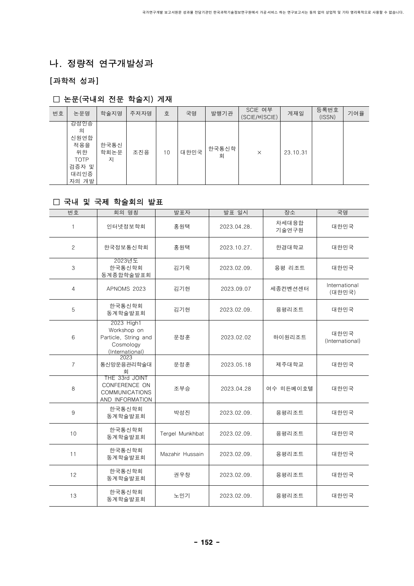
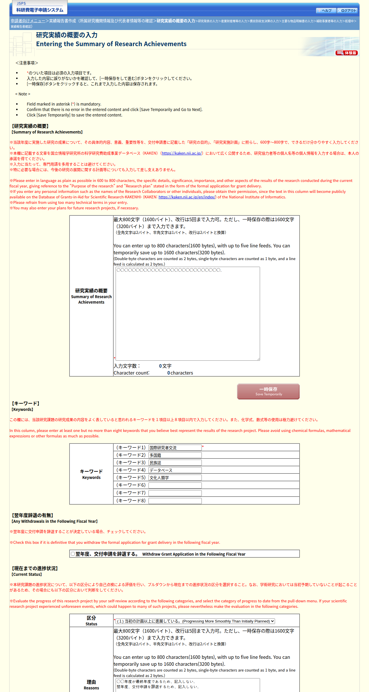
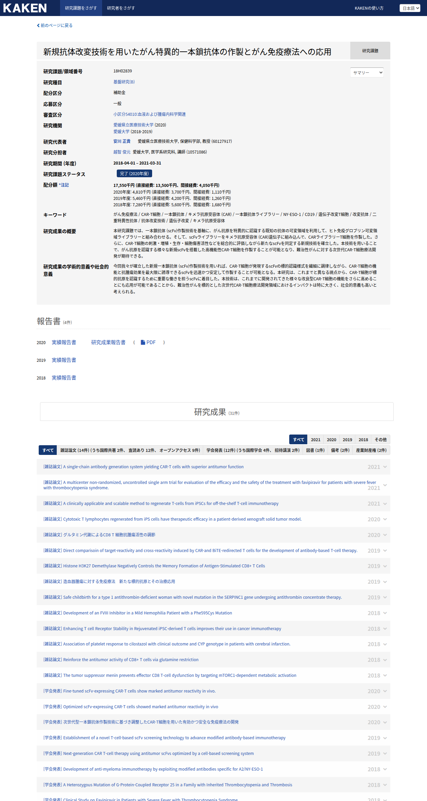
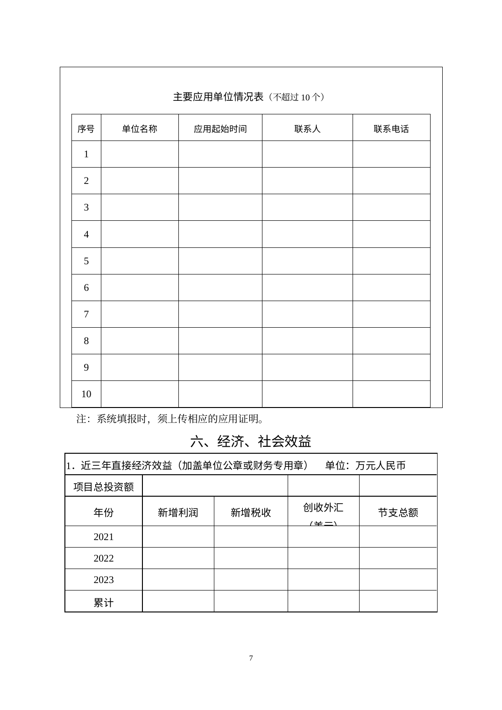

# 해외 R&D 성과보고 체계 비교 — 시스템 입력 필드 · 연구보고서 · 공개 재표현

- 작성일: 2026.11.
- 작성자: 장민석 (msjang@kisti.re.kr)

> [!NOTE]
> 각국의 과제관리 시스템 상당수는 로그인 뒤에만 입력 화면을 볼 수 있어, 공개 매뉴얼·서식 파일·체험판·공개 DB로 확인한 범위에서 비교했습니다. 인용한 원문의 보존 사본과 수집일은 [출처](sources.md)에 정리해 두었습니다.

## 개요와 기준점

한국 연구보고서의 "사업화 계획 및 무역 수지 개선 효과" 표는 3단 병합 헤더 안에 사업화 소요기간, 예산, 매출 전망, 시장점유율, 수입대체·수출을 한 장에 담습니다. 해당 사항이 없어도 빈 표가 그대로 실립니다. 아래가 그 표입니다. 예상 매출규모와 시장점유율, 수입대체·수출을 현재·3년 후·5년 후로 나누어 받는 전망형 표입니다.

<table class="kr-form">
<colgroup>
<col style="width:16%"><col style="width:13%"><col style="width:13%"><col style="width:19.34%"><col style="width:19.33%"><col style="width:19.33%">
</colgroup>
<tbody>
<tr><td class="l" colspan="3">성과</td><td class="e" colspan="3"></td></tr>
<tr><td class="l" rowspan="8">사업화 계획</td><td class="l" colspan="2">사업화 소요기간(년)</td><td class="e" colspan="3"></td></tr>
<tr><td class="l" colspan="2">소요예산(천원)</td><td class="e" colspan="3"></td></tr>
<tr><td class="l" colspan="2" rowspan="2">예상 매출규모(천원)</td><td class="h">현재까지</td><td class="h">3년 후</td><td class="h">5년 후</td></tr>
<tr><td class="e"></td><td class="e"></td><td class="e"></td></tr>
<tr><td class="l" rowspan="3">시장 점유율</td><td class="l">단위(%)</td><td class="h">현재까지</td><td class="h">3년 후</td><td class="h">5년 후</td></tr>
<tr><td class="l">국내</td><td class="e"></td><td class="e"></td><td class="e"></td></tr>
<tr><td class="l">국외</td><td class="e"></td><td class="e"></td><td class="e"></td></tr>
<tr><td class="l" colspan="2">향후 관련기술, 제품을 응용한 타 모델, 제품 개발계획</td><td class="e" colspan="3"></td></tr>
<tr><td class="l" rowspan="3">무역 수지 개선 효과(천원)</td><td class="l" colspan="2" rowspan="2">수입대체(내수)</td><td class="h">현재</td><td class="h">3년 후</td><td class="h">5년 후</td></tr>
<tr><td class="e"></td><td class="e"></td><td class="e"></td></tr>
<tr><td class="l" colspan="2">수 출</td><td class="e" colspan="3"></td></tr>
</tbody>
</table>

▲ 한국 연구보고서 표준 양식의 "사업화 계획 및 무역 수지 개선 효과" 표. 원본 양식 캡처는 <a href="sources/korea/kr-commercialization-table-form_2026-11-26.png">sources/korea/</a>에 보존했다. 이 문서는 같은 종류의 정보를 일본, 중국, 미국, EU, 영국이 어떻게 받고 어떻게 다시 보여주는지 비교한다.

양식형 표의 문제는 사업화 표만의 것이 아닙니다. 아래는 기준 보고서로 삼은 KISTI 연차보고서의 정량적 연구개발성과 표입니다. 좁은 칸에 논문 제목이 들어가 "강성인증의 신원연합 적용을 위한 TOTP 검증자 및 대리인증자의 개발"이 글자 단위로 끊깁니다. 데이터가 판형에 묶여 있어 사람도 읽기 어렵고 기계도 칸의 의미를 되살리기 어렵습니다.

비교는 국가마다 세 층으로 봅니다.

1. **입력**: 과제관리 시스템이 성과를 어떤 필드로 받는가 (대부분 로그인 뒤라 공식 매뉴얼·서식 화면으로 확인)
2. **보고서**: 최종·연차 연구보고서가 어떤 모양인가
3. **재표현**: 공개 DB나 보고서가 입력 필드를 어떻게 그대로 렌더링하거나 서술로 바꾸는가

특히 올려주신 표의 핵심인 사업화 성과(매출, 기술이전, 창업, 시장 전망)를 각 체계가 어디서 다루는지에 초점을 둡니다.

## 일본 — 科研費(JSPS)

일본은 시스템 입력과 서식 파일이 반반 섞인 구조입니다. 개요·키워드·성과 목록은 웹 필드로 받고, 최종 성과보고서는 정해진 Word 서식을 내려받아 채운 뒤 업로드합니다.

**입력.** JSPS 科研費電子申請システム의 실적보고서 작성은 소속 확인 → 연구실적 개요 → 연구발표 → 산업재산권 → 비목별 결산 → 물품 → 보조사업자 순의 단계별 화면입니다. JSPS가 로그인 없이 볼 수 있는 [체험판](https://www-shinsei.jsps.go.jp/kaken/kakenhi_taiken/taiken_free/kofu/shinsei/pages/jissekiH/inputGaiyo.html)을 공개하고 있어 실제 필드 구성을 그대로 확인할 수 있습니다.

- [연구실적 개요 화면](https://www-shinsei.jsps.go.jp/kaken/kakenhi_taiken/taiken_free/kofu/shinsei/pages/jissekiH/inputGaiyo.html): 개요 600–800자, 키워드 최대 8개, 진척도 4단계 드롭다운과 그 이유, 향후 추진방책. 개요 칸은 KAKEN에 그대로 공개된다고 화면에 명시돼 있습니다.
- [연구발표 화면](https://www-shinsei.jsps.go.jp/kaken/kakenhi_taiken/taiken_free/kofu/shinsei/pages/jissekiH/inputHappyo.html): 논문마다 심사 유무, 국제공저, 즉시 오픈액세스 해당 여부를 예/아니오로 받습니다.
- [산업재산권 화면](https://www-shinsei.jsps.go.jp/kaken/kakenhi_taiken/taiken_free/kofu/shinsei/pages/jissekiH/inputZaisanken.html): 발명자, 권리자, 국내·해외, 종류와 번호, 출원·취득 연도를 행 단위로 추가합니다.

**보고서.** 시스템에 입력한 값으로 [様式 F-7-2 실적보고서](https://www.jsps.go.jp/j-grantsinaid/16_rule/data/29_dl/f-07-2_rei_chui.pdf)가 PDF로 생성됩니다. 기관번호·과제번호를 한 글자씩 칸에 넣는 양식형 표라 한국 서식과 모양이 가장 닮았습니다. 최종 [연구성과보고서(様式 C-41)](https://www.jsps.go.jp/file/storage/kaken_g_4594/r7jisseki_shourei_checklist_kikan.pdf)는 1쪽이 시스템 입력으로 자동 생성되고, 2쪽부터는 연구자가 서식 파일을 채워 2쪽 이내로 올립니다. JSPS 점검표는 서식 개조, 2단 편집, 항목 추가, 여백 변경을 대표적 반려 사유로 꼽습니다.

**재표현.** NII의 [KAKEN](https://kaken.nii.ac.jp/)이 입력 필드를 과제 페이지로 렌더링합니다. [과제 예시(18H02839)](https://kaken.nii.ac.jp/ja/grant/KAKENHI-PROJECT-18H02839/)를 보면 배분액이 연도별로 펼쳐지고, 성과가 "잡지논문 14건(국제공저 2, 심사 12, OA 9) · 산업재산권 2건"처럼 입력 때 받은 예/아니오 값으로 집계됩니다. 각 논문에는 어느 연도 보고서에서 왔는지가 붙어 있어 출처 추적이 됩니다.

입력 화면에서 논문마다 예/아니오로 받은 값이, 공개 페이지에서 사람이 다시 입력하지 않아도 집계로 나타납니다. 입력(구조화 필드)과 재표현(공개 페이지)이 같은 데이터를 공유하는 구조입니다.

사업화 관점: 科研費는 기초연구 지원이라 매출, 시장점유율, 수입대체 같은 필드가 없습니다. 산업 쪽 성과는 산업재산권 행으로만 받습니다.

## 중국 — 국가과기계획 과기보고·검수

중국은 한국과 가장 비슷한 쪽입니다. 매출·이윤·세수·외화획득을 연도별로 적는 병합 표가 지방 서식에 그대로 남아 있고, 과기보고서는 국가표준으로 구조를 강제합니다.

**입력.** 국가 중점연구개발계획 과제는 검수 자료를 [国家科技管理信息系统](https://service.most.gov.cn/u/cms/static/201806/12145654y1jn.pdf)으로 제출합니다. 이 시스템은 로그인 전용이고 일본 같은 공개 체험판이 없어, 입력 화면은 이번에 직접 확인하지 못했습니다. 대신 지방 과기청은 서식 파일을 내려받아 채운 뒤 시스템에 올리거나 제본해 내는 방식이 흔합니다. 예를 들어 [후허하오터시 검수 자료](https://lawinsider.com/zh/contracts/fZbOhHhewDc)는 검수 신청 시 서식을 내려받아 채운 뒤 순서대로 제본해 제출하라고 안내합니다. 총결보고 목차에는 "경제지표 달성(생산액, 수입, 이윤, 세수, 시장규모)"이 별도 항목으로 있습니다.

**보고서.** 과기보고서는 국가표준 [GB/T 7713.3-2014 과기보고 작성규칙](https://lib.tsinghua.edu.cn/wj/GBT7713_3-2014.pdf)을 따르고, 보고서 번호도 [기관코드-과제번호/순번 형식](https://www.most.gov.cn/ztzl/zdzx/tztg/201405/P020140526386090154713.pdf)으로 고정됩니다. 논문 발표나 특허 출원이 필요하면 [2~5년 공개 유예](https://kjc.seu.edu.cn/_upload/article/files/0b/26/f18499fc415b8d6b323a58e3d2f0/98a22588-7936-4af0-8027-fbf6e754c561.pdf)를 신청할 수 있습니다. 표지 다음에 서지·초록·키워드를 모은 "辑要页(documentation page)"가 있고, 이 항목이 [과기보고 메타데이터 표준(GB/T 30535)](https://most.gov.cn/ztzl/jlkjbg/kjbgxxjl/201409/P020140915541814539196.pdf)의 요소와 짝을 이룹니다.

**올려주신 표와 가장 닮은 사례.** 중국 과학기술상 추천서의 경제효익 표는 연도별 행에 신규이윤·신규세수·외화획득·비용절감(节支) 열을 두고, 맨 아래 누계(累计) 행과 투자총액 칸을 둡니다. 직접효익과 간접효익 표가 따로 있고, "이미 취득한 신규 직접효익만 기재한다(只填写已取得的新增直接效益)"는 단서는 한국 표의 "해당없음"·실적 기재 구조와 같습니다.

> [!NOTE]
> 원래 인용한 저장성 추천서 서식([링크](https://kyc.hznu.edu.cn/upload/Attach/mrbj/302089459.doc))은 수집 시점(2026-11-26)에 접속되지 않았습니다. 중국 과기상 추천서의 경제효익 표는 전국적으로 구조가 같아, 접속되는 [동지대 공개본](https://kyy.tongji.edu.cn/)에서 동일한 표를 확인해 보존했습니다. 사본은 [`sources/china/`](sources/china/award-recommendation-economic-benefit_2026-11-26.txt.md)에 있습니다.

**재표현.** 과제기관이 낸 보고서는 중국과학기술정보연구소(ISTIC)로 이관되어 [国家科技报告服务系统](https://www.nstrs.cn/)에서 공개됩니다. 공개 페이지는 辑要页 메타데이터(제목, 과제번호, 키워드, 초록)를 검색 항목으로 보여주고 본문은 PDF로 제공합니다. 경제효익 수치는 메타데이터 필드가 아니라 보고서 본문 안에 남습니다.

## 미국 — RPPR · NSF Project Outcomes · SBIR

미국은 "연구 성과"와 "사업화 성과"를 아예 다른 시스템으로 분리합니다. 일반 과제 보고서에는 매출 칸이 없고, 매출·투자 유치는 SBIR 기업 단위 DB에 숫자 필드로 쌓입니다.

**입력 — 연구 성과.** 연방 공통 진도보고 양식인 RPPR은 웹 폼 섹션으로 구성됩니다. NIH 기준 [A 표지, B 성과, C 산출물, D 참여자, E 영향, F 변경, G 특별보고, H 예산, I 최종성과](https://www.ora.umd.edu/sites/default/files/2024-07/RPPR%20NIH.pdf) 순입니다. 산출물 섹션은 [논문, 웹사이트, 기술·기법, 발명·특허·라이선스, 기타 산출물](https://www.era.nih.gov/erahelp/commons/Commons/rppr/Forms/C.Products.htm)로 나뉩니다. 특허는 [C.4에서 예/아니오로 답하고](https://medschool.ucla.edu/sites/g/files/oketem306/files/media/documents/NIH-RPPR-Progress-Report-Questions.pdf), 상세는 별도 발명신고 시스템 iEdison으로 보냅니다. 논문 목록도 직접 타이핑하지 않고 My NCBI에서 끌어옵니다.

**입력 — 사업화 성과.** SBIR/STTR 기업은 SBIR.gov의 [Company Commercialization Report](https://www.sbir.gov/sites/default/files/Guide_for_completing_commercialization_Report_SBIR_Gov.pdf)를 갱신해야 합니다. Phase II 과제마다 매출, 추가 투자, 제3자 매출을 필드로 넣고, 과제 정보는 수상 DB에서 자동으로 채워집니다. [양식 정의](https://omb.report/icr/202610-3245-001/doc/173864100.pdf)는 매출을 "해당 기술을 담은 신제품·비R&D 서비스의 현금 수입"으로 좁게 정의하고, 직전 회계연도 총매출은 구간 드롭다운으로 받습니다. SBA는 이 값을 합산해 [사업화율 벤치마크](https://www.sbir.gov/performance-benchmarks)를 계산하고, 기준 미달 기업은 신규 Phase I 지원이 제한됩니다.

**올려주신 표와 가장 닮은 사례.** NSF SBIR [2019년 이전 Phase II 최종보고 서식](https://seedfund.nsf.gov/assets/files/awardees/Phase_II_Reporting_Pre-2019.pdf)에는 "Revenue Breakdown" 표가 있었습니다. 행은 직원 수, 총매출, SBIR 의존 비율이고 열은 "과제 시작 시점 / 현재"입니다. 한국 표의 "현재까지 / 3년 후 / 5년 후" 구조와 같지만, 미국 쪽은 전망이 아니라 실적만 묻습니다. 지금은 이 서식이 SBIR.gov 필드 입력으로 대체됐습니다.

**보고서.** NSF 최종보고서는 Research.gov의 RPPR 폼으로 내고, 별도로 [일반인 대상 Project Outcomes Report](https://nsf.gov/awards/report-your-outcomes)를 과제 종료 120일 안에 냅니다. POR은 [200–800단어 텍스트 박스에 이미지 최대 6장](https://resources.research.gov/common/attachment/Desktop/PORPreparingandSubmittingQuickReferenceGuide.pdf)이고, 글자 수를 벗어나면 제출 단계에서 오류가 납니다. 표 서식은 없습니다.

**재표현.** POR은 [NSF 검토 없이 제출한 그대로](https://nsf.gov/awards/report-your-outcomes) Research.gov 과제 상세 페이지에 공개됩니다. 논문 목록은 POR에 쓸 필요가 없습니다. [연차·최종보고에 입력한 인용 정보를 시스템이 자동으로 가져와](https://www.nsf.gov/funding/opportunities/dcl-national-science-foundation-directorate-social-behavioral/nsf16-141) POR 옆에 붙이기 때문입니다. 서술은 사람이 쓰고 목록은 필드에서 렌더링하는, 이번 비교에서 가장 깔끔한 분리 사례입니다.

> [!TIP]
> 미국 DoE 산하 ESnet의 실제 보고서(High Energy Physics Network Requirements Review)를 구조·기계가독성 관점에서 따로 뜯어본 분석은 [미국 DoE 심층](findings-usa-doe.md)에 있습니다.

## EU — Horizon Europe

EU는 "Part A는 시스템이 만들고, Part B는 사람이 쓴다"는 분리를 보고 규칙에 명문화했습니다. 이번 비교에서 입력→보고서 자동 생성이 가장 체계적인 곳입니다.

**입력.** Funding & Tenders Portal의 Continuous Reporting 모듈은 과제 기간 내내 열려 있습니다. 산출물, 마일스톤, 위험을 수시로 입력하고, Horizon Europe 과제는 여기에 [논문, 확산, 특허(IPR), 중소기업 참여, 성별, 인프라, 혁신, 오픈데이터, 교육 같은 정책 모니터링 화면](https://webgate.ec.europa.eu/funding-tenders-opportunities/spaces/OM/pages/1867968/Continuous+reporting+on+milestones+deliverables)이 더 붙습니다. 논문은 [OpenAIRE에서 자동으로 끌어오거나 수동 입력](https://www.businessfinland.fi/4ab659/globalassets/finnish-customers/horizon-2020/esitysaineistot/dissemination-and-exploitation-under-h2020_rommens.pdf)할 수 있습니다.

**보고서.** 정기보고는 기술보고 Part A, Part B, 재무보고로 구성되고 [보고기간 종료 후 60일 안에](https://www.ihi.europa.eu/resources-projects/project-documents) 냅니다.

- **Part A**: Continuous Reporting 모듈의 입력값이 [보고서를 "검토 잠금"하는 순간 자동으로 묶여](https://webgate.ec.europa.eu/funding-tenders-opportunities/spaces/OM/pages/1867968/Continuous+reporting+on+milestones+deliverables) 만들어집니다. 사람이 따로 쓰지 않습니다.
- **Part B**: 포털에서 템플릿을 내려받아 [서술형으로 작성해 PDF로 업로드](https://backend.uni-heidelberg.de/de/dokumente/horizon-europe-periodic-report-template/download)합니다. H2020 시절 템플릿에서도 Part A의 "확산·활용" 항목(논문, 확산활동, IPR, 혁신)은 구조화 필드였고, Part B는 [자유 서술](https://www.vinnova.se/globalassets/mikrosajter/horisont-2020/dokument/h2020_sweden-20112018_disseminationexploitation.pdf)이었습니다.

**재표현.** 같은 패턴이 ERC에서도 보입니다. ERC 과학보고서는 [웹 탭과 내려받는 Word 템플릿이 섞인 구조](https://erc.europa.eu/system/files/2024-04/ERC-Scientific-Reporting-Guidelines.pdf)이고, 템플릿 일부가 [Continuous Reporting에 먼저 넣은 논문 목록과 과제 요약으로 미리 채워져](https://erc.europa.eu/manage-your-project/financial-reporting) 나옵니다. 시스템 입력을 보고서가 참조하는 방식이 명시적으로 드러나는 사례입니다. 공개 쪽에서는 [CORDIS](https://cordis.europa.eu/)가 과제 페이지에 Part A의 공개용 요약과 논문·산출물 목록을 렌더링합니다.

사업화 관점: 매출이나 시장점유율 전망 칸은 없습니다. 대신 "혁신"과 "IPR" 화면에서 결과물의 활용 형태를 범주로 고르게 하고, 활용 계획 갱신은 Part B 서술로 받습니다.

## 영국 — Researchfish · Gateway to Research

영국은 "보고서"라는 문서가 거의 사라지고 성과 레코드 DB만 남은 쪽입니다. 사업화 성과도 표가 아니라 유형이 정해진 레코드로 쌓입니다.

**입력.** UKRI 과제 책임자는 Researchfish에 매년 정해진 제출 기간(2027년은 [2월 1일–3월 11일](https://www.ukri.org/manage-your-award/reporting-your-projects-%20outcomes/)) 동안 성과를 입력합니다. 과제 종료 후에도 [5년간](https://www.research-services.admin.cam.ac.uk/sites/default/files/Researchfish%20Node%20Admin%20Workshop%2004%20Dec%202025.pdf) 이어집니다. 입력 단위는 ["공통 성과 유형"](https://www.ukri.org/manage-your-award/reporting-your-projects-outcomes/what-you-need-to-report) 레코드이고, 성과가 거의 없어도 정보가 최신임을 확인해야 합니다. 질문 체계는 RCUK와 RAND Europe가 만든 [Common Question Set](https://www.uwe.ac.uk/-/media/uwe/documents/research/research-outcomes-common-question-set.pdf)으로, 필드마다 필수 여부와 형식(텍스트, 단일 선택, 통화 코드 목록 등)이 [정의돼 있고](https://warwick.ac.uk/services/ris/systems/researchfish/research_outcomes_common_question_set.pdf) XML로도 공개됩니다.

사업화 관련 유형은 둘입니다.

- **지식재산·라이선싱**: [저작권, 특허출원 공개, 특허등록, 보호 불요, 상표](https://warwick.ac.uk/services/ris/systems/researchfish/researchfish_common_outcomes_overview_december2016.pdf) 중 하나를 고릅니다. 2026년부터는 [디자인권과 식물품종보호권](https://www.research-services.admin.cam.ac.uk/manage-project/share-your-research/research-outcomes-and-researchfish)도 받습니다.
- **스핀아웃**: 연구와 영리·비영리 법인 설립의 연결을 기록하며, [UK Spinout Register 정의](https://www.casrai.org/guides/researchfish)에 맞춰 범위를 좁혔습니다.

**보고서.** 과제별 최종보고서 문서는 따로 없습니다. 이 레코드를 기관이 집계한 결과보고서가 나옵니다. 예를 들어 [EPSRC 2022 성과보고서](https://www.ukri.org/wp-content/uploads/2023/05/EPSRC-04052023-EPSRC-Research-Outcomes-2022-Final.pdf)는 2017년 이후 23만 건 넘는 레코드로부터 특허 패밀리 1,631건, 스핀아웃 246개 설립 같은 수치를 냅니다. 개별 과제 표가 아니라 기관 단위 집계표입니다.

**재표현.** 입력한 성과는 [Gateway to Research](https://gtr.ukri.org/)에 공개됩니다. 그래서 [기밀 정보를 넣지 말라](https://www.research-services.admin.cam.ac.uk/manage-project/share-your-research/research-outcomes-and-researchfish)는 안내가 붙습니다. 과제 페이지가 레코드를 유형별 목록으로 렌더링하므로, 일본 KAKEN과 같은 "필드 → 공개 페이지" 구조입니다.

변동 사항: Researchfish 운영사 Elsevier가 [2027년 7월 31일 플랫폼을 종료](https://www.dementiaresearcher.nihr.ac.uk/researchfish-closure-2027/)한다고 발표했고, 대체 시스템은 아직 확정되지 않았습니다. Innovate UK 과제는 원래부터 Researchfish가 아니라 [별도의 임팩트 추적 설문](https://www.contractsfinder.service.gov.uk/Notice/Attachment/7813cda8-6cd7-4ad0-a015-bbdcb382662d)으로 사업화 데이터를 받습니다.

## 비교 요약

한국식 병합 표는 중국 지방 서식과 미국 SBIR의 옛 서식에서만 거의 같은 모양으로 확인됐습니다. 나머지는 같은 정보를 웹 필드나 레코드로 받고, 보고서는 그 필드를 자동으로 끌어다 붙이는 쪽으로 갔습니다.

| 국가 | 입력 방식 | 보고서 형태 | 입력→보고서 연결 | 공개 재표현 | 매출·시장 전망 칸 |
| --- | --- | --- | --- | --- | --- |
| 한국 (기준) | 서식 파일 안의 표 | 병합 표가 든 HWP 보고서 | 표 자체가 데이터 | 보고서 PDF | 있음 (현재·3년·5년 전망) |
| 일본 科研費 | 웹 필드 + Word 서식 업로드 | 1쪽 자동 생성 + 2쪽 서술 | 1쪽이 시스템 입력 | KAKEN 과제 페이지 | 없음 (산업재산권만) |
| 중국 | 시스템 제출 + 서식 파일 | GB/T 7713.3 표준 보고서 | 辑要页 메타데이터 | 国家科技报告服务系统 | 있음 (연도별 매출·이윤·세수·외화, 일부 서식) |
| 미국 연구과제 | RPPR 웹 폼 | 폼 출력 + 일반인용 POR | 논문 목록 자동 첨부 | Research.gov 과제 페이지 | 없음 |
| 미국 SBIR | SBIR.gov 필드 | (과거) 매출 비교 표 | 수상 정보 자동 채움 | 사업화율 벤치마크 | 실적만 (시작 시점·현재) |
| EU Horizon | Continuous Reporting 웹 화면 | Part A 자동 + Part B 서술 | Part A 전체가 자동 | CORDIS 과제 페이지 | 없음 (혁신·IPR 범주) |
| 영국 UKRI | Researchfish 레코드 | 과제별 문서 없음 | 문서 단계 없음 | Gateway to Research | 없음 (IP·스핀아웃 레코드) |

가장 두드러진 차이는 미래 전망입니다. 한국 표는 3년 후·5년 후 매출과 시장점유율을 묻지만, 이번에 본 해외 보고 체계는 모두 이미 일어난 실적만 받습니다. 영국 LSE 안내는 [실현된 성과만 보고하라](https://info.lse.ac.uk/staff/divisions/research-and-innovation/research/Researchfish.aspx)고 못박고 있습니다. 미국 SBIR도 전망은 신청 단계의 사업화 계획서 서술로 받고, 보고 단계에서는 실적 숫자만 받습니다.

## 어떤 정보를 어디에 두나 — 시스템 vs 보고서

과제를 떠올리면 따라오는 정보가 있습니다. 분류, 기간, 예산·회계, 참여인력, 참여기관, 협력자, 보안등급, 정량실적, 성과지표, 초록, 그리고 연구 목표·동향·내용·기대효과·활용 계획. 발표나 심사에서 이 정보가 필요하면 **시스템에 넣어 두고 시스템 기능으로 출력하면 됩니다.** 굳이 종이 판형에 굳혀 HWPX 표 안에 박아 넣을 이유가 없습니다. 아래는 나라마다 이 정보를 어디에 두는지, 성격별로 묶어 정리한 것입니다.

<b>어디에 있나</b> &nbsp;
시스템·DB 필드(구조화) &nbsp;
보고서 서술 &nbsp;
보고서 표·양식(종이에 굳힘) &nbsp;
없음·별도

<table class="whereinfo"><thead><tr><th>정보</th><th>한국</th><th>일본</th><th>중국</th><th>미국</th><th>EU</th><th>영국</th></tr></thead><tbody>
<tr><td colspan="7" style="background:#eef1f4;font-weight:700;font-size:12.5px;text-align:left">① 관리·식별 메타데이터 — 시스템에 둘 것</td></tr>
<tr><td style="text-align:left;font-size:12.5px;white-space:nowrap">분류정보</td><td style="background:#fde4e4;color:#b02a2a;font-size:12px;text-align:center">요약문 표</td><td style="background:#e6f4ea;color:#1e7a34;font-size:12px;text-align:center">시스템</td><td style="background:#e6f4ea;color:#1e7a34;font-size:12px;text-align:center">辑要页</td><td style="background:#e6f4ea;color:#1e7a34;font-size:12px;text-align:center">award DB</td><td style="background:#e6f4ea;color:#1e7a34;font-size:12px;text-align:center">Portal</td><td style="background:#e6f4ea;color:#1e7a34;font-size:12px;text-align:center">레코드</td></tr>
<tr><td style="text-align:left;font-size:12.5px;white-space:nowrap">기간정보</td><td style="background:#fde4e4;color:#b02a2a;font-size:12px;text-align:center">초록 표</td><td style="background:#e6f4ea;color:#1e7a34;font-size:12px;text-align:center">KAKEN</td><td style="background:#e6f4ea;color:#1e7a34;font-size:12px;text-align:center">辑要页</td><td style="background:#e6f4ea;color:#1e7a34;font-size:12px;text-align:center">award DB</td><td style="background:#e6f4ea;color:#1e7a34;font-size:12px;text-align:center">Portal</td><td style="background:#e6f4ea;color:#1e7a34;font-size:12px;text-align:center">레코드</td></tr>
<tr><td style="text-align:left;font-size:12.5px;white-space:nowrap">예산·회계</td><td style="background:#fde4e4;color:#b02a2a;font-size:12px;text-align:center">초록 중첩표</td><td style="background:#e6f4ea;color:#1e7a34;font-size:12px;text-align:center">결산 화면</td><td style="background:#e6f4ea;color:#1e7a34;font-size:12px;text-align:center">辑要页</td><td style="background:#e6f4ea;color:#1e7a34;font-size:12px;text-align:center">award DB</td><td style="background:#e6f4ea;color:#1e7a34;font-size:12px;text-align:center">재무보고</td><td style="background:#e6f4ea;color:#1e7a34;font-size:12px;text-align:center">레코드</td></tr>
<tr><td style="text-align:left;font-size:12.5px;white-space:nowrap">참여인력</td><td style="background:#fde4e4;color:#b02a2a;font-size:12px;text-align:center">초록 표</td><td style="background:#e6f4ea;color:#1e7a34;font-size:12px;text-align:center">시스템</td><td style="background:#e6f4ea;color:#1e7a34;font-size:12px;text-align:center">辑要页</td><td style="background:#e6f4ea;color:#1e7a34;font-size:12px;text-align:center">award DB</td><td style="background:#e6f4ea;color:#1e7a34;font-size:12px;text-align:center">Portal</td><td style="background:#e6f4ea;color:#1e7a34;font-size:12px;text-align:center">레코드</td></tr>
<tr><td style="text-align:left;font-size:12.5px;white-space:nowrap">참여기관·기업</td><td style="background:#fde4e4;color:#b02a2a;font-size:12px;text-align:center">초록 표</td><td style="background:#e6f4ea;color:#1e7a34;font-size:12px;text-align:center">시스템</td><td style="background:#e6f4ea;color:#1e7a34;font-size:12px;text-align:center">辑要页</td><td style="background:#e6f4ea;color:#1e7a34;font-size:12px;text-align:center">award DB</td><td style="background:#e6f4ea;color:#1e7a34;font-size:12px;text-align:center">Portal</td><td style="background:#e6f4ea;color:#1e7a34;font-size:12px;text-align:center">레코드</td></tr>
<tr><td style="text-align:left;font-size:12.5px;white-space:nowrap">협력자(COA류)</td><td style="background:#f1f3f5;color:#868e96;font-size:12px;text-align:center">—</td><td style="background:#e6f4ea;color:#1e7a34;font-size:12px;text-align:center">시스템</td><td style="background:#f1f3f5;color:#868e96;font-size:12px;text-align:center">—</td><td style="background:#e6f4ea;color:#1e7a34;font-size:12px;text-align:center">COA 시트</td><td style="background:#e6f4ea;color:#1e7a34;font-size:12px;text-align:center">Portal</td><td style="background:#e6f4ea;color:#1e7a34;font-size:12px;text-align:center">레코드</td></tr>
<tr><td style="text-align:left;font-size:12.5px;white-space:nowrap">보안등급·공개</td><td style="background:#e6f4ea;color:#1e7a34;font-size:12px;text-align:center">시스템 분류</td><td style="background:#f1f3f5;color:#868e96;font-size:12px;text-align:center">—</td><td style="background:#e6f4ea;color:#1e7a34;font-size:12px;text-align:center">GB/T 30534</td><td style="background:#e6f4ea;color:#1e7a34;font-size:12px;text-align:center">시스템</td><td style="background:#e6f4ea;color:#1e7a34;font-size:12px;text-align:center">Portal</td><td style="background:#e6f4ea;color:#1e7a34;font-size:12px;text-align:center">레코드</td></tr>
<tr><td colspan="7" style="background:#eef1f4;font-weight:700;font-size:12.5px;text-align:left">② 성과 메타데이터 — 구조화할 것</td></tr>
<tr><td style="text-align:left;font-size:12.5px;white-space:nowrap">정량실적(논문·특허)</td><td style="background:#fde4e4;color:#b02a2a;font-size:12px;text-align:center">정량성과 표</td><td style="background:#e6f4ea;color:#1e7a34;font-size:12px;text-align:center">웹 필드 예/아니오</td><td style="background:#fdf4d6;color:#8a6d1a;font-size:12px;text-align:center">보고서 본문</td><td style="background:#e6f4ea;color:#1e7a34;font-size:12px;text-align:center">RPPR 필드</td><td style="background:#e6f4ea;color:#1e7a34;font-size:12px;text-align:center">Continuous Rep.</td><td style="background:#e6f4ea;color:#1e7a34;font-size:12px;text-align:center">Researchfish</td></tr>
<tr><td style="text-align:left;font-size:12.5px;white-space:nowrap">성과지표·연차 목표</td><td style="background:#fde4e4;color:#b02a2a;font-size:12px;text-align:center">성과지표 표</td><td style="background:#e6f4ea;color:#1e7a34;font-size:12px;text-align:center">KAKEN 진척도</td><td style="background:#fdf4d6;color:#8a6d1a;font-size:12px;text-align:center">서술</td><td style="background:#e6f4ea;color:#1e7a34;font-size:12px;text-align:center">마일스톤</td><td style="background:#e6f4ea;color:#1e7a34;font-size:12px;text-align:center">마일스톤</td><td style="background:#e6f4ea;color:#1e7a34;font-size:12px;text-align:center">레코드</td></tr>
<tr><td style="text-align:left;font-size:12.5px;white-space:nowrap">초록·요약</td><td style="background:#fde4e4;color:#b02a2a;font-size:12px;text-align:center">초록·요약문 표</td><td style="background:#e6f4ea;color:#1e7a34;font-size:12px;text-align:center">概要 필드</td><td style="background:#e6f4ea;color:#1e7a34;font-size:12px;text-align:center">辑要页</td><td style="background:#fdf4d6;color:#8a6d1a;font-size:12px;text-align:center">POR 서술</td><td style="background:#fdf4d6;color:#8a6d1a;font-size:12px;text-align:center">Results in Brief</td><td style="background:#fdf4d6;color:#8a6d1a;font-size:12px;text-align:center">GtR 초록</td></tr>
<tr><td colspan="7" style="background:#eef1f4;font-weight:700;font-size:12.5px;text-align:left">③ 서술 내용 — 보고서가 담을 것 (연구 내용이 핵심)</td></tr>
<tr><td style="text-align:left;font-size:12.5px;white-space:nowrap">연구 목표(최종·단계별)</td><td style="background:#fde4e4;color:#b02a2a;font-size:12px;text-align:center">요약문·개요 표</td><td style="background:#fdf4d6;color:#8a6d1a;font-size:12px;text-align:center">신청서 서술</td><td style="background:#fdf4d6;color:#8a6d1a;font-size:12px;text-align:center">서술</td><td style="background:#fdf4d6;color:#8a6d1a;font-size:12px;text-align:center">서술</td><td style="background:#fdf4d6;color:#8a6d1a;font-size:12px;text-align:center">Part B</td><td style="background:#f1f3f5;color:#868e96;font-size:12px;text-align:center">문서 없음</td></tr>
<tr><td style="text-align:left;font-size:12.5px;white-space:nowrap">국내외 기술 동향</td><td style="background:#fdf4d6;color:#8a6d1a;font-size:12px;text-align:center">개요 서술</td><td style="background:#fdf4d6;color:#8a6d1a;font-size:12px;text-align:center">서술</td><td style="background:#fdf4d6;color:#8a6d1a;font-size:12px;text-align:center">서술</td><td style="background:#fdf4d6;color:#8a6d1a;font-size:12px;text-align:center">서술</td><td style="background:#fdf4d6;color:#8a6d1a;font-size:12px;text-align:center">Part B</td><td style="background:#f1f3f5;color:#868e96;font-size:12px;text-align:center">문서 없음</td></tr>
<tr><td style="text-align:left;font-size:12.5px;white-space:nowrap"><b>연구 내용·방법</b></td><td style="background:#fdf4d6;color:#8a6d1a;font-size:12px;text-align:center">서술(+표 섞임)</td><td style="background:#fdf4d6;color:#8a6d1a;font-size:12px;text-align:center">성과보고 서술</td><td style="background:#fdf4d6;color:#8a6d1a;font-size:12px;text-align:center">본문</td><td style="background:#fdf4d6;color:#8a6d1a;font-size:12px;text-align:center">RPPR 서술</td><td style="background:#fdf4d6;color:#8a6d1a;font-size:12px;text-align:center">Part B 서술</td><td style="background:#f1f3f5;color:#868e96;font-size:12px;text-align:center">문서 없음</td></tr>
<tr><td style="text-align:left;font-size:12.5px;white-space:nowrap">기대효과</td><td style="background:#fde4e4;color:#b02a2a;font-size:12px;text-align:center">활용·요약 표</td><td style="background:#fdf4d6;color:#8a6d1a;font-size:12px;text-align:center">서술</td><td style="background:#fdf4d6;color:#8a6d1a;font-size:12px;text-align:center">서술</td><td style="background:#fdf4d6;color:#8a6d1a;font-size:12px;text-align:center">POR 서술</td><td style="background:#fdf4d6;color:#8a6d1a;font-size:12px;text-align:center">Part B</td><td style="background:#e6f4ea;color:#1e7a34;font-size:12px;text-align:center">임팩트 레코드</td></tr>
<tr><td style="text-align:left;font-size:12.5px;white-space:nowrap">사업화·시장 전망</td><td style="background:#fde4e4;color:#b02a2a;font-size:12px;text-align:center">사업화 표</td><td style="background:#f1f3f5;color:#868e96;font-size:12px;text-align:center">없음</td><td style="background:#fdf4d6;color:#8a6d1a;font-size:12px;text-align:center">추천서(별도)</td><td style="background:#e6f4ea;color:#1e7a34;font-size:12px;text-align:center">SBIR DB(실적)</td><td style="background:#fdf4d6;color:#8a6d1a;font-size:12px;text-align:center">IPR·혁신 범주</td><td style="background:#e6f4ea;color:#1e7a34;font-size:12px;text-align:center">스핀아웃 레코드</td></tr>
<tr><td style="text-align:left;font-size:12.5px;white-space:nowrap">활용 계획</td><td style="background:#fde4e4;color:#b02a2a;font-size:12px;text-align:center">활용 표</td><td style="background:#fdf4d6;color:#8a6d1a;font-size:12px;text-align:center">서술</td><td style="background:#fdf4d6;color:#8a6d1a;font-size:12px;text-align:center">서술</td><td style="background:#fdf4d6;color:#8a6d1a;font-size:12px;text-align:center">POR 서술</td><td style="background:#fdf4d6;color:#8a6d1a;font-size:12px;text-align:center">Part B 서술</td><td style="background:#e6f4ea;color:#1e7a34;font-size:12px;text-align:center">임팩트 레코드</td></tr>
<tr><td colspan="7" style="background:#eef1f4;font-weight:700;font-size:12.5px;text-align:left">④ 구조 메타데이터</td></tr>
<tr><td style="text-align:left;font-size:12.5px;white-space:nowrap">참고문헌</td><td style="background:#e6f4ea;color:#1e7a34;font-size:12px;text-align:center">구조 메타</td><td style="background:#e6f4ea;color:#1e7a34;font-size:12px;text-align:center">구조 메타</td><td style="background:#e6f4ea;color:#1e7a34;font-size:12px;text-align:center">결미부</td><td style="background:#e6f4ea;color:#1e7a34;font-size:12px;text-align:center">구조 메타</td><td style="background:#e6f4ea;color:#1e7a34;font-size:12px;text-align:center">구조 메타</td><td style="background:#e6f4ea;color:#1e7a34;font-size:12px;text-align:center">구조 메타</td></tr>
</tbody></table>

표를 보면 패턴이 한눈에 드러납니다.

- **한국 열만 빨강이 흩어져 있습니다.** ①②의 메타데이터(분류·기간·예산·인력·정량실적)를 보고서 표에 굳히고, ③의 서술 내용 가운데 연구 목표·기대효과·사업화·활용까지 표로 만듭니다. 반면 다른 나라는 ①②가 거의 전부 녹색(시스템 필드)입니다.
- **보고서가 담아야 할 본령은 ③의 "연구 내용·방법"입니다.** 이 행만 모든 나라가 노랑(서술)입니다. 보고서는 바로 이것, 연구가 무엇을 어떻게 했는가를 서술로 담는 자리입니다. 한국도 여기는 서술이지만 표가 섞입니다.
- **한국도 할 수 있다는 증거가 있습니다.** 보안등급은 시스템 분류(녹색), 참고문헌은 구조 메타데이터(녹색)로 이미 둡니다. 나머지 메타데이터도 같은 자리로 옮기면 됩니다.
- **영국은 서술 보고서 자체를 없앴습니다.** ③ 대부분이 "문서 없음"이고 모든 것을 Researchfish 레코드로 받습니다. 한쪽 극단이지만, 보고서에서 메타데이터를 걷어낸다는 방향은 같습니다.

핵심은 이것입니다. 메타데이터는 시스템에 있을 때 검색·관리·재사용이 되고, 보고서 표에 굳으면 종이 판형에 갇혀 매년 사람이 다시 채우고 기계가 다시 파싱해야 합니다. 한국이 바꿀 것은 정보를 없애는 것이 아니라, **두는 자리를 보고서 표에서 시스템 필드로 옮기고, 보고서에는 연구 내용 서술만 남기는 것**입니다.

## 기계가독성 관점에서 본 함의## 기계가독성 관점에서 본 함의

세 층을 나란히 놓고 보면 공통된 설계가 드러납니다. 성과 데이터를 보고서라는 종이 판형에 직접 적어 넣는 대신, 시스템이 **구조화된 필드로 먼저 받고** 보고서는 그 필드를 **참조해 렌더링**합니다. 일본의 1쪽 자동 생성, EU의 Part A 자동 묶기, 미국의 논문 목록 자동 첨부, 영국의 레코드 DB가 모두 같은 방향입니다. 그 결과 공개 DB(KAKEN, CORDIS, Gateway to Research, NSTRS, Research.gov)가 사람이 다시 입력하지 않아도 과제 페이지를 필드 단위로 보여줄 수 있습니다.

한국 보고서의 병합 표는 데이터와 판형이 한 칸에 붙어 있어, 같은 정보를 기계가 읽으려면 PDF에서 다시 파싱해야 합니다. 이 조사의 실천적 함의는 서식 자체를 바꾸자는 것이 아니라, **데이터를 받는 입력 단계와 보고서를 찍는 출력 단계를 분리**하면 공개 재표현과 기계가독성이 따라온다는 점입니다.

## 조사 방법과 한계

- 각국 과제관리 시스템의 입력 화면 상당수는 로그인 뒤에만 보여, 공개 매뉴얼·서식 파일·체험판·공개 DB로 확인한 범위에서만 비교했습니다. 로그인 전용 화면은 본문에 그 사실을 밝혔습니다.
- 인용한 원문은 [출처](sources.md)에 URL·수집일·보존 사본 경로를 함께 적었습니다. 원문 사이트가 바뀌어도 [`sources/`](sources/)의 스냅샷으로 확인할 수 있습니다.
- 각국 제도는 수시로 개정되므로, 특히 영국 Researchfish 종료(2027)처럼 진행 중인 변동은 확인일 기준임을 밝혀 두었습니다.
